# 09 — Frontend UI and API Engineering

> [!abstract] Lesson Overview
> **Repository:** [addyosmani/agent-skills](https://github.com/addyosmani/agent-skills)
>
> **Primary Skills:**
> - `frontend-ui-engineering`
> - `api-and-interface-design`
>
> **Purpose:** Understand how AI coding agents can design and implement production-quality interfaces and stable communication contracts while respecting accessibility, architecture, security, and existing project conventions.
>
> **Prerequisites:**
> - [[05 - Requirements and Spec-Driven Development]]
> - [[06 - Planning and Task Breakdown]]
> - [[07 - Incremental Implementation and TDD]]
> - [[08 - Context Engineering and Source-Driven Development]]
>
> **Learning Approach:** Theory First
>
> **Expected Outcome:** Develop a systematic understanding of frontend architecture, design systems, responsive behavior, API contracts, validation, error handling, and frontend–backend integration.

---

# Part I — Learning Objectives

After completing this lesson, you should be able to:

1. Define frontend UI engineering.
2. Understand the purpose of `frontend-ui-engineering`.
3. Explain the difference between UI design and UI engineering.
4. Identify the characteristics of production-quality interfaces.
5. Understand component-based architecture.
6. Apply component composition.
7. Understand component responsibility and boundaries.
8. Design reusable UI components.
9. Understand design systems and design tokens.
10. Establish consistent spacing and typography.
11. Recognize generic AI-generated UI patterns.
12. Understand responsive design.
13. Apply accessibility principles.
14. Understand keyboard navigation.
15. Design loading, empty, error, and success states.
16. Select appropriate state management.
17. Understand frontend performance considerations.
18. Define API and interface design.
19. Understand the purpose of `api-and-interface-design`.
20. Explain contract-first development.
21. Design REST API endpoints.
22. Understand request and response structures.
23. Apply predictable naming conventions.
24. Understand API error semantics.
25. Distinguish authentication from authorization.
26. Validate data at system boundaries.
27. Understand API compatibility and versioning.
28. Explain Hyrum's Law.
29. Understand idempotency.
30. Integrate frontend and backend applications.
31. Design testable interfaces.
32. Apply both skills to real-world projects.

---

# Part II — Frontend UI Engineering Fundamentals

## 1. What Is Frontend UI Engineering?

Frontend UI engineering is the process of translating product requirements and visual designs into functional, accessible, responsive, and maintainable user interfaces.

It combines several disciplines:

- Software engineering.
- User interface design.
- User experience design.
- Accessibility.
- State management.
- Performance optimization.
- Interaction design.

Frontend engineering is not simply about making a page visually attractive.

It also ensures that the interface behaves correctly.

## 1.1 Example

Consider a product management dashboard.

A visually attractive dashboard may contain:

- Navigation.
- Product cards.
- Buttons.
- Search inputs.
- Tables.
- Forms.

However, production-quality engineering also requires:

- Functional interactions.
- Responsive layouts.
- Correct data rendering.
- Loading indicators.
- Error handling.
- Keyboard accessibility.
- Predictable navigation.
- Appropriate performance.

## 1.2 Mental Model

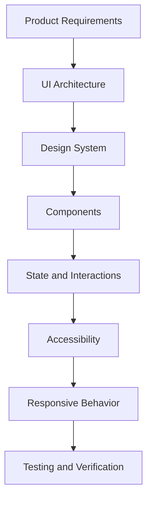

> [!important]
> A production-quality interface must be visually coherent, functionally correct, accessible, and maintainable.

---

# Part III — The frontend-ui-engineering Skill

## 2. Purpose

The `frontend-ui-engineering` skill guides AI coding agents when creating or modifying user-facing interfaces.

It emphasizes:

1. Component architecture.
2. Design-system adherence.
3. Accessibility.
4. Responsive layouts.
5. State management.
6. Interaction design.
7. Performance.
8. Verification.

## 2.1 When to Use

Use the skill when:

- Creating a new page.
- Building reusable components.
- Redesigning an interface.
- Implementing responsive layouts.
- Adding interactions.
- Fixing accessibility issues.
- Improving existing UI quality.
- Connecting UI elements to application state.

## 2.2 When Not to Use

The skill is generally unnecessary for:

- Database-only changes.
- Backend-only validation.
- Server infrastructure configuration.
- Unrelated build tooling.
- Pure documentation changes.

For those tasks, other skills may be more appropriate.

---

# Part IV — UI Design vs UI Engineering

## 3. Understanding the Difference

UI design determines the visual and interaction direction of an interface.

UI engineering implements that direction as working software.

| UI Design | UI Engineering |
|---|---|
| Visual hierarchy | Component structure |
| Colors and typography | Design tokens and CSS |
| Layout composition | Responsive implementation |
| Interaction concepts | Event handling and state |
| Screen mockups | Functional application screens |
| User flows | Routing and navigation |
| Accessibility intentions | Semantic elements and testing |

## 3.1 Example

Design requirement:

> The primary action should be visually prominent.

Engineering implementation:

- Use the approved primary color.
- Apply consistent button dimensions.
- Provide keyboard focus styling.
- Support disabled and loading states.
- Ensure sufficient contrast.
- Use an appropriate semantic button element.

## 3.2 Important

Good engineering does not replace design thinking.

Both should reinforce each other.

---

# Part V — Component-Based Architecture

## 4. What Is a Component?

A component is a reusable unit of interface functionality.

Examples:

- Button.
- Input field.
- Navigation bar.
- Sidebar.
- Product card.
- Task item.
- Modal dialog.
- Data table.

## 4.1 Component Hierarchy

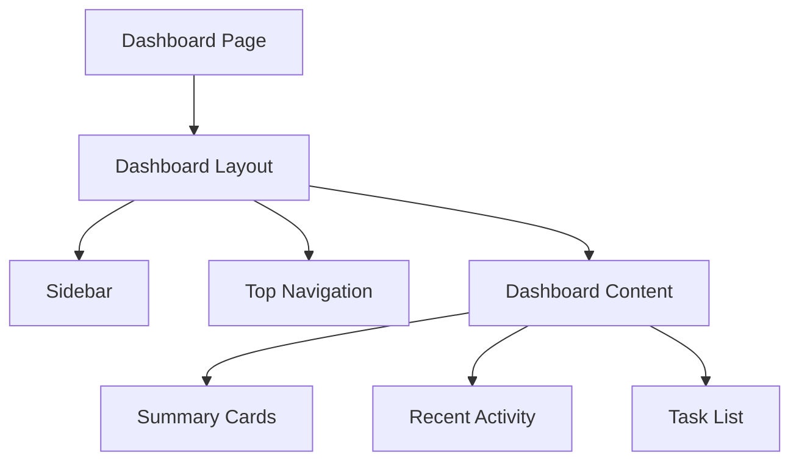

Each component has a specific responsibility.

## 4.2 Benefits

Component-based architecture improves:

- Reusability.
- Maintainability.
- Testing.
- Consistency.
- Separation of concerns.
- Team collaboration.

## 4.3 Important

Not every small element needs its own component.

Extract components when doing so improves clarity, reuse, or testability.

---

# Part VI — Component Responsibility

## 5. Single Responsibility

A component should have one clear purpose.

Consider a task item.

Its responsibilities might include:

- Displaying the task title.
- Showing the current status.
- Displaying the due date.
- Exposing approved actions.

It should not independently manage unrelated application concerns.

## 5.1 Example

```tsx
type TaskItemProps = {
  title: string;
  status: string;
  dueDate: string;
};

export function TaskItem({
  title,
  status,
  dueDate,
}: TaskItemProps) {
  return (
    <article>
      <h3>{title}</h3>
      <p>Status: {status}</p>
      <p>Due: {dueDate}</p>
    </article>
  );
}
```

This component has a narrow responsibility.

## 5.2 Warning Signs

Consider splitting a component when:

- It contains several unrelated responsibilities.
- It is difficult to test.
- It manages unrelated data sources.
- It contains excessive conditional rendering.
- Changes to one feature frequently break another.

The repository treats components exceeding approximately 200 lines as a review signal.

That is a heuristic rather than an absolute restriction.

---

# Part VII — Composition Over Configuration

## 6. What Is Component Composition?

Composition builds complex interfaces by combining smaller components.

Example:

```tsx
<Card>
  <CardHeader>
    <CardTitle>My Tasks</CardTitle>
  </CardHeader>

  <CardBody>
    <TaskList tasks={tasks} />
  </CardBody>
</Card>
```

This approach allows individual parts to be combined flexibly.

## 6.1 Over-Configured Components

An alternative might expose many unrelated configuration properties:

```tsx
<Card
  title="My Tasks"
  titleSize="large"
  showHeader={true}
  headerAlignment="left"
  bodyVariant="compact"
  content={<TaskList tasks={tasks} />}
/>
```

Excessive configuration can make components difficult to understand.

## 6.2 Principle

> Prefer clear component composition over components with large numbers of configuration options.

## 6.3 Important

Configuration properties are not inherently bad.

They become problematic when they make the component difficult to reason about.

---

# Part VIII — Component Organization

## 7. File Structure

The skill recommends keeping related component files together.

Illustrative structure:

```text
src/
└── components/
    └── TaskList/
        ├── TaskList.tsx
        ├── TaskList.test.tsx
        ├── TaskList.stories.tsx
        ├── use-task-list.ts
        └── types.ts
```

Not every component requires every file.

## 7.1 Purpose

| File | Responsibility |
|---|---|
| `TaskList.tsx` | Component implementation |
| `TaskList.test.tsx` | Component tests |
| `TaskList.stories.tsx` | Component examples, if Storybook is used |
| `use-task-list.ts` | Complex reusable state logic, if needed |
| `types.ts` | Component-specific types, if needed |

## 7.2 Avoid Overengineering

For a simple component:

```text
components/
└── Button.tsx
```

may be sufficient.

Do not introduce unnecessary files simply to follow a template.

---

# Part IX — Design Systems

## 8. What Is a Design System?

A design system is a collection of reusable visual and interaction rules that help maintain consistency across an application.

It commonly includes:

- Color tokens.
- Typography.
- Spacing.
- Component styles.
- Border radii.
- Interaction states.
- Accessibility guidelines.
- Layout conventions.

## 8.1 Design System Architecture

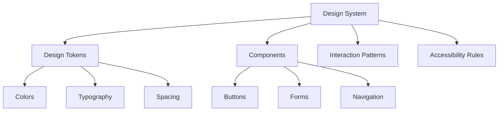

## 8.2 Why Design Systems Matter

Without a design system, developers may repeatedly invent:

- Different shades of the same color.
- Inconsistent spacing.
- Different button sizes.
- Unrelated border radii.
- Inconsistent typography.

A design system reduces unnecessary decisions.

---

# Part X — Design Tokens

## 9. What Are Design Tokens?

Design tokens are named values representing visual decisions.

Instead of repeatedly using raw values, components reference semantic tokens.

Example:

```css
:root {
  --color-primary: #ff7448;
  --color-secondary: #46c7dc;
  --color-background: #f3f6fa;
  --color-text: #0b1629;

  --spacing-1: 0.25rem;
  --spacing-2: 0.5rem;
  --spacing-3: 0.75rem;
  --spacing-4: 1rem;
}
```

These values illustrate HarayaForge's established brand palette.

## 9.1 Semantic Tokens

A more scalable approach separates brand colors from their purposes.

```css
:root {
  --brand-navy: #0b1629;
  --brand-orange: #ff7448;
  --brand-cyan: #46c7dc;
  --brand-white: #f3f6fa;

  --surface-primary: var(--brand-white);
  --text-primary: var(--brand-navy);
  --action-primary: var(--brand-orange);
  --accent-secondary: var(--brand-cyan);
}
```

## 9.2 Benefits

- Consistency.
- Easier maintenance.
- Centralized updates.
- Clearer design intent.
- Better support for themes.

## 9.3 Important

A token name should describe its purpose.

Avoid creating dozens of tokens that serve no practical purpose.

---

# Part XI — Avoiding Generic AI-Generated UI

## 10. The AI Aesthetic Problem

The repository explicitly warns against interfaces that look like generic AI-generated templates.

Common patterns include:

- Excessive purple or indigo.
- Unnecessary gradients.
- Oversized rounded cards.
- Generic hero sections.
- Excessive shadows.
- Uniform card grids.
- Large empty spaces.
- Unrelated decorative elements.

## 10.1 Why These Patterns Can Fail

They often prioritize decoration over:

- Content hierarchy.
- Product identity.
- Usability.
- Information density.
- Existing brand conventions.

## 10.2 Better Approach

Before implementation:

1. Understand the product's purpose.
2. Inspect its current design system.
3. Study relevant reference interfaces.
4. Identify useful layout patterns.
5. Establish a design contract.
6. Implement the design using the product's own visual identity.

## 10.3 Design Contract Example

```markdown
# Dashboard Design Contract

## Screen Purpose
Help users understand project progress.

## Primary Action
Open the selected project.

## Required Information
- Project name
- Progress
- Deadline
- Member count

## Required States
- Loading
- Empty
- Error
- Success

## Responsive Behavior
- Mobile: single-column layout
- Desktop: structured multi-column layout

## Design Constraints
- Follow existing brand colors
- Maintain consistent spacing
- Avoid unnecessary gradients
- Avoid decorative elements without purpose
```

## 10.4 Important

Reference interfaces should guide structural decisions.

Do not copy another product's branding, proprietary content, or exact design.

---

# Part XII — Visual Hierarchy

## 11. What Is Visual Hierarchy?

Visual hierarchy controls the order in which users notice information.

It uses:

- Size.
- Position.
- Contrast.
- Spacing.
- Typography.
- Grouping.
- Alignment.

## 11.1 Example

A task card may contain:

**Primary information**

Task title.

**Secondary information**

Project name.

**Supporting information**

Due date and status.

**Action**

Open task.

The title should generally receive more emphasis than supporting metadata.

## 11.2 Poor Hierarchy

Every element uses the same:

- Font size.
- Weight.
- Color.
- Spacing.

The user struggles to identify what matters.

## 11.3 Better Hierarchy

Use consistent levels:

```text
PAGE TITLE
    ↓
SECTION TITLE
    ↓
PRIMARY CONTENT
    ↓
SECONDARY DETAILS
    ↓
SUPPORTING INFORMATION
```

---

# Part XIII — Typography Engineering

## 12. Typography Hierarchy

The repository recommends semantic heading structure.

| Element | Purpose |
|---|---|
| `h1` | Main page heading |
| `h2` | Major section |
| `h3` | Subsection |
| Paragraph | Body content |
| Small text | Supporting information |

## 12.1 Example

```tsx
<main>
  <h1>Project Dashboard</h1>

  <section aria-labelledby="tasks-heading">
    <h2 id="tasks-heading">My Tasks</h2>

    <article>
      <h3>Implement Members Page</h3>
      <p>Project: GroupTrack</p>
    </article>
  </section>
</main>
```

## 12.2 Important

Semantic headings improve document structure and assistive technology navigation.

Do not choose heading levels solely because of their default visual appearance.

---

# Part XIV — Spacing and Alignment

## 13. Consistent Spacing

A spacing scale prevents arbitrary values.

Example:

```text
4px
8px
12px
16px
24px
32px
48px
```

A project may use a different scale.

The important part is consistency.

## 13.1 Example

```css
.task-card {
  padding: 1rem;
}

.task-card__content {
  display: flex;
  flex-direction: column;
  gap: 0.75rem;
}
```

## 13.2 Alignment Principles

- Align related content to shared edges.
- Group related information.
- Maintain predictable gaps.
- Avoid unnecessary nested containers.
- Keep action placement consistent.

## 13.3 Important

Large spacing does not automatically create good design.

Spacing should communicate relationships between elements.

---

# Part XV — Responsive Design

## 14. What Is Responsive Design?

Responsive design allows interfaces to adapt to different screen sizes and available space.

It may involve:

- Flexible grids.
- Fluid widths.
- Responsive typography.
- Content reflow.
- Navigation changes.
- Touch-friendly controls.

## 14.1 Common Layout Strategy

```text
Mobile
    ↓
Single-column content

Tablet
    ↓
Wider layout with selective columns

Desktop
    ↓
Multi-column layout with persistent navigation
```

## 14.2 Example

```css
.project-grid {
  display: grid;
  grid-template-columns: 1fr;
  gap: 1rem;
}

@media (min-width: 768px) {
  .project-grid {
    grid-template-columns: repeat(2, minmax(0, 1fr));
  }
}

@media (min-width: 1200px) {
  .project-grid {
    grid-template-columns: repeat(3, minmax(0, 1fr));
  }
}
```

## 14.3 Important

Breakpoints should reflect the content's needs.

Do not assume that every project requires the same breakpoints.

---

# Part XVI — Mobile-First Design

## 15. What Is Mobile-First?

Mobile-first design begins with the constraints of smaller screens.

The layout is progressively enhanced as more space becomes available.

## 15.1 Benefits

- Encourages content prioritization.
- Reduces unnecessary visual complexity.
- Supports constrained screen sizes.
- Encourages flexible layouts.

## 15.2 Example

On mobile:

```text
Header
Search
Filters
Task List
Bottom Navigation
```

On desktop:

```text
Sidebar | Header
        | Search + Filters
        | Task List
```

## 15.3 Important

Mobile-first does not mean desktop experiences should be neglected.

Both require intentional design.

---

# Part XVII — Accessibility Fundamentals

## 16. What Is Web Accessibility?

Web accessibility ensures that people with different abilities and assistive technologies can use an interface.

The skill references WCAG 2.1 AA.

Core concerns include:

- Keyboard navigation.
- Semantic HTML.
- Screen reader support.
- Color contrast.
- Focus visibility.
- Accessible forms.
- Meaningful feedback.

## 16.1 Four Accessibility Principles

WCAG organizes accessibility around four principles:

1. Perceivable.
2. Operable.
3. Understandable.
4. Robust.

## 16.2 Important

Accessibility should be considered during component design rather than added only after implementation.

---

# Part XVIII — Keyboard Accessibility

## 17. Semantic Interactive Elements

Use elements that already provide appropriate keyboard behavior.

Good:

```tsx
<button type="button" onClick={openTask}>
  Open Task
</button>
```

Less appropriate:

```tsx
<div onClick={openTask}>
  Open Task
</div>
```

A clickable `div` does not automatically provide the keyboard behavior of a button.

## 17.1 Keyboard Testing

Verify:

- Tab navigation.
- Visible focus.
- Enter and Space activation.
- Logical focus order.
- Dialog focus handling.
- Escape behavior where appropriate.

## 17.2 Important

ARIA attributes do not automatically repair incorrect interaction semantics.

Prefer native HTML elements whenever practical.

---

# Part XIX — Accessible Forms

## 18. Input Labels

Every form input should have an accessible name.

Example:

```tsx
<label htmlFor="product-name">
  Product Name
</label>

<input
  id="product-name"
  name="name"
  type="text"
  required
/>
```

## 18.1 Error Feedback

A useful form should explain:

- Which field is invalid.
- What correction is required.
- Whether the submission succeeded.

Example:

```tsx
<label htmlFor="product-name">
  Product Name
</label>

<input
  id="product-name"
  aria-invalid={Boolean(error)}
  aria-describedby={
    error ? "product-name-error" : undefined
  }
/>

{error && (
  <p id="product-name-error">
    {error}
  </p>
)}
```

## 18.2 Important

Do not communicate errors using color alone.

Include meaningful text.

---

# Part XX — Color Contrast

## 19. Contrast Requirements

For WCAG 2.1 AA, common text contrast requirements include:

- Normal text: at least 4.5:1.
- Large text: at least 3:1.

Other accessibility requirements apply to non-text interface elements.

## 19.1 Example

A bright accent color may look attractive but still provide insufficient contrast when used for small text.

## 19.2 Better Approach

- Test actual foreground and background combinations.
- Use semantic tokens.
- Maintain visible focus indicators.
- Avoid relying on red and green alone.
- Include status labels or icons.

## 19.3 Important

Brand colors do not automatically guarantee accessible combinations.

Each intended usage must be checked.

---

# Part XXI — UI State Management

## 20. What Is UI State?

UI state describes the current condition of an interface.

Examples:

- Selected tab.
- Open modal.
- Search query.
- Current filter.
- Form values.
- Loading status.
- Error message.

## 20.1 State Categories

| Category | Example |
|---|---|
| Local state | Open or closed modal |
| Shared state | Selected project |
| URL state | Search filters and pagination |
| Server state | Product list from API |
| Global state | Application-wide session information |

## 20.2 Choosing a Strategy

The repository recommends starting with the simplest approach that works.

Conceptual progression:

```text
Local State
    ↓
Lifted State
    ↓
Context
    ↓
Dedicated Server-State Management
    ↓
Global State Store
```

This is not a mandatory upgrade sequence.

Choose according to actual requirements.

## 20.3 Avoid Overengineering

Do not introduce Redux or another global state library for a simple modal toggle.

---

# Part XXII — Server State vs Client State

## 21. Understanding the Difference

Client state belongs to the interface.

Server state represents remote application data.

### Client State

Examples:

- Sidebar visibility.
- Selected tab.
- Current draft input.

### Server State

Examples:

- Products.
- Tasks.
- Project members.
- User permissions.
- Fleet assignments.

## 21.1 Why This Matters

Server state may require:

- Fetching.
- Caching.
- Revalidation.
- Error handling.
- Synchronization.
- Loading indicators.

## 21.2 Important

Avoid duplicating server state unnecessarily in multiple client stores.

---

# Part XXIII — UI States and Feedback

## 22. The Five Important States

A user-facing data component should consider:

1. Loading.
2. Empty.
3. Error.
4. Success.
5. Permission or unavailable state.

Not every component requires every state.

## 22.1 State Diagram

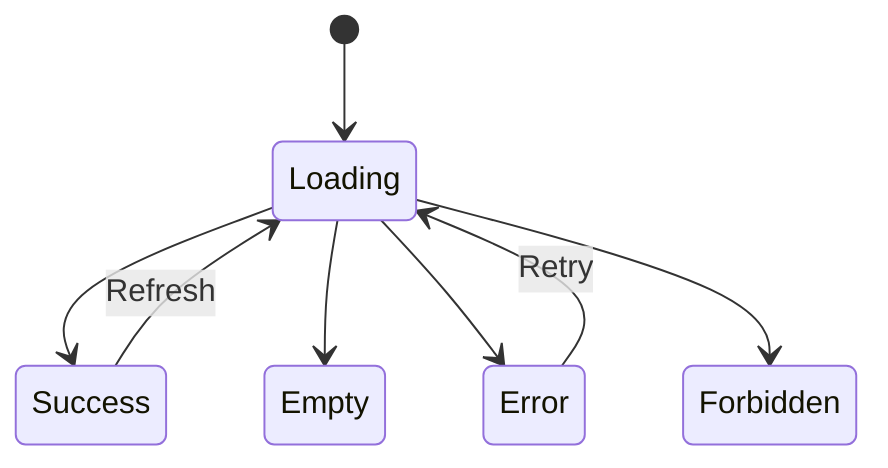

## 22.2 Loading

Communicate that an operation is in progress.

## 22.3 Empty

Explain why no content is visible.

## 22.4 Error

Explain the problem and provide recovery when possible.

## 22.5 Success

Confirm completed operations.

## 22.6 Permission

Explain that the action or resource is unavailable to the current user.

---

# Part XXIV — Frontend Performance

## 23. Why Performance Matters

A visually polished interface may still provide a poor experience when it:

- Loads slowly.
- Renders unnecessary content.
- Performs excessive network requests.
- Causes layout shifts.
- Blocks interactions.
- Loads oversized assets.

## 23.1 Common Strategies

- Use appropriately sized images.
- Avoid unnecessary client-side JavaScript.
- Reduce duplicate requests.
- Use pagination for large datasets.
- Optimize rendering where measurement identifies a problem.
- Keep component dependencies reasonable.

## 23.2 Important

Do not optimize blindly.

Measure the actual problem before introducing complex optimization techniques.

---

# Part XXV — API and Interface Design Fundamentals

## 24. What Is an API?

An Application Programming Interface defines how software components communicate.

An API may connect:

- Frontend and backend.
- Application and database services.
- Internal modules.
- External integrations.
- Mobile applications and cloud services.

## 24.1 Example Architecture

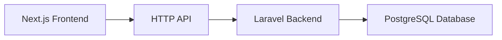

The frontend sends requests.

The backend validates requests, applies business rules, and returns responses.

## 24.2 Important

An API is not limited to HTTP endpoints.

Module interfaces, component props, and library contracts are also interfaces.

---

# Part XXVI — The api-and-interface-design Skill

## 25. Purpose

The `api-and-interface-design` skill guides developers in creating stable and predictable interfaces.

Its major principles include:

1. Contract-first design.
2. Consistent error semantics.
3. Validation at boundaries.
4. Backward-compatible evolution.
5. Predictable naming.
6. Idempotency where needed.
7. Explicit interface responsibilities.

## 25.1 When to Use

Use this skill when:

- Designing REST endpoints.
- Designing GraphQL interfaces.
- Defining frontend–backend contracts.
- Creating reusable module interfaces.
- Changing public API behavior.
- Designing component prop contracts.
- Establishing communication boundaries.

---

# Part XXVII — Contract-First Development

## 26. What Is an API Contract?

An API contract defines how a consumer communicates with a service.

It specifies:

- Endpoint.
- HTTP method.
- Request format.
- Response format.
- Status codes.
- Error structure.
- Authentication requirements.
- Authorization expectations.

## 26.1 Example Contract

```text
Endpoint:
POST /api/products

Request:
{
  "name": "Mechanical Keyboard",
  "price": 2500
}

Successful Response:
HTTP 201

{
  "id": 101,
  "name": "Mechanical Keyboard",
  "price": 2500
}
```

This is an illustrative contract, not an existing endpoint confirmed in the user's project.

## 26.2 Why Contract First?

Without a shared contract, frontend and backend developers may make incompatible assumptions.

## 26.3 Contract-First Workflow

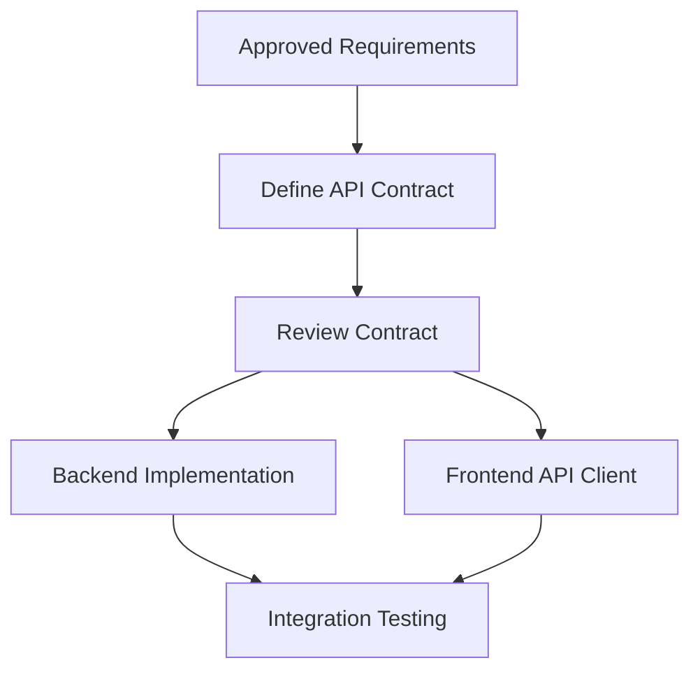

---

# Part XXVIII — REST API Design

## 27. REST Resources

REST-style APIs commonly organize endpoints around resources.

Examples:

```text
GET    /api/products
POST   /api/products
GET    /api/products/{id}
PATCH  /api/products/{id}
DELETE /api/products/{id}
```

## 27.1 HTTP Methods

| Method | Common Purpose |
|---|---|
| GET | Retrieve data |
| POST | Create or submit data |
| PUT | Replace a resource |
| PATCH | Partially update a resource |
| DELETE | Delete a resource |

## 27.2 Resource Naming

Prefer meaningful resource names.

Example:

```text
/api/products
/api/orders
/api/customers
```

Avoid unnecessary action-oriented endpoint names when ordinary resource semantics are sufficient.

## 27.3 Important

These are common conventions, not rigid rules for every API.

Existing project contracts and domain requirements still matter.

---

# Part XXIX — Request and Response Design

## 28. Request Structure

A request may include:

- HTTP method.
- URL.
- Headers.
- Query parameters.
- Request body.

## 28.1 Example

```http
POST /api/products
Content-Type: application/json
```

Body:

```json
{
  "name": "Wireless Mouse",
  "price": 850
}
```

## 28.2 Response Structure

```json
{
  "id": 102,
  "name": "Wireless Mouse",
  "price": 850,
  "isActive": true
}
```

## 28.3 Important

The contract should define field types, required fields, optional fields, and relevant constraints.

Do not assume that a JSON example alone is a complete specification.

---

# Part XXX — Consistent API Error Semantics

## 29. Why Errors Need Contracts

Frontend applications must understand when requests fail.

An inconsistent API might return:

```json
{
  "message": "Invalid"
}
```

from one endpoint and:

```json
{
  "errorText": "Invalid"
}
```

from another.

This forces consumers to implement different error-handling logic.

## 29.1 Consistent Example

```json
{
  "error": {
    "code": "VALIDATION_ERROR",
    "message": "Invalid product data",
    "details": {
      "name": [
        "Product name is required."
      ]
    }
  }
}
```

## 29.2 HTTP Status Codes

| Code | Meaning |
|---|---|
| 200 | Successful request |
| 201 | Resource created |
| 204 | Successful request without response body |
| 400 | Bad request |
| 401 | Authentication required or invalid |
| 403 | Authenticated but not authorized |
| 404 | Resource not found |
| 409 | Conflict |
| 422 | Validation failure |
| 500 | Internal server error |

## 29.3 Important

An API should avoid exposing internal stack traces or sensitive implementation details in production error responses.

---

# Part XXXI — Validation at Boundaries

## 30. What Is Boundary Validation?

Boundary validation checks information entering a system from an external source.

Examples:

- User-submitted forms.
- HTTP requests.
- External API responses.
- Environment configuration.

## 30.1 Frontend Validation

Frontend validation improves usability.

Example:

```typescript
if (!name.trim()) {
  setError("Product name is required.");
}
```

## 30.2 Backend Validation

Backend validation protects the application from invalid input.

Illustrative Laravel example:

```php
$validated = $request->validate([
    'name' => ['required', 'string', 'max:255'],
    'price' => ['required', 'numeric', 'min:0'],
]);
```

## 30.3 Important

Frontend validation is not a security boundary.

The backend must independently validate requests and enforce authorization.

---

# Part XXXII — Authentication vs Authorization

## 31. Authentication

Authentication establishes who is making a request.

Examples:

- Session login.
- Authentication tokens.
- Supported identity-provider flows.

## 31.1 Authorization

Authorization determines what an authenticated user is allowed to do.

Example:

```text
Authenticated User
    ↓
Role or Permission Check
    ↓
Allowed or Denied
```

## 31.2 Example

An e-commerce application may have:

- Admin.
- Staff.
- Customer.

A customer may be authenticated but still lack permission to create products.

## 31.3 Important

Hiding an admin button in the frontend is not authorization.

The backend must enforce permissions.

---

# Part XXXIII — Hyrum's Law

## 32. What Is Hyrum's Law?

Hyrum's Law observes that when enough consumers depend on a system, they may rely on observable behavior beyond its formally documented contract.

## 32.1 Example

An API returns products in a particular order.

The contract does not guarantee that ordering.

However, frontend code may begin relying on it.

Changing the order can break the frontend.

## 32.2 Implications

API designers should:

- Document important guarantees.
- Avoid exposing unnecessary implementation details.
- Preserve established behavior when practical.
- Test consumer expectations.
- Plan migrations carefully.

## 32.3 Important

Even changes that appear technically safe can affect existing consumers.

---

# Part XXXIV — Backward Compatibility

## 33. What Is Backward Compatibility?

A backward-compatible change allows existing consumers to continue functioning.

## 33.1 Additive Changes

Suppose an API originally returns:

```json
{
  "id": 1,
  "name": "Keyboard"
}
```

Later it returns:

```json
{
  "id": 1,
  "name": "Keyboard",
  "isActive": true
}
```

Adding an optional response field is often easier for consumers to tolerate.

However, strict consumers may still reject unexpected fields.

## 33.2 Breaking Changes

Examples:

- Removing a required field.
- Renaming a field.
- Changing its type.
- Changing error semantics.
- Changing authorization requirements.
- Changing response structure.

## 33.3 Important

Compatibility must be evaluated against actual consumers, not assumed from a general rule.

---

# Part XXXV — API Versioning

## 34. Why Version APIs?

Versioning helps manage incompatible changes between service providers and consumers.

Possible approaches include:

- URL versioning.
- Header-based versioning.
- Media-type versioning.
- Controlled contract evolution without frequent version changes.

## 34.1 Example

```text
/api/v1/products
/api/v2/products
```

This is one possible strategy.

It is not mandatory for every application.

## 34.2 The One-Version Rule

The repository also discusses avoiding situations where consumers are forced to manage conflicting versions of the same dependency or interface.

The broader objective is to minimize unnecessary fragmentation.

## 34.3 Important

Do not introduce versioned endpoints without a clear compatibility requirement.

For a small project, maintaining a stable existing contract may be sufficient.

---

# Part XXXVI — Idempotency

## 35. What Is Idempotency?

An operation is idempotent when repeating it has the same intended effect as performing it once.

For example, setting a resource's status to a specific value can be designed to be idempotent.

## 35.1 Why It Matters

Network requests may be retried because of:

- Timeouts.
- Connection interruptions.
- Client retries.
- Temporary server failures.

A retry must not accidentally create duplicate side effects.

## 35.2 Example

Consider a request to create an order.

The server may process the request, but the client may lose the response.

If the client retries, duplicate orders could be created.

An idempotency mechanism can help prevent this.

## 35.3 Idempotency Keys

Some APIs accept an `Idempotency-Key` identifying one logical operation.

A correct implementation needs to handle:

- Repeated requests.
- Concurrent requests.
- Different payloads using the same key.
- Unknown outcomes after timeouts.
- Appropriate retention periods.

## 35.4 Important

Simply accepting an idempotency header does not guarantee idempotent behavior.

The backend must enforce the contract reliably.

---

# Part XXXVII — Pagination, Filtering, and Sorting

## 36. Pagination

Pagination divides large result sets into manageable portions.

Example:

```text
GET /api/products?page=2&pageSize=20
```

## 36.1 Filtering

```text
GET /api/products?status=active
```

## 36.2 Sorting

```text
GET /api/products?sortBy=createdAt
```

## 36.3 Why These Matter

They can improve:

- Response efficiency.
- Frontend usability.
- Network performance.
- Large dataset handling.

## 36.4 Important

Define pagination and sorting semantics in the API contract.

Do not assume clients can safely infer ordering or page boundaries.

---

# Part XXXVIII — Frontend–Backend Integration

## 37. Integration Architecture

Consider a Next.js frontend and Laravel backend.

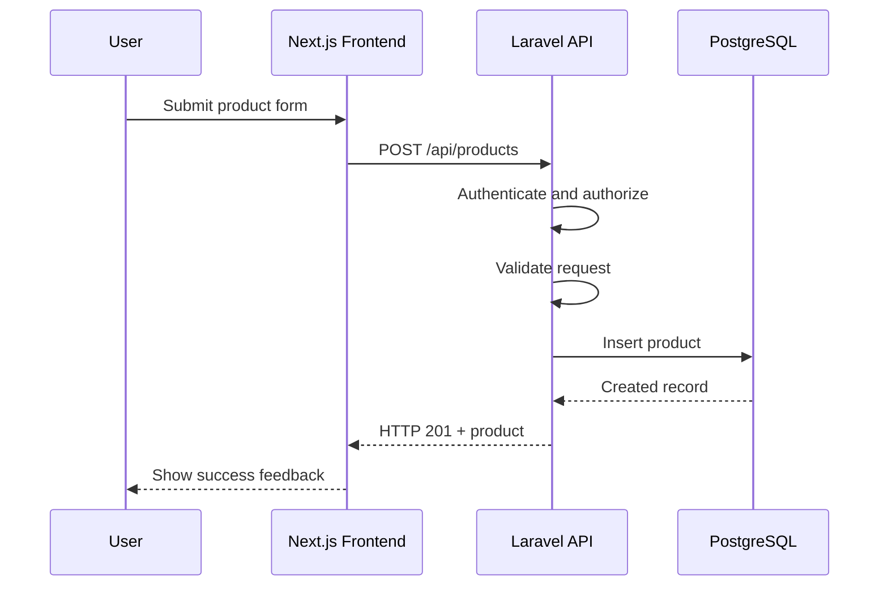

## 37.1 Responsibility Separation

### Frontend

Responsible for:

- Rendering interfaces.
- Capturing user input.
- Displaying validation feedback.
- Managing UI state.
- Calling backend APIs.

### Backend

Responsible for:

- Authentication and authorization enforcement.
- Request validation.
- Business logic.
- Persistence.
- API responses.
- Data integrity.

## 37.2 Important

The frontend should not be trusted to enforce backend business rules.

---

# Part XXXIX — API Client Architecture

## 38. Why Use an API Client?

An API client centralizes communication with backend endpoints.

Instead of scattering raw requests across many components, the application can use dedicated functions.

## 38.1 Illustrative Structure

```text
frontend/
├── app/
│   └── admin/
│       └── products/
│           └── page.tsx
├── components/
│   └── products/
│       └── ProductForm.tsx
├── lib/
│   └── api/
│       ├── client.ts
│       └── products.ts
└── types/
    └── product.ts
```

This is an example structure.

The actual project should follow its existing conventions.

## 38.2 Example API Function

```typescript
type CreateProductInput = {
  name: string;
  price: number;
};

async function createProduct(
  input: CreateProductInput
) {
  const response = await fetch(
    `${process.env.NEXT_PUBLIC_API_URL}/products`,
    {
      method: "POST",
      headers: {
        "Content-Type": "application/json",
      },
      body: JSON.stringify(input),
    }
  );

  if (!response.ok) {
    throw new Error("Product creation failed");
  }

  return response.json();
}
```

This example demonstrates separation of concerns.

It is not a complete production API client.

Real implementation must account for the project's authentication method, response contracts, error handling, and runtime environment.

---

# Part XL — Handling Integration Failures

## 39. Common Failure Categories

| Failure | Possible Cause |
|---|---|
| 400 | Malformed request |
| 401 | Missing or invalid authentication |
| 403 | Insufficient permission |
| 404 | Incorrect endpoint or missing resource |
| 409 | Conflicting operation |
| 422 | Invalid submitted data |
| 500 | Server-side failure |
| Network error | Connectivity or configuration problem |

## 39.1 Debugging Workflow

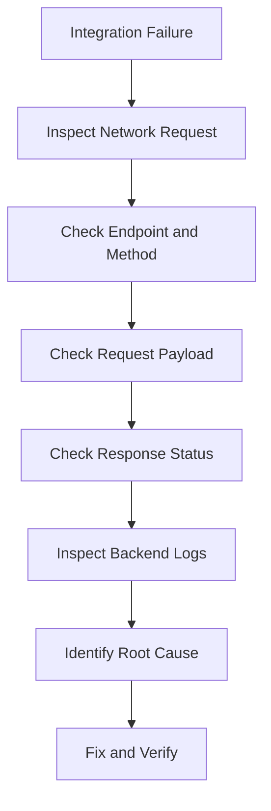

## 39.2 Important

Do not immediately rewrite the frontend when an API request fails.

Determine which boundary is responsible.

---

# Part XLI — API Security Boundaries

## 40. Security Principles

Important API design considerations include:

- Authentication.
- Authorization.
- Input validation.
- Output handling.
- Least privilege.
- Safe error messages.
- Appropriate rate limiting.
- Secure credential handling.
- Transport security.

## 40.1 External Data

Treat responses from external services as untrusted input.

Validate relevant structures before relying on them.

## 40.2 Sensitive Information

Do not expose:

- Private API keys.
- Database credentials.
- Internal stack traces.
- Secret tokens.
- Sensitive server configuration.

## 40.3 Important

Client-exposed environment variables must not contain secrets.

A frontend-accessible API base URL is different from a private backend credential.

---

# Part XLII — Testing Frontend Interfaces

## 41. UI Verification Strategy

A complete UI review should consider:

1. Rendering.
2. Interactions.
3. Accessibility.
4. Responsiveness.
5. Data states.
6. Error handling.
7. Performance.
8. Visual consistency.

## 41.1 Suggested Screen Widths

The skill lists example verification widths:

- 320px.
- 768px.
- 1024px.
- 1440px.

These are useful checkpoints, not the only widths that matter.

## 41.2 Browser Testing

Useful checks include:

- Console errors.
- Network failures.
- Keyboard navigation.
- Layout overflow.
- Accessibility warnings.
- Responsive behavior.

## 41.3 Important

A successful build does not prove that an interface is visually or functionally correct.

---

# Part XLIII — Testing API Contracts

## 42. Contract Verification

API tests should confirm that requests and responses follow the agreed contract.

Example scenarios:

```text
createsProductWithValidInput
rejectsMissingProductName
rejectsUnauthorizedProductCreation
returnsConsistentValidationErrors
returnsNotFoundForUnknownProduct
```

## 42.1 Integration Testing

Verify:

- Correct HTTP method.
- Correct endpoint.
- Expected request fields.
- Expected response fields.
- Correct status codes.
- Validation behavior.
- Authorization enforcement.

## 42.2 Regression Testing

Existing consumers should continue working after contract changes.

---

# Part XLIV — Combining Both Skills

## 43. Unified Engineering Workflow

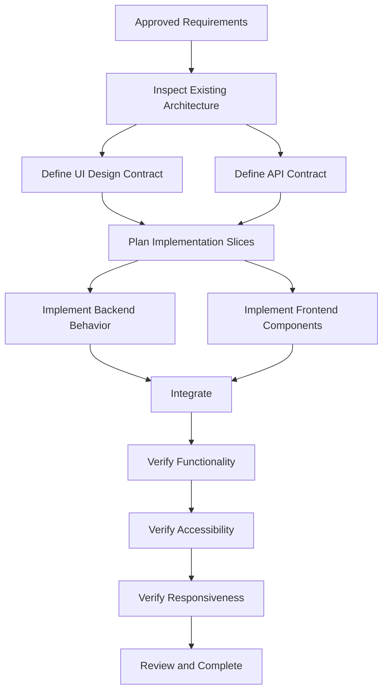

## 43.1 Why Use Both Skills?

The frontend skill ensures that the interface is usable and coherent.

The API skill ensures that communication between components is predictable.

Together, they help prevent:

- Beautiful but nonfunctional screens.
- Inconsistent request structures.
- Broken frontend–backend integration.
- Poor error handling.
- Unnecessary architectural complexity.

---

# Part XLV — HarayaForge Case Study

## 44. Feature: Contact Form

### Product Context

HarayaForge is a software development startup with a defined visual identity.

Brand palette:

| Token | Color |
|---|---|
| Forge Navy | `#0B1629` |
| Ember Orange | `#FF7448` |
| Digital Cyan | `#46C7DC` |
| Cloud White | `#F3F6FA` |

### UI Requirements

A contact form may include:

- Name.
- Email.
- Project inquiry.
- Message.
- Submit action.

### Design Constraints

- Use the established brand palette.
- Avoid unnecessary gradients.
- Maintain clear spacing.
- Provide accessible labels.
- Use responsive layout.
- Provide meaningful feedback.

## 44.1 UI Architecture

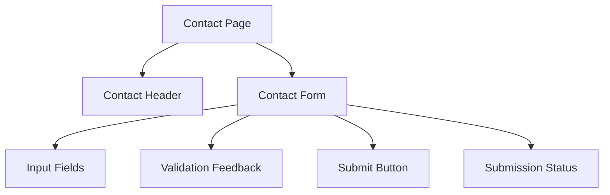

## 44.2 API Considerations

If a backend submission endpoint is approved, define:

- Request fields.
- Validation rules.
- Successful response.
- Error response.
- Abuse-prevention requirements.

## 44.3 Important

Do not invent a CRM, notification pipeline, or complex lead-scoring system unless the product requirements justify it.

---

# Part XLVI — GroupTrack Android Case Study

## 45. Feature: My Tasks

### Approved Goal

Display tasks assigned to the current user across their projects.

### UI Considerations

Each task card may display:

- Task title.
- Project name.
- Due date.
- Status.

### Architecture

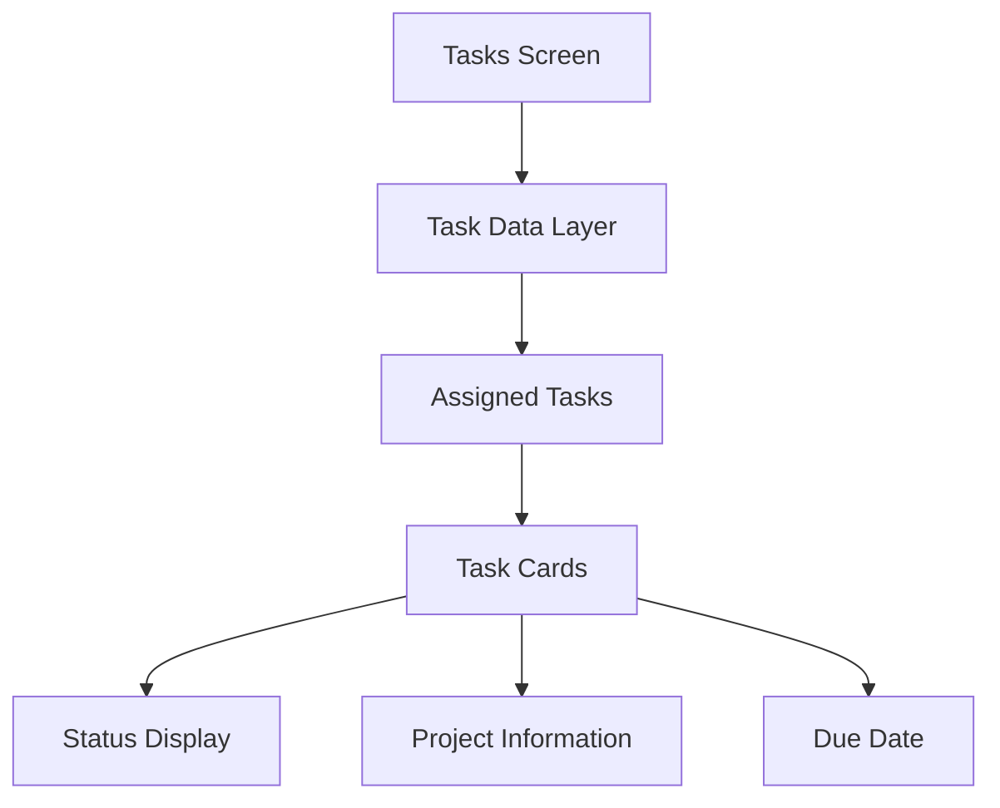

## 45.1 Required States

- Loading.
- No assigned tasks.
- Data available.
- Error.
- Retry.

## 45.2 Interface Considerations

Although this is an Android application rather than a web frontend, similar principles apply:

- Clear component responsibilities.
- Predictable data contracts.
- Accessible interactions.
- Consistent visual hierarchy.
- Appropriate loading and error states.

## 45.3 Important

The implementation should respect the existing Java, Android, and Firebase architecture.

Do not introduce a separate HTTP API if the existing approved architecture does not require one.

---

# Part XLVII — GoPasig Case Study

## 46. Feature: Bus Tracking Dashboard

### Goal

Display current bus positions and relevant route information.

### UI Considerations

Potential information includes:

- Route name.
- Bus identifier.
- Current location.
- Estimated arrival information.
- Last location update.

### Architecture

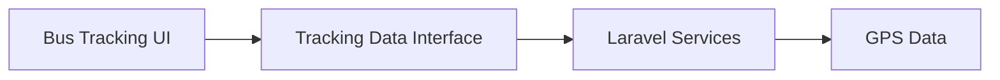

## 46.1 API Contract Considerations

A tracking response may need clearly defined:

- Bus identifier.
- Latitude.
- Longitude.
- Timestamp.
- Route association.
- Location availability.

## 46.2 Example

```json
{
  "busId": 12,
  "latitude": 14.576,
  "longitude": 121.085,
  "updatedAt": "2026-10-26T10:30:00Z"
}
```

This is an illustrative response shape and coordinate pair, not actual live bus data.

## 46.3 Important

Location timestamps matter because a stored coordinate is not necessarily a current coordinate.

The UI should distinguish fresh data from stale or unavailable data according to approved requirements.

---

# Part XLVIII — Next.js + Laravel E-commerce Case Study

## 47. Feature: Product Management

### Architecture

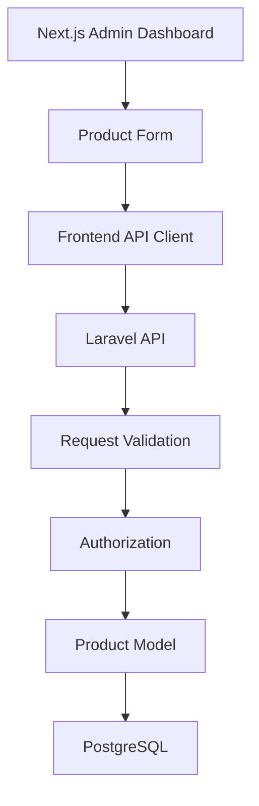

## 47.1 Frontend Responsibilities

- Display product information.
- Capture form input.
- Show validation feedback.
- Handle loading and success states.
- Present available actions.

## 47.2 Backend Responsibilities

- Validate submitted data.
- Enforce role permissions.
- Apply product business rules.
- Persist records.
- Return documented responses.

## 47.3 Example Contract

```text
POST /api/products

Authentication:
Required

Authorization:
Admin or approved staff role

Request:
name
price

Success:
201 Created

Validation Error:
422 Unprocessable Content

Forbidden:
403 Forbidden
```

The role permissions and endpoint are illustrative until confirmed in the project's approved specification.

## 47.4 Verification

- Authorized creation succeeds.
- Invalid input is rejected.
- Unauthorized creation is denied.
- The frontend displays backend errors.
- Product data persists correctly.
- Existing product functionality remains intact.

---

# Part XLIX — Example Codex Prompt

## 48. Using Both Skills

The following is a conceptual prompt. Use the skill invocation syntax supported by your installed Codex configuration.

```text
Use the following installed skills:

- frontend-ui-engineering
- api-and-interface-design
- incremental-implementation
- test-driven-development

PROJECT:
Next.js frontend with Laravel backend.

TASK:
Implement the approved product creation feature.

BEFORE IMPLEMENTATION:

1. Read AGENTS.md.
2. Read the approved specification.
3. Inspect existing frontend and backend architecture.
4. Identify the current API conventions.
5. Inspect the existing design system.
6. Confirm the required data contract.
7. Identify relevant tests.

FRONTEND REQUIREMENTS:

- Follow the existing design system.
- Use focused, reusable components.
- Implement responsive layouts.
- Support keyboard accessibility.
- Provide loading, error, and success states.
- Avoid generic AI-generated design patterns.

API REQUIREMENTS:

- Define the request and response contract.
- Use consistent error semantics.
- Validate input at the backend boundary.
- Enforce authorization.
- Preserve existing API compatibility.

IMPLEMENTATION:

- Work incrementally.
- Follow approved task boundaries.
- Avoid unnecessary dependencies.
- Do not modify unrelated modules.

VERIFICATION:

- Run relevant frontend checks.
- Run backend tests.
- Verify API integration.
- Check accessibility.
- Check responsive behavior.
- Review the final diff.

Do not push or deploy changes.

Report actual verification results.
```

---

# Part L — Engineering Verification Checklist

## 49. Frontend Checklist

- [ ] Approved UI requirements are understood.
- [ ] Existing design system was inspected.
- [ ] Components have clear responsibilities.
- [ ] Unnecessary abstractions were avoided.
- [ ] Spacing and typography are consistent.
- [ ] Visual hierarchy is clear.
- [ ] Responsive layouts were verified.
- [ ] Keyboard interactions work.
- [ ] Form labels are accessible.
- [ ] Color contrast is sufficient.
- [ ] Loading states are handled.
- [ ] Empty states are handled.
- [ ] Error states are handled.
- [ ] Success feedback is meaningful.
- [ ] Relevant tests pass.
- [ ] No unrelated UI changes were introduced.

## 49.1 API Checklist

- [ ] API contract is documented.
- [ ] Endpoints follow established conventions.
- [ ] Request fields are defined.
- [ ] Response fields are defined.
- [ ] Error responses are consistent.
- [ ] Validation occurs at appropriate boundaries.
- [ ] Authentication is enforced.
- [ ] Authorization is enforced.
- [ ] Sensitive information is protected.
- [ ] Compatibility was evaluated.
- [ ] Idempotency was considered where relevant.
- [ ] Integration tests pass.
- [ ] Existing consumers remain functional.

---

# Part LI — Common Anti-Patterns

## 50. Frontend Anti-Patterns

### 50.1 Generic AI Aesthetic

Using arbitrary gradients, excessive cards, and unrelated decorative elements.

### 50.2 Giant Components

Putting navigation, forms, data fetching, and unrelated state inside one component.

### 50.3 Excessive State Management

Introducing a global store for simple local state.

### 50.4 Missing Accessibility

Using clickable nonsemantic elements without keyboard support.

### 50.5 Missing UI States

Displaying a blank screen when loading or errors occur.

### 50.6 Premature Optimization

Adding complicated memoization or caching without evidence of a performance problem.

---

## 51. API Anti-Patterns

### 51.1 Undefined Contracts

Frontend and backend independently invent request structures.

### 51.2 Inconsistent Errors

Every endpoint returns a different error shape.

### 51.3 Frontend-Only Authorization

Permissions are enforced only by hiding buttons.

### 51.4 Unvalidated Inputs

External data enters business logic without appropriate checks.

### 51.5 Breaking Changes Without Planning

Existing response fields are removed without evaluating consumers.

### 51.6 Fake Idempotency

The API accepts an idempotency key but does not actually prevent duplicate effects.

### 51.7 Unnecessary API Layers

The application introduces services or endpoints that provide no clear benefit.

---

# Part LII — Practical Exercises

> [!note]
> Theory-first exercises. No application implementation required.

## Exercise 1 — Frontend Engineering

Explain the difference between UI design and UI engineering.

## Exercise 2 — Component Architecture

Create a component hierarchy for an admin dashboard.

## Exercise 3 — Component Responsibility

Identify three responsibilities that should not belong inside a simple task card.

## Exercise 4 — Composition

Compare component composition with over-configured components.

## Exercise 5 — Design Systems

Explain why design tokens improve consistency.

## Exercise 6 — Visual Hierarchy

Design an information hierarchy for a project card.

## Exercise 7 — AI Aesthetic

Identify five generic AI-generated UI patterns and explain why they may be inappropriate.

## Exercise 8 — Responsive Design

Describe how a dashboard should adapt between mobile and desktop.

## Exercise 9 — Accessibility

List five keyboard accessibility requirements.

## Exercise 10 — Forms

Design accessible validation feedback for a registration form.

## Exercise 11 — Color Contrast

Explain why brand colors must still be checked for accessibility.

## Exercise 12 — State Management

Choose appropriate state-management approaches for:

- A modal.
- A search filter.
- A remote product list.
- A shared theme.

## Exercise 13 — UI States

Design loading, empty, error, and success states for a task list.

## Exercise 14 — Frontend Performance

Identify five potential causes of slow dashboard rendering.

## Exercise 15 — API Fundamentals

Define an API contract.

## Exercise 16 — REST

Design CRUD endpoints for a task resource.

## Exercise 17 — Request and Response

Write an example request and response for creating a project.

## Exercise 18 — Error Semantics

Define a consistent error response structure.

## Exercise 19 — Validation

Explain why backend validation is necessary even when frontend validation exists.

## Exercise 20 — Authorization

Explain the difference between authentication and authorization.

## Exercise 21 — Hyrum's Law

Describe how undocumented response ordering can become a compatibility problem.

## Exercise 22 — API Compatibility

Identify three potentially breaking API changes.

## Exercise 23 — Versioning

Explain when explicit API versioning may be justified.

## Exercise 24 — Idempotency

Explain why network retries can create duplicate operations.

## Exercise 25 — Pagination

Design a paginated product-list contract.

## Exercise 26 — Integration

Create a sequence diagram for frontend–backend product creation.

## Exercise 27 — HarayaForge

Design a contact form using its established design system.

## Exercise 28 — GroupTrack

Design the component and data boundaries for the My Tasks page.

## Exercise 29 — GoPasig

Design a tracking data contract that accounts for stale location updates.

## Exercise 30 — E-commerce

Create a complete API contract for product creation.

## Exercise 31 — Final Exercise

Design a complete frontend and API engineering strategy for one approved feature.

Include:

1. Feature overview.
2. User requirements.
3. UI design contract.
4. Component architecture.
5. Design tokens.
6. Visual hierarchy.
7. Responsive strategy.
8. Accessibility requirements.
9. UI state model.
10. State management.
11. API endpoints.
12. Request schema.
13. Response schema.
14. Error semantics.
15. Authentication.
16. Authorization.
17. Validation boundaries.
18. Compatibility strategy.
19. Performance considerations.
20. Test strategy.
21. Verification checklist.
22. Definition of Done.

---

# Part LIII — Knowledge Check

1. What is frontend UI engineering?
2. What is the purpose of `frontend-ui-engineering`?
3. How does UI engineering differ from UI design?
4. What makes an interface production-quality?
5. What is a component?
6. What is component composition?
7. Why should components have focused responsibilities?
8. What is a design system?
9. What are design tokens?
10. Why should generic AI-generated UI patterns be avoided?
11. What is visual hierarchy?
12. Why is consistent spacing important?
13. What is responsive design?
14. What is mobile-first design?
15. What are the four WCAG principles?
16. Why are semantic HTML elements important?
17. What makes a form accessible?
18. What is client state?
19. What is server state?
20. What UI states should data-driven interfaces consider?
21. What is an API?
22. What is the purpose of `api-and-interface-design`?
23. What is contract-first development?
24. What are common REST HTTP methods?
25. Why should error responses be consistent?
26. What is boundary validation?
27. What is authentication?
28. What is authorization?
29. What is Hyrum's Law?
30. What is backward compatibility?
31. When might API versioning be necessary?
32. What is idempotency?
33. Why does pagination matter?
34. What is an API client?
35. How do frontend UI engineering and API design complement each other?

---

# Part LIV — Key Takeaways

> [!summary]
> - Frontend engineering combines design, accessibility, state management, and software architecture.
> - Production-quality interfaces prioritize usability and maintainability.
> - Components should have focused responsibilities.
> - Composition can reduce excessive component configuration.
> - Design systems provide consistent visual rules.
> - Semantic tokens improve maintainability.
> - Visual hierarchy helps users understand information.
> - Responsive design must be intentional.
> - Accessibility is a core engineering requirement.
> - Semantic HTML supports keyboard and assistive technology behavior.
> - Loading, empty, error, and success states improve usability.
> - State management should remain as simple as practical.
> - Frontend performance should be measured.
> - API contracts define communication boundaries.
> - Contract-first development reduces integration assumptions.
> - Consistent error semantics simplify frontend handling.
> - Validation belongs at external boundaries.
> - Authentication and authorization solve different problems.
> - Backend authorization cannot be replaced by hidden UI controls.
> - API compatibility matters because consumers may depend on observable behavior.
> - Idempotency protects against duplicate effects during retries.
> - Frontend and backend responsibilities should remain clearly separated.
> - Testing must cover both interfaces and integration behavior.
> - Good engineering avoids unnecessary complexity.

---

# Part LV — Final Mental Model

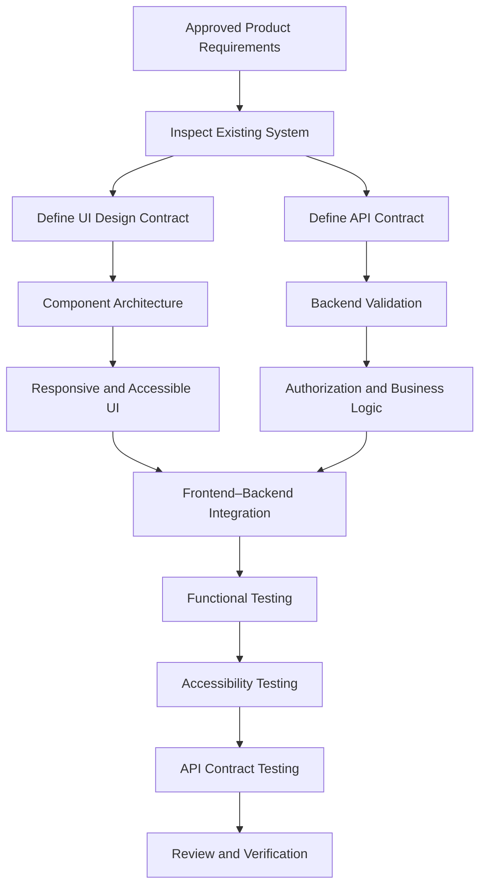

> [!important] Final Principle
> **A reliable interface is not merely a beautiful screen, and a reliable API is not merely a working endpoint. Both must be intentionally designed, consistently implemented, and verified against clear contracts.**

---

# Part LVI — Official References

## Primary Repository

- [Agent Skills Repository](https://github.com/addyosmani/agent-skills)
- [Frontend UI Engineering Skill](https://github.com/addyosmani/agent-skills/blob/main/skills/frontend-ui-engineering/SKILL.md)
- [API and Interface Design Skill](https://github.com/addyosmani/agent-skills/blob/main/skills/api-and-interface-design/SKILL.md)
- [Incremental Implementation Skill](https://github.com/addyosmani/agent-skills/blob/main/skills/incremental-implementation/SKILL.md)
- [Test-Driven Development Skill](https://github.com/addyosmani/agent-skills/blob/main/skills/test-driven-development/SKILL.md)

## Supporting Documentation

- [OpenAI Codex Documentation](https://developers.openai.com/codex/)
- [Next.js Documentation](https://nextjs.org/docs)
- [React Documentation](https://react.dev/)
- [Laravel 12 Documentation](https://laravel.com/docs/12.x/)
- [MDN Web Docs](https://developer.mozilla.org/)
- [W3C Web Accessibility Initiative](https://www.w3.org/WAI/)
- [WCAG 2.1](https://www.w3.org/TR/WCAG21/)
- [OpenAPI Specification](https://spec.openapis.org/oas/latest.html)
- [Android Developers](https://developer.android.com/)

> [!note] Documentation Scope
> This lesson is based on the public `frontend-ui-engineering` and `api-and-interface-design` skills.
>
> The architecture diagrams, code examples, API contracts, and project case studies are educational illustrations.
>
> No local project files were inspected or modified.
>
> No application code was implemented.
>
> No tests were executed.

---

# Part LVII — Next Lesson

**[[10 - Debugging, Testing, and Error Recovery]]**

Topics:

1. Debugging fundamentals.
2. The `debugging-and-error-recovery` skill.
3. The `browser-testing-with-devtools` skill.
4. Error classification.
5. Reproducing defects.
6. Root cause analysis.
7. The Reproduce–Localize–Reduce–Fix–Guard workflow.
8. Debugging frontend applications.
9. Debugging API integration.
10. Browser console inspection.
11. Network request analysis.
12. Test failure investigation.
13. Regression prevention.
14. Safe recovery strategies.
15. Avoiding speculative fixes.
16. Android, Laravel, and Next.js examples.
17. Practical exercises.
18. Official references.

**End of Lesson 09 — Frontend UI and API Engineering.**
