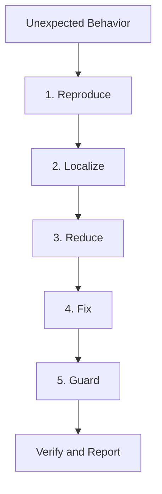
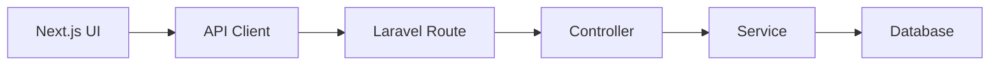
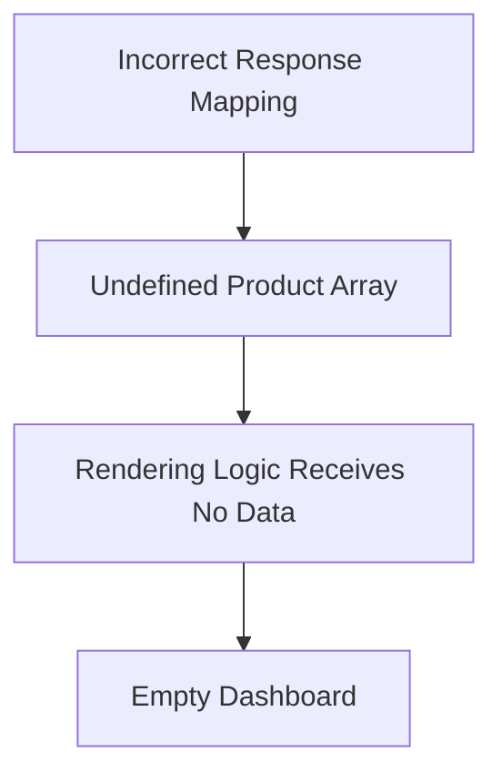
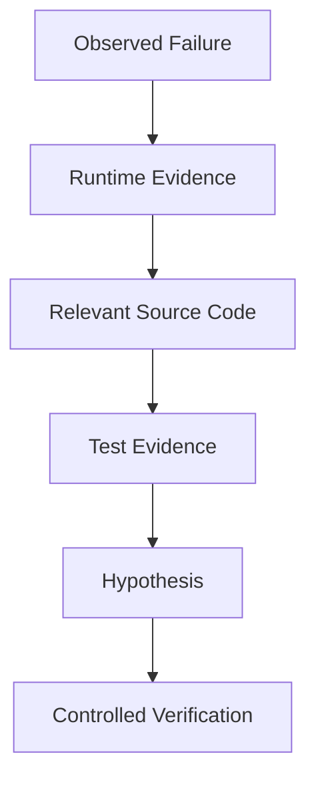
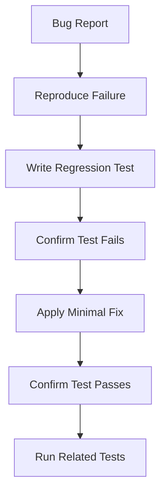
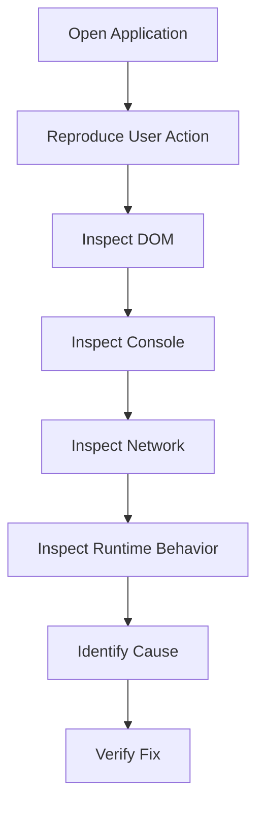
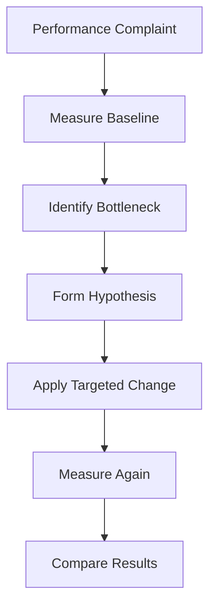
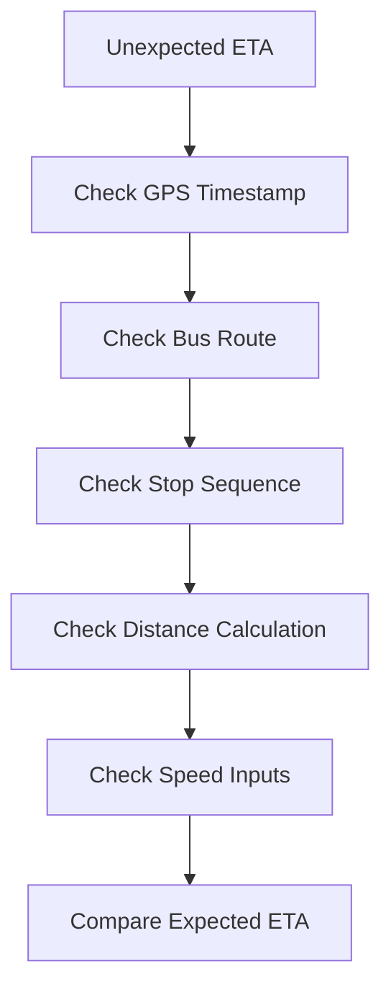
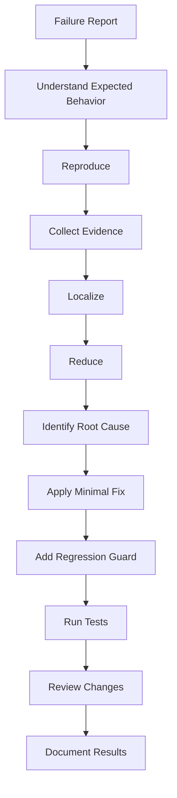

---
title: "10 — Debugging, Testing, and Error Recovery"
course: "Agent Skills"
repository: "addyosmani/agent-skills"
lesson: 10
difficulty: Intermediate to Advanced
approach: Theory First
tags:
  - agentic-engineering
  - debugging
  - testing
  - error-recovery
  - root-cause-analysis
  - regression-testing
  - browser-devtools
  - codex
---

# 10 — Debugging, Testing, and Error Recovery

> [!abstract] Lesson Overview
> **Repository:** addyosmani/agent-skills
>
> **Primary Skills:**
> - `debugging-and-error-recovery`
> - `browser-testing-with-devtools`
>
> **Supporting Skills:**
> - `test-driven-development`
> - `context-engineering`
> - `source-driven-development`
> - `code-review-and-quality`
>
> **Purpose:** Learn how AI coding agents investigate failures, identify root causes, apply minimal corrections, verify fixes, and prevent recurring defects.
>
> **Prerequisites:**
> - [[07 - Incremental Implementation and TDD]]
> - [[08 - Context Engineering and Source-Driven Development]]
> - [[09 - Frontend UI and API Engineering]]
>
> **Learning Approach:** Theory First

---

# Part I — Learning Objectives

After completing this lesson, you should be able to:

1. Define debugging and error recovery.
2. Understand the `debugging-and-error-recovery` skill.
3. Apply the five-step debugging workflow.
4. Distinguish symptoms from root causes.
5. Reproduce software defects reliably.
6. Classify common software failures.
7. Collect useful debugging evidence.
8. Understand stack traces and logs.
9. Localize failures to specific components.
10. Reduce complex failures to minimal examples.
11. Form and test debugging hypotheses.
12. Apply minimal corrective changes.
13. Understand the stop-the-line principle.
14. Use regression tests to guard fixes.
15. Understand the `browser-testing-with-devtools` skill.
16. Investigate browser console errors.
17. Analyze network requests.
18. Inspect DOM and runtime behavior.
19. Understand performance traces.
20. Debug frontend–backend integration.
21. Handle asynchronous failures.
22. Understand database-related failures.
23. Apply safe recovery strategies.
24. Avoid speculative fixes.
25. Evaluate debugging evidence.
26. Document root causes and resolutions.
27. Apply these concepts to Android, Laravel, and Next.js projects.

---

# Part II — Debugging Fundamentals

## 1. What Is Debugging?

Debugging is the systematic process of identifying, investigating, and correcting defects in software.

A defect is a problem that causes software to behave differently from its intended behavior.

Examples include:

- A button that does not respond.
- An API returning an unexpected status.
- A page that fails to render.
- A database query returning incorrect results.
- An application crashing during startup.
- A test failing after a code change.

## 1.1 Debugging Is Not Guessing

Consider this situation:

> The dashboard displays no products.

An inexperienced approach might immediately modify the frontend component.

However, the actual cause could be:

- The backend is unavailable.
- The API endpoint is incorrect.
- The request lacks authentication.
- The database contains no products.
- The API response structure changed.
- The frontend incorrectly handles the response.

Changing the UI without investigating the cause may not solve the problem.

## 1.2 Core Principle

> Debugging begins with evidence, not assumptions.

---

# Part III — The debugging-and-error-recovery Skill

## 2. Purpose

The `debugging-and-error-recovery` skill provides a structured approach to unexpected behavior, failed tests, broken builds, and runtime errors.

Its central workflow is:

**Reproduce → Localize → Reduce → Fix → Guard**

Each stage has a distinct purpose.

| Stage | Primary Question |
|---|---|
| Reproduce | Can we reliably observe the failure? |
| Localize | Where does the failure originate? |
| Reduce | What is the smallest case that demonstrates it? |
| Fix | What is the smallest correct change? |
| Guard | How do we prevent this regression? |

## 2.1 Workflow Diagram



## 2.2 When to Use

Use this skill when:

- Tests fail.
- Builds break.
- Runtime behavior is unexpected.
- Integration fails.
- A recent change introduces a regression.
- A bug cannot be explained by the current evidence.

## 2.3 Important

The purpose of the workflow is not to make debugging slower.

It is to prevent repeated speculative changes that consume more time and introduce additional defects.

---

# Part IV — Step 1: Reproduce

## 3. What Does Reproduce Mean?

Reproduction means identifying a reliable sequence of conditions and actions that causes the problem to appear.

A useful reproduction should explain:

1. The environment.
2. The initial application state.
3. The actions performed.
4. The expected behavior.
5. The actual behavior.
6. Whether the failure occurs consistently.

## 3.1 Example

Problem:

> The GroupTrack Tasks page shows no assigned tasks.

Reproduction report:

```text
Project:
GroupTrack Android

Environment:
Android emulator

Initial State:
User is authenticated and belongs
to a project with assigned tasks.

Steps:
1. Launch the application.
2. Sign in.
3. Open the Tasks tab.
4. Wait for data loading.

Expected:
Assigned tasks appear.

Actual:
The empty state appears.

Frequency:
Reproduced in three consecutive attempts.
```

This report is an illustrative example, not an observed test result.

## 3.2 Why Reproduction Matters

Without reliable reproduction, a developer cannot confidently determine whether a proposed fix worked.

## 3.3 Intermittent Failures

Some bugs occur only under specific conditions.

Examples:

- Slow network connections.
- Concurrent requests.
- Certain user permissions.
- Specific device sizes.
- Missing database records.
- Race conditions.

These failures require careful recording of the circumstances.

---

# Part V — Expected vs Actual Behavior

## 4. The Debugging Contract

Every debugging task should establish the difference between expected and actual behavior.

| Element | Example |
|---|---|
| Expected | Clicking Save creates one product |
| Actual | Clicking Save creates two products |
| Environment | Next.js frontend and Laravel API |
| Trigger | Submitting the form once |
| Impact | Duplicate database records |

## 4.1 Why This Matters

Without an expected behavior definition, an agent may implement a technically valid change that does not satisfy the actual requirement.

## 4.2 Example

An API returns `403 Forbidden`.

Is this a bug?

Not necessarily.

If the user lacks permission, the response may be correct.

The agent must understand the authorization requirements before changing the endpoint.

> [!important]
> Unexpected behavior is not automatically incorrect behavior. Compare it against the approved specification.

---

# Part VI — Step 2: Localize

## 5. What Is Failure Localization?

Localization identifies the component, operation, or boundary responsible for a defect.

The objective is to narrow the investigation.

## 5.1 Example Architecture



Suppose the UI displays an error.

The agent should determine whether the problem occurs in:

- UI rendering.
- Request construction.
- Network communication.
- Backend routing.
- Validation.
- Business logic.
- Database access.

## 5.2 Localization Questions

Ask:

1. What was the last operation that succeeded?
2. What was the first operation that failed?
3. Which component owns that operation?
4. What evidence supports this location?
5. Can the failure be observed independently?

## 5.3 Important

The location where an error becomes visible is not necessarily where the defect originates.

---

# Part VII — Symptoms vs Root Causes

## 6. What Is a Symptom?

A symptom is an observable effect of a problem.

Examples:

- Blank screen.
- HTTP 500 response.
- Missing data.
- Application crash.

## 6.1 What Is a Root Cause?

A root cause is the underlying condition responsible for the failure.

Example:

**Symptom:** The dashboard shows no products.

**Root cause:** The frontend expects `response.products`, but the approved API contract returns `response.data`.

## 6.2 Cause-and-Effect Diagram



## 6.3 Why Root Cause Analysis Matters

Fixing only the visible symptom may leave the underlying defect unresolved.

For example, adding a fallback empty array may prevent a rendering error but conceal a broken API contract.

## 6.4 Important

A defensive fallback can be appropriate, but it should not silently hide a contract violation.

---

# Part VIII — Error Classification

## 7. Common Error Categories

| Category | Description | Example |
|---|---|---|
| Syntax | Invalid language syntax | Missing bracket |
| Compilation | Code cannot compile | Unknown Java method |
| Runtime | Failure during execution | Null reference |
| Logic | Incorrect behavior | Wrong contribution count |
| Integration | Components disagree | API response mismatch |
| Configuration | Environment is incorrect | Missing environment variable |
| Database | Persistence or query failure | Constraint violation |
| Authorization | Permission mismatch | Unexpected 403 |
| Performance | Excessive resource usage | Slow database query |
| Concurrency | Timing-dependent failure | Duplicate assignment |
| UI | Incorrect interface behavior | Button remains disabled |

## 7.1 Why Classification Helps

Different failure types require different evidence.

For example:

- Compilation errors require compiler output.
- Network failures require request and response inspection.
- Database failures require query and constraint analysis.
- UI defects may require DOM or visual inspection.

---

# Part IX — Debugging Evidence

## 8. Types of Evidence

A reliable investigation may use:

- Error messages.
- Stack traces.
- Test output.
- Application logs.
- Network traces.
- Database query results.
- Git diffs.
- Runtime state.
- Screenshots.
- Reproduction steps.

## 8.1 Evidence Hierarchy



## 8.2 Weak Evidence

> I think the problem is probably the controller.

## 8.3 Stronger Evidence

> The request reaches the controller, but the service throws an exception before the database operation. The stack trace identifies the failing method.

## 8.4 Important

Never claim to have inspected logs, executed tests, or reproduced a bug unless those actions actually occurred.

---

# Part X — Reading Stack Traces

## 9. What Is a Stack Trace?

A stack trace describes the sequence of function calls associated with an exception or failure.

It can help identify:

- Exception type.
- Error message.
- Failing function.
- Source location.
- Call sequence.

## 9.1 Illustrative Java Error

```text
java.lang.NullPointerException
    at TaskRepository.loadTasks(TaskRepository.java:84)
    at TasksActivity.refresh(TasksActivity.java:121)
```

## 9.2 Investigation

The agent should:

1. Identify the exception type.
2. Inspect the referenced line.
3. Review the values used at that line.
4. Trace the source of those values.
5. Determine why the invalid state occurred.

## 9.3 Important

The top frame may identify where the failure occurred, but the underlying cause can originate earlier.

---

# Part XI — Step 3: Reduce

## 10. What Is Failure Reduction?

Reduction isolates the smallest set of conditions needed to reproduce a defect.

It removes unrelated complexity.

## 10.1 Example

Original situation:

> A large dashboard with navigation, charts, filters, and product tables crashes.

Reduced investigation:

> Rendering the product table with a specific malformed API response reproduces the failure.

This makes the problem easier to understand.

## 10.2 Reduction Strategies

- Use a minimal input.
- Isolate one component.
- Reproduce with one API request.
- Disable unrelated interactions in a test environment.
- Compare working and failing cases.
- Use a focused test.

## 10.3 Important

Reduction should not alter the essential conditions responsible for the bug.

If removing asynchronous behavior makes the problem disappear, timing may be part of the cause.

---

# Part XII — Hypothesis-Driven Debugging

## 11. What Is a Debugging Hypothesis?

A hypothesis is a testable explanation of the observed failure.

Example:

> The empty state appears because the task query filters by the wrong user identifier.

## 11.1 Testing the Hypothesis

The agent should inspect:

- Current user identifier.
- Query parameters.
- Database records.
- Returned results.
- Existing query logic.

## 11.2 Hypothesis Table

| Hypothesis | Evidence Needed |
|---|---|
| Wrong endpoint | Network request URL |
| Missing authorization | Response status and permissions |
| Incorrect query | Query and returned records |
| Response mismatch | Actual response and frontend types |
| Race condition | Request timing and state transitions |

## 11.3 Avoid Confirmation Bias

Do not search only for evidence supporting the first explanation.

Consider alternative causes.

---

# Part XIII — Step 4: Fix

## 12. What Makes a Good Fix?

A good fix:

1. Addresses the demonstrated cause.
2. Preserves approved behavior.
3. Changes only necessary code.
4. Avoids unrelated refactoring.
5. Includes appropriate verification.
6. Does not introduce unnecessary dependencies.

## 12.1 Minimal Corrective Change

Suppose the frontend incorrectly reads:

```typescript
const products = response.products;
```

But the documented contract returns:

```json
{
  "data": []
}
```

A targeted correction may be:

```typescript
const products = response.data;
```

This is an illustrative example.

The actual fix must be based on the real API contract and source code.

## 12.2 Why Minimal Changes Matter

Small changes are easier to:

- Review.
- Test.
- Explain.
- Revert.
- Compare against the original failure.

## 12.3 Important

Minimal does not mean incomplete.

A correct fix may require multiple coordinated changes when the root cause crosses system boundaries.

---

# Part XIV — The Stop-the-Line Principle

## 13. What Does Stop the Line Mean?

In this workflow, stop the line means pausing further implementation when a meaningful failure appears.

Instead of continuing to build additional features on top of a broken foundation, investigate the failure first.

## 13.1 Example

An agent is implementing a product management feature.

During implementation:

```text
Backend tests: FAILED
Frontend build: PASSED
```

Incorrect response:

> Continue implementing the next feature and fix the tests later.

Better response:

> Stop implementation, investigate the failing backend tests, and determine whether the current change caused the failure.

## 13.2 Why It Matters

Continuing after a failure can make root cause analysis harder because additional changes introduce more possible causes.

## 13.3 Important

An unrelated pre-existing failure should be documented and distinguished from a regression introduced by the current task.

---

# Part XV — Step 5: Guard

## 14. What Does Guard Mean?

Guard means adding an appropriate mechanism to detect or prevent recurrence of the same defect.

A common mechanism is a regression test.

## 14.1 What Is a Regression?

A regression occurs when previously working behavior breaks after a change.

## 14.2 Regression Test Example

Bug:

> A user with no assigned tasks causes the Tasks page to crash.

Regression test:

```text
Given:
A valid authenticated user with no tasks.

When:
The Tasks page loads.

Then:
The page displays the approved empty state.

And:
The application does not crash.
```

## 14.3 Other Guard Mechanisms

Depending on the defect:

- Unit tests.
- Integration tests.
- UI tests.
- Database constraints.
- Type checks.
- Static analysis.
- Contract tests.
- Monitoring.

## 14.4 Important

A regression test should fail when the original defect is present and pass when the fix is applied.

---

# Part XVI — Debugging and Test-Driven Development

## 15. How Do They Work Together?

Test-driven development and debugging share an emphasis on observable behavior.

For a reproducible bug, a useful workflow is:

1. Reproduce the bug.
2. Create a focused failing test.
3. Confirm the test fails for the expected reason.
4. Apply the minimal fix.
5. Confirm the test passes.
6. Run relevant regression tests.

## 15.1 Diagram



## 15.2 Important

Not every bug can be reproduced through a conventional unit test.

Browser, integration, device, or system-level tests may be more appropriate.

---

# Part XVII — Testing Levels

## 16. Unit Testing

Tests individual functions or components in isolation.

Example:

> Does the contribution-count function return the expected count?

## 16.1 Integration Testing

Tests communication between components.

Example:

> Does the Laravel controller correctly call the scheduling service and return the documented response?

## 16.2 End-to-End Testing

Tests complete user workflows.

Example:

> Can an authorized user create a product through the frontend and see it in the product list?

## 16.3 Comparison

| Test Level | Scope | Main Benefit |
|---|---|---|
| Unit | Small logic unit | Fast, focused feedback |
| Integration | Multiple components | Detects boundary problems |
| End-to-end | User workflow | Verifies overall behavior |

## 16.4 Important

Use the lowest test level that can reliably demonstrate the defect, while adding higher-level coverage when the failure depends on integration.

---

# Part XVIII — The browser-testing-with-devtools Skill

## 17. Purpose

The `browser-testing-with-devtools` skill focuses on verifying web applications through live browser evidence.

It is relevant when working with:

- Next.js.
- React.
- Laravel-rendered web interfaces.
- Other browser-based applications.

## 17.1 Browser Evidence Sources

The repository highlights:

- DOM inspection.
- Console logs.
- Network traces.
- Performance profiling.

## 17.2 Workflow



## 17.3 Important

Browser automation and DevTools integrations depend on the actual development environment and installed tools.

Do not assume Codex has browser access without checking its configuration.

---

# Part XIX — Browser Console Debugging

## 18. What Is the Browser Console?

The browser console displays information such as:

- JavaScript errors.
- Runtime warnings.
- Logged application messages.
- Failed resource notifications.
- Framework warnings.

## 18.1 Example

```text
TypeError:
Cannot read properties of undefined
```

Possible explanations include:

- Missing response data.
- Incorrect object structure.
- Uninitialized state.
- Unexpected rendering conditions.

## 18.2 Investigation

1. Identify the relevant error.
2. Inspect its source location.
3. Reproduce the triggering action.
4. Inspect the data involved.
5. Compare expected and actual values.

## 18.3 Important

Console warnings and errors should be evaluated by relevance.

Not every warning is the root cause of the current defect.

---

# Part XX — DOM Inspection

## 19. What Is the DOM?

The Document Object Model represents the structure of a web document.

DOM inspection helps determine:

- Whether an element exists.
- Which attributes it has.
- Whether it is hidden.
- Whether a disabled state is applied.
- Which content was rendered.
- Whether accessibility attributes are present.

## 19.1 Example

Problem:

> The Save button cannot be clicked.

Possible causes:

- The button is disabled.
- Another element overlays it.
- The button is not rendered.
- Event handling is incorrect.
- A loading state never resets.

## 19.2 Important

A visible UI problem can originate from CSS, application state, event handling, or data flow.

DOM inspection helps distinguish these possibilities.

---

# Part XXI — Network Request Debugging

## 20. Why Inspect Network Requests?

Network inspection reveals communication between frontend and backend.

Useful information includes:

- Request URL.
- HTTP method.
- Status code.
- Request headers.
- Request payload.
- Response body.
- Timing.

## 20.1 Example

Problem:

> Product creation fails.

Observed response:

```text
POST /api/products
HTTP 422
```

This indicates a validation-related response in a typical Laravel API.

The next step is to inspect the response body and compare the submitted fields against the contract.

## 20.2 Diagnostic Questions

- Was the correct endpoint called?
- Was the method correct?
- Was the payload valid?
- Was authentication included?
- What did the server return?
- Did the frontend handle the response correctly?

## 20.3 Important

Avoid exposing authentication tokens, cookies, or sensitive request data when sharing debugging logs.

---

# Part XXII — Understanding HTTP Failures

## 21. Common HTTP Status Codes

| Status | Typical Meaning | Investigation |
|---|---|---|
| 400 | Invalid request | Inspect payload |
| 401 | Authentication failure | Check session or credentials |
| 403 | Authorization failure | Check permissions |
| 404 | Missing resource or route | Verify URL and resource |
| 409 | Conflict | Inspect business constraints |
| 422 | Validation failure | Inspect validation errors |
| 429 | Too many requests | Check rate limits |
| 500 | Server error | Inspect backend logs |
| 503 | Service unavailable | Check service health |

## 21.1 Important

The status code narrows the investigation but does not independently establish the root cause.

---

# Part XXIII — Performance Debugging

## 22. What Is Performance Debugging?

Performance debugging investigates why an application is slower or less responsive than expected.

Possible causes include:

- Slow network requests.
- Large JavaScript bundles.
- Expensive rendering.
- Unoptimized images.
- Excessive database queries.
- Blocking operations.
- Repeated data fetching.

## 22.1 Measure Before Optimizing

A useful workflow is:



## 22.2 Example

A dashboard loads slowly.

Possible evidence:

```text
Page load: 4.8 seconds
API request: 3.9 seconds
UI rendering: 0.4 seconds
```

These are hypothetical measurements.

They suggest investigating the API before rewriting the frontend.

## 22.3 Important

Optimization should address measured bottlenecks rather than assumed ones.

---

# Part XXIV — Debugging Asynchronous Behavior

## 23. Why Async Bugs Are Difficult

Asynchronous systems do not always complete operations in the same order.

Examples:

- Network requests.
- Database operations.
- Background tasks.
- Firebase listeners.
- UI updates.
- Scheduled jobs.

## 23.1 Race Condition Example

A user changes the selected project quickly.

Two requests are sent:

```text
Request A: Project 1
Request B: Project 2
```

Request B finishes first.

Request A finishes later.

Without proper handling, the UI may display Project 1 data even though Project 2 is selected.

## 23.2 Investigation

Determine:

1. Which requests were initiated?
2. In what order?
3. Which completed first?
4. Which response updated the UI?
5. Was stale data allowed to overwrite current state?

## 23.3 Important

Do not assume asynchronous operations finish in the order they start.

---

# Part XXV — Database Debugging

## 24. Common Database Problems

Examples:

- Incorrect joins.
- Missing records.
- Duplicate records.
- Constraint violations.
- Transaction failures.
- Slow queries.
- Incorrect filtering.
- Unexpected null values.

## 24.1 Example

Problem:

> GroupTrack displays an incorrect contribution count.

Approved requirement:

> Count assigned tasks with `DONE` status for the member within the relevant project.

Potential causes:

- Counting all assigned tasks.
- Ignoring project scope.
- Counting duplicate records.
- Filtering by the wrong member identifier.
- Using the wrong status value.

## 24.2 Investigation

1. Inspect the approved rule.
2. Inspect the query.
3. Examine representative test data.
4. Compare actual and expected counts.
5. Add a focused regression test.

## 24.3 Important

Do not modify production data merely to test a hypothesis.

Use appropriate test environments and authorized access.

---

# Part XXVI — Configuration Debugging

## 25. Environment-Related Failures

Some problems are caused by the environment rather than application logic.

Examples:

- Incorrect environment variables.
- Unavailable services.
- Missing dependencies.
- Wrong ports.
- Unsupported runtime versions.
- Incorrect file permissions.

## 25.1 Example

A Next.js frontend cannot connect to its Laravel backend.

Possible causes:

- Incorrect API base URL.
- Backend server not running.
- Wrong port.
- Cross-origin configuration.
- Authentication configuration.
- Network connectivity.

## 25.2 Investigation

Check the actual runtime configuration before changing application architecture.

## 25.3 Important

Do not expose private environment values while collecting diagnostic evidence.

---

# Part XXVII — Safe Error Recovery

## 26. What Is Error Recovery?

Error recovery is the process of restoring an application or development workflow to a valid state after failure.

Recovery can involve:

- Retrying a safe operation.
- Restoring valid state.
- Rolling back a problematic change.
- Reverting an incomplete migration.
- Disabling a faulty feature through approved controls.
- Returning a meaningful error to the user.

## 26.1 Recovery Principles

A recovery strategy should be:

- Predictable.
- Authorized.
- Reversible where possible.
- Observable.
- Compatible with existing data.
- Appropriate to the failure.

## 26.2 Important

Retries are not automatically safe.

Operations with side effects may require idempotency protection.

---

# Part XXVIII — Safe Fallbacks

## 27. What Is a Fallback?

A fallback provides an alternative behavior when the preferred operation is unavailable.

Examples:

- Displaying a retry button.
- Showing cached information with a timestamp.
- Displaying an informative empty state.
- Disabling an unavailable action.
- Providing a read-only view.

## 27.1 GoPasig Example

If a bus location update is unavailable, the interface might display:

```text
Bus location temporarily unavailable.

Last update:
10:32 AM
```

This is an illustrative UI message.

## 27.2 Important

A fallback must not misrepresent stale data as current information.

For a location-tracking application, data freshness is part of correctness.

---

# Part XXIX — Avoiding Speculative Fixes

## 28. What Is a Speculative Fix?

A speculative fix changes code without sufficient evidence that the change addresses the defect.

Examples:

- Adding arbitrary delays.
- Increasing timeouts without investigation.
- Suppressing exceptions.
- Disabling validation.
- Removing failing tests.
- Rewriting entire modules.
- Adding dependencies without necessity.

## 28.1 Example

Problem:

> An API request occasionally fails.

Speculative approach:

```text
Increase timeout to 60 seconds.
```

Evidence-driven approach:

```text
Inspect request timing,
server logs, network failures,
and backend processing behavior.
```

## 28.2 Important

A change that makes a symptom disappear is not automatically a correct fix.

---

# Part XXX — Debugging Existing Codebases

## 29. Why Legacy Code Requires Care

Existing applications may contain:

- Undocumented behavior.
- Inconsistent conventions.
- Limited tests.
- Complex dependencies.
- Hidden assumptions.

## 29.1 Recommended Approach

1. Read project instructions.
2. Inspect the affected module.
3. Understand current behavior.
4. Identify relevant dependencies.
5. Reproduce the defect.
6. Add characterization or regression tests where appropriate.
7. Make a focused correction.
8. Verify existing behavior.

## 29.2 Characterization Tests

A characterization test records what existing code currently does.

It is useful when behavior is poorly documented.

## 29.3 Important

Characterization tests describe existing behavior; they do not automatically prove that behavior is correct according to product requirements.

---

# Part XXXI — Git and Debugging

## 30. Why Git Matters

Git helps identify what changed before a failure appeared.

Useful information includes:

- Current branch.
- Working-tree status.
- Recent commits.
- Changed files.
- Differences between versions.

## 30.1 Example Commands

```powershell
git status
git diff
git log --oneline -5
```

These commands inspect repository state.

## 30.2 Important

Before changing or reverting files, distinguish your own changes from existing uncommitted work.

Never discard unrelated work without authorization.

---

# Part XXXII — Debugging Documentation

## 31. Why Record Bug Investigations?

Documented investigations help future developers understand:

- What failed.
- Why it failed.
- How it was corrected.
- Which tests protect the behavior.

## 31.1 Bug Report Template

```markdown
# Bug Report

## Summary
Describe the failure.

## Environment
Record relevant versions and configuration.

## Expected Behavior
Describe approved behavior.

## Actual Behavior
Describe observed behavior.

## Reproduction Steps
List exact steps.

## Evidence
Include relevant logs and test output.

## Root Cause
Explain the demonstrated cause.

## Fix
Describe the minimal correction.

## Verification
Record commands and results.

## Regression Guard
Identify the test or protection added.

## Remaining Risks
Document unresolved concerns.
```

## 31.2 Important

Separate observed facts from hypotheses.

---

# Part XXXIII — Debugging with Codex

## 32. Example Investigation Prompt

```text
Use the debugging-and-error-recovery skill.

PROJECT:
GroupTrack Android application.

PROBLEM:
The Tasks page displays an empty state
even when the current user has assigned tasks.

WORKFLOW:

1. Read AGENTS.md and relevant documentation.
2. Inspect the current Tasks implementation.
3. Reproduce the reported behavior if the
   required environment is available.
4. Identify the expected behavior.
5. Inspect relevant data-access logic.
6. Localize the failure.
7. Reduce it to a focused test case.
8. Explain the root cause with evidence.
9. Propose the smallest correct fix.
10. Add appropriate regression coverage.
11. Run relevant verification.

CONSTRAINTS:
- Preserve MVP scope.
- Do not add unnecessary libraries.
- Do not modify unrelated modules.
- Do not change the database schema
  without approval.

REPORT:
- Reproduction result
- Root cause
- Changed files
- Tests executed
- Test results
- Remaining risks

Do not claim verification unless executed.
```

## 32.1 Why This Prompt Is Better

It directs the agent toward investigation before implementation.

It also establishes scope and evidence requirements.

---

# Part XXXIV — Browser Debugging with Codex

## 33. Example Browser Investigation Prompt

```text
Use browser-testing-with-devtools
and debugging-and-error-recovery.

PROJECT:
Next.js frontend with Laravel API.

PROBLEM:
The product form fails after submission.

INSTRUCTIONS:

1. Inspect the existing API contract.
2. Reproduce the failure in the browser
   if browser tools are available.
3. Inspect console errors.
4. Inspect the network request.
5. Record request method, URL, and status.
6. Inspect the response structure.
7. Trace the failure to the responsible layer.
8. Explain the root cause.
9. Apply a minimal approved fix.
10. Verify the full submission flow.

SECURITY:
Do not expose cookies, tokens,
passwords, or private environment values.

CONSTRAINTS:
Do not rewrite unrelated components.

OUTPUT:
Provide observed evidence and
actual verification results.
```

## 33.1 Important

If browser tooling is unavailable, the agent should explain the limitation rather than pretending to have performed browser verification.

---

# Part XXXV — GroupTrack Case Study

## 34. Scenario: Incorrect Task Count

### Problem

The Members page displays an incorrect completed-task count.

### Expected Behavior

Count tasks assigned to a specific member that have `DONE` status within the relevant project.

### Investigation Workflow

**Reproduce**

Prepare a representative test case with known assignments and statuses.

**Localize**

Inspect the contribution-count query and the UI mapping.

**Reduce**

Use a small test dataset containing:

- One member.
- One project.
- Several tasks with different statuses.

**Fix**

Correct the demonstrated query or mapping defect.

**Guard**

Add a regression test covering the intended counting rule.

## 34.1 Example Test Matrix

| Task | Member | Project | Status | Counted? |
|---|---|---|---|---|
| A | Member 1 | Project A | DONE | Yes |
| B | Member 1 | Project A | WORKING | No |
| C | Member 2 | Project A | DONE | No |
| D | Member 1 | Project B | DONE | No |

Expected count for Member 1 in Project A: **1**.

## 34.2 Important

The test should match the approved contribution-count definition.

---

# Part XXXVI — GoPasig Case Study

## 35. Scenario: Incorrect ETA

### Problem

A commuter sees an ETA that does not reflect current route conditions.

### Possible Causes

- Stale GPS data.
- Incorrect route association.
- Incorrect stop sequence.
- Distance calculation error.
- Speed estimation error.
- Timestamp handling problem.

## 35.1 Investigation Workflow



## 35.2 Evidence

The agent should inspect:

- Relevant GPS records.
- Route geometry.
- Stop coordinates.
- ETA calculation logic.
- Input timestamps.
- Representative test cases.

## 35.3 Important

An ETA discrepancy does not automatically mean the formula is incorrect.

The underlying location or route data may be the actual cause.

---

# Part XXXVII — Next.js + Laravel Case Study

## 36. Scenario: Product Creation Fails

### Problem

An authorized user submits a product form, but no product is created.

### Investigation

**Step 1 — Reproduce**

Submit the form with valid test data.

**Step 2 — Inspect Network**

Check the request method, URL, payload, and response.

**Step 3 — Localize**

Determine whether the failure occurs in:

- Frontend validation.
- API client.
- Backend route.
- Authentication.
- Authorization.
- Backend validation.
- Database persistence.

**Step 4 — Reduce**

Reproduce with one valid product payload.

**Step 5 — Fix**

Apply a targeted correction based on observed evidence.

**Step 6 — Guard**

Add a test verifying successful creation for an authorized user.

## 36.1 Integration Test Expectations

- Valid data is accepted.
- Authorized users can create products.
- Unauthorized users cannot.
- Invalid data produces documented errors.
- Created records persist correctly.
- Frontend feedback matches the response.

---

# Part XXXVIII — Common Debugging Anti-Patterns

## 37. Anti-Pattern Table

| Anti-Pattern | Why It Fails | Better Approach |
|---|---|---|
| Guessing the cause | Unsupported changes | Collect evidence |
| Editing before reproducing | No baseline | Reproduce first |
| Rewriting entire modules | Large regression risk | Make focused changes |
| Ignoring failing tests | Problems accumulate | Stop and investigate |
| Suppressing errors | Hides defects | Identify root cause |
| Arbitrary delays | Masks timing problems | Analyze async behavior |
| Disabling validation | Weakens correctness | Fix request or contract |
| Removing tests | Eliminates protection | Repair implementation or valid test |
| Ignoring existing patterns | Creates inconsistency | Inspect codebase |
| Claiming tests passed | Misrepresents evidence | Report actual results |
| Missing regression test | Bug may return | Add an appropriate guard |
| Exposing secrets in logs | Security risk | Redact sensitive data |

---

# Part XXXIX — Debugging Verification Checklist

## 38. Before Investigation

- [ ] Problem statement is clear.
- [ ] Expected behavior is defined.
- [ ] Actual behavior is recorded.
- [ ] Relevant environment is identified.
- [ ] Project rules are available.
- [ ] Existing source state is understood.

## 38.1 During Investigation

- [ ] Failure was reproduced or limitations documented.
- [ ] Relevant evidence was collected.
- [ ] Failure category was identified.
- [ ] Responsible component was localized.
- [ ] Hypotheses were evaluated.
- [ ] Minimal reproduction was attempted.
- [ ] Root cause is supported by evidence.

## 38.2 During Fix

- [ ] Change addresses the demonstrated cause.
- [ ] Approved behavior is preserved.
- [ ] Unrelated files remain untouched.
- [ ] No unnecessary dependency was added.
- [ ] Security boundaries remain intact.
- [ ] Existing data is protected.

## 38.3 After Fix

- [ ] Original failure no longer reproduces.
- [ ] Regression test was added where appropriate.
- [ ] Relevant tests pass.
- [ ] Build results are recorded.
- [ ] Integration behavior is checked.
- [ ] Final diff is reviewed.
- [ ] Remaining risks are documented.
- [ ] Verification claims match actual execution.

---

# Part XL — Practical Exercises

> [!note]
> Theory-first exercises. No project execution required.

## Exercise 1 — Debugging Fundamentals

Define debugging in your own words.

## Exercise 2 — Five-Step Workflow

Explain Reproduce, Localize, Reduce, Fix, and Guard.

## Exercise 3 — Expected vs Actual

Write an expected-versus-actual report for a broken login form.

## Exercise 4 — Reproduction

Design reproduction steps for a task list that sometimes appears empty.

## Exercise 5 — Error Classification

Classify examples of syntax, runtime, logic, and integration failures.

## Exercise 6 — Evidence

Identify five useful debugging evidence sources.

## Exercise 7 — Stack Traces

Explain how stack traces help identify failing code paths.

## Exercise 8 — Localization

Identify possible failure boundaries in a Next.js–Laravel application.

## Exercise 9 — Root Cause

Distinguish a visible symptom from an underlying defect.

## Exercise 10 — Reduction

Describe how to reduce a dashboard failure to a minimal test case.

## Exercise 11 — Hypotheses

Create three competing hypotheses for an HTTP 500 response.

## Exercise 12 — Minimal Fix

Explain why unrelated refactoring should be avoided during bug fixes.

## Exercise 13 — Stop the Line

Describe when an agent should stop feature implementation.

## Exercise 14 — Regression Testing

Design a regression test for a previously broken empty state.

## Exercise 15 — Testing Levels

Compare unit, integration, and end-to-end testing.

## Exercise 16 — Browser Console

Explain what information browser console errors provide.

## Exercise 17 — DOM Inspection

Describe how to investigate a button that cannot be clicked.

## Exercise 18 — Network Inspection

List the request and response details needed to debug an API failure.

## Exercise 19 — HTTP Errors

Explain the differences between 401, 403, 404, 422, and 500 responses.

## Exercise 20 — Performance

Design a measurement-first workflow for a slow dashboard.

## Exercise 21 — Async Behavior

Explain how out-of-order responses can create stale UI state.

## Exercise 22 — Database Debugging

Design a test dataset for verifying member contribution counts.

## Exercise 23 — Configuration

Identify possible environment-related causes of failed API requests.

## Exercise 24 — Recovery

Explain why automatic retries are not always safe.

## Exercise 25 — Fallbacks

Design an appropriate UI fallback for unavailable GPS information.

## Exercise 26 — Anti-Patterns

Explain why arbitrary delays and suppressed exceptions are poor debugging strategies.

## Exercise 27 — Git

Describe how Git history helps investigate regressions.

## Exercise 28 — Documentation

Create a complete bug report using the provided template.

## Exercise 29 — GroupTrack

Design a debugging workflow for an incorrect completed-task count.

## Exercise 30 — GoPasig

Design an investigation plan for stale bus location information.

## Exercise 31 — E-commerce

Design a debugging workflow for a product creation request returning HTTP 422.

## Exercise 32 — Final Exercise

Create a complete debugging strategy for an approved project feature.

Include:

1. Problem summary.
2. Environment.
3. Expected behavior.
4. Actual behavior.
5. Reproduction steps.
6. Failure classification.
7. Evidence collection.
8. Localization strategy.
9. Root cause hypotheses.
10. Minimal reproduction.
11. Proposed fix.
12. Scope constraints.
13. Security considerations.
14. Regression test.
15. Integration verification.
16. Build verification.
17. Final diff review.
18. Recovery strategy.
19. Documentation.
20. Definition of Done.

---

# Part XLI — Knowledge Check

1. What is debugging?
2. Why should debugging begin with evidence?
3. What is the five-step debugging workflow?
4. What does reproduction establish?
5. Why must expected behavior be defined?
6. What is failure localization?
7. How does a symptom differ from a root cause?
8. What are common software error categories?
9. What information does a stack trace provide?
10. What is failure reduction?
11. What is a debugging hypothesis?
12. Why should multiple hypotheses be considered?
13. What makes a fix minimal and correct?
14. What does stop the line mean?
15. What is a regression?
16. What does Guard mean?
17. How does TDD support debugging?
18. What is a characterization test?
19. What are the differences between testing levels?
20. What is browser runtime evidence?
21. How does DOM inspection help?
22. Why inspect network requests?
23. What does an HTTP 422 response suggest?
24. What is a race condition?
25. Why should performance be measured?
26. What are configuration-related failures?
27. What makes a recovery strategy safe?
28. Why are retries sometimes dangerous?
29. Why should speculative fixes be avoided?
30. How does Git support debugging?
31. What belongs in a bug report?
32. Why should regression tests be added?
33. What should Codex report after a fix?
34. Why must secrets be protected during debugging?
35. What evidence is needed before declaring a bug resolved?

---

# Part XLII — Key Takeaways

> [!summary]
> - Debugging is a structured investigation process.
> - Evidence should guide technical decisions.
> - Reproduction establishes a reliable baseline.
> - Expected and actual behavior must be distinguished.
> - Symptoms are not necessarily root causes.
> - Localization narrows the responsible component.
> - Reduction removes unrelated complexity.
> - Hypotheses should be tested rather than assumed.
> - Fixes should be focused and justified.
> - Significant failures should interrupt further implementation.
> - Regression tests protect corrected behavior.
> - Browser DevTools provide runtime evidence.
> - Network inspection helps diagnose API integration failures.
> - DOM inspection helps identify rendering and interaction problems.
> - Async bugs may depend on operation timing.
> - Database bugs require query and data verification.
> - Recovery strategies should preserve correctness.
> - Retries must account for side effects.
> - Suppressing errors does not solve their underlying causes.
> - Git helps identify regressions and changed behavior.
> - Debugging reports should separate facts from assumptions.
> - Verification must be supported by actual execution evidence.

---

# Part XLIII — Final Mental Model



> [!important] Final Principle
> **A reliable debugging process does not end when the error disappears. It ends when the cause is understood, the correction is verified, and appropriate protection exists against recurrence.**

---

# Part XLIV — References

## Primary Repository

- Agent Skills Repository — `addyosmani/agent-skills`
- Debugging and Error Recovery — `skills/debugging-and-error-recovery/SKILL.md`
- Browser Testing with DevTools — `skills/browser-testing-with-devtools/SKILL.md`
- Test-Driven Development — `skills/test-driven-development/SKILL.md`
- Context Engineering — `skills/context-engineering/SKILL.md`
- Code Review and Quality — `skills/code-review-and-quality/SKILL.md`

## Supporting Documentation

- OpenAI Codex Documentation
- Chrome DevTools Documentation
- Chrome DevTools MCP Documentation
- Android Developers — Debugging
- Laravel 12 Documentation — Testing
- Next.js Documentation — Debugging
- React Documentation
- Git Documentation

> [!note] Documentation Scope
> This lesson is an educational synthesis of the repository's documented debugging and browser-testing workflows, with additional general software engineering concepts.
>
> All project-specific scenarios are illustrative.
>
> No local project files were inspected or modified.
>
> No application code was executed.
>
> No tests or browser investigations were performed.

---

# Part XLV — Next Lesson

**[[11 - Code Review, Simplification, and Security]]**

Topics:

1. Code review fundamentals.
2. The `code-review-and-quality` skill.
3. Review dimensions and quality gates.
4. Correctness and maintainability.
5. Architecture consistency.
6. The `code-simplification` skill.
7. Identifying unnecessary complexity.
8. Safe refactoring.
9. The `security-and-hardening` skill.
10. Authentication and authorization review.
11. Input validation.
12. Secret management.
13. Dependency security.
14. Security boundaries.
15. Performance-aware review.
16. Reviewing AI-generated code.
17. Android, Laravel, and Next.js examples.
18. Practical exercises.
19. Official references.

**End of Lesson 10 — Debugging, Testing, and Error Recovery.**
