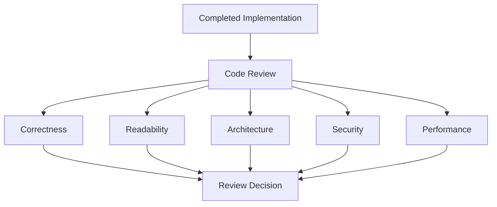
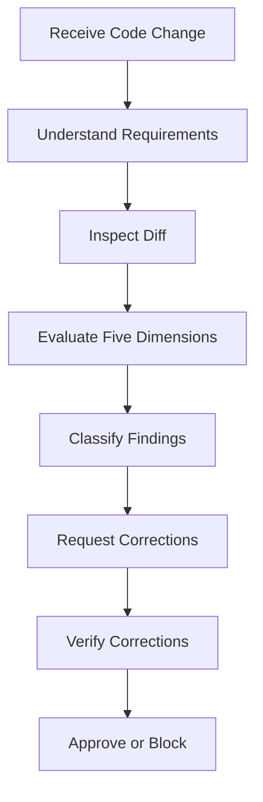
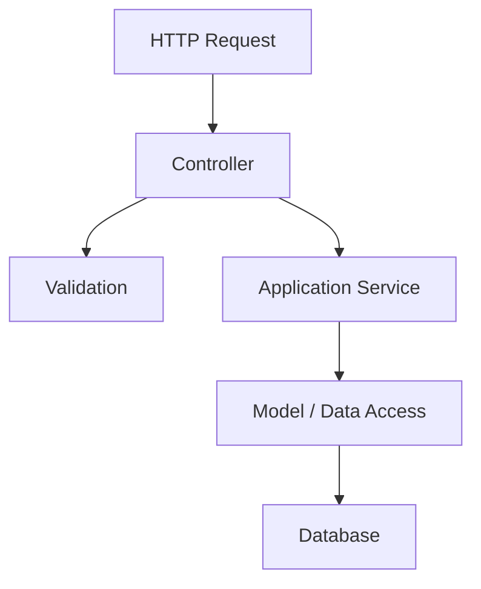
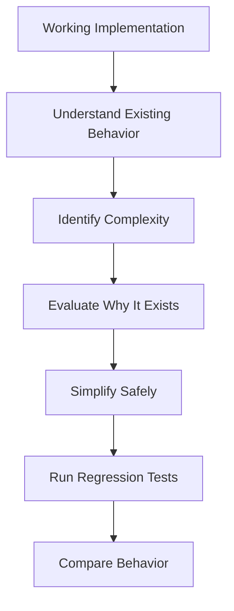
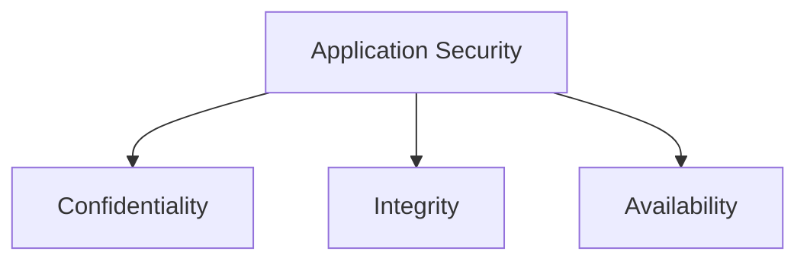
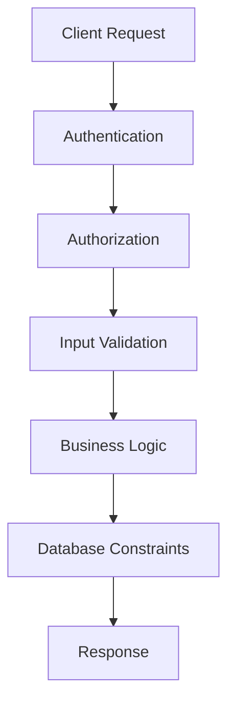
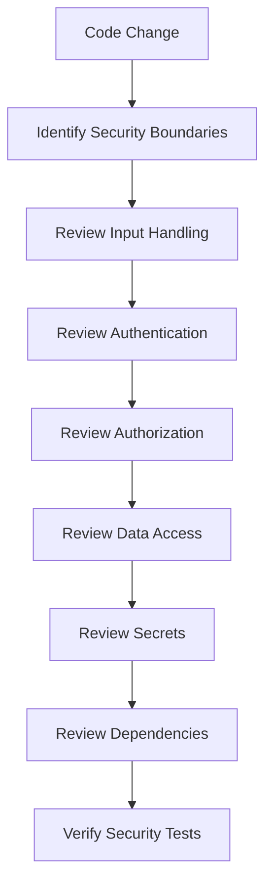
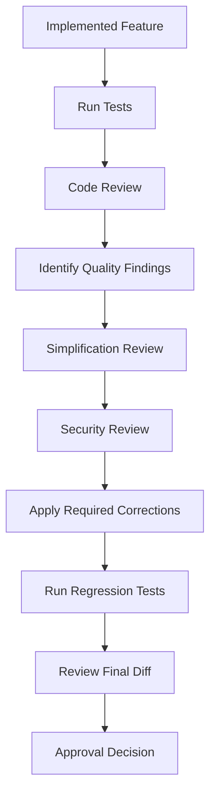
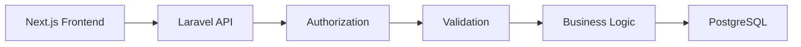
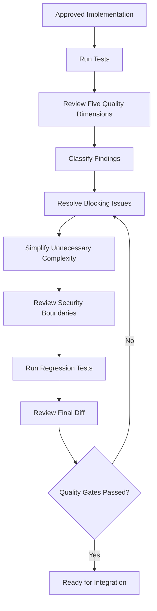

# 11 — Code Review, Simplification, and Security

> [!abstract] Lesson Overview
> **Repository:** [addyosmani/agent-skills](https://github.com/addyosmani/agent-skills)
>
> **Primary Skills:**
> - `code-review-and-quality`
> - `code-simplification`
> - `security-and-hardening`
>
> **Supporting Skills:**
> - `test-driven-development`
> - `debugging-and-error-recovery`
> - `performance-optimization`
> - `context-engineering`
>
> **Purpose:** Understand how AI coding agents evaluate code quality, identify defects, simplify implementations, and review security risks before changes are approved for integration.
>
> **Prerequisites:**
> - [[07 - Incremental Implementation and TDD]]
> - [[08 - Context Engineering and Source-Driven Development]]
> - [[09 - Frontend UI and API Engineering]]
> - [[10 - Debugging, Testing, and Error Recovery]]
>
> **Learning Approach:** Theory First
>
> **Expected Outcome:** Develop a systematic approach to reviewing AI-generated code, identifying unnecessary complexity, evaluating security boundaries, and establishing evidence-based quality gates.

---

# Part I — Learning Objectives

After completing this lesson, you should be able to:

1. Define code review and explain its purpose.
2. Understand the `code-review-and-quality` skill.
3. Identify the five dimensions of code quality.
4. Distinguish correctness from maintainability.
5. Understand review severity classifications.
6. Identify merge-blocking findings.
7. Evaluate code readability.
8. Assess architectural consistency.
9. Recognize performance concerns.
10. Understand code review scope.
11. Explain why smaller changes are easier to review.
12. Understand the `code-simplification` skill.
13. Define code complexity.
14. Identify unnecessary abstractions.
15. Recognize duplicated business logic.
16. Explain Chesterton's Fence.
17. Understand the Rule of 500.
18. Distinguish simplification from feature removal.
19. Understand behavior-preserving refactoring.
20. Identify safe refactoring opportunities.
21. Understand the `security-and-hardening` skill.
22. Explain defense in depth.
23. Identify common web application vulnerabilities.
24. Distinguish authentication from authorization.
25. Understand input validation.
26. Explain least privilege.
27. Understand secrets management.
28. Recognize insecure dependencies.
29. Identify security-sensitive changes.
30. Establish quality and security gates.
31. Review AI-generated code critically.
32. Apply these principles to Android, Laravel, and Next.js projects.

---

# Part II — Code Review Fundamentals

## 1. What Is Code Review?

Code review is the systematic examination of source code to identify problems before changes are integrated into a shared codebase.

It helps evaluate whether an implementation is:

- Correct.
- Understandable.
- Maintainable.
- Consistent with architecture.
- Secure.
- Efficient enough for its intended purpose.

Code review is not simply checking whether code compiles.

A program can compile successfully while containing serious logical or security defects.

## 1.1 Example

Suppose an AI agent implements a product creation endpoint.

The code successfully inserts products into the database.

However, the implementation may still have problems:

- Missing authorization.
- Duplicate validation logic.
- Incorrect error responses.
- Unnecessary service layers.
- Missing regression tests.
- Unrelated file modifications.

A code review should identify these concerns.

## 1.2 Mental Model



> [!important]
> Code review determines whether a change is appropriate for integration, not merely whether the code executes.

---

# Part III — The code-review-and-quality Skill

## 2. Purpose

The `code-review-and-quality` skill establishes a structured review process for AI-generated and human-written code.

It emphasizes:

1. Reviewing across five quality dimensions.
2. Identifying actionable findings.
3. Classifying severity.
4. Keeping changes appropriately sized.
5. Avoiding unnecessary review comments.
6. Verifying changes before integration.

## 2.1 When to Use

Use the skill:

- Before merging a feature.
- After implementing a bug fix.
- After refactoring.
- Before approving an AI-generated change.
- When evaluating a pull request.
- When inspecting unfamiliar code.

## 2.2 Review Workflow



## 2.3 Important

A reviewer should understand the purpose of the change before evaluating its implementation.

Without the requirements, a reviewer may recommend technically elegant changes that contradict the intended behavior.

---

# Part IV — The Five Dimensions of Code Review

## 3. Overview

The repository organizes code review around five dimensions.

| Dimension | Main Question |
|---|---|
| Correctness | Does the code behave as required? |
| Readability | Can developers understand it? |
| Architecture | Does it fit the existing system? |
| Security | Does it preserve security boundaries? |
| Performance | Does it use resources appropriately? |

These dimensions complement one another.

A change may perform well in one dimension but poorly in another.

For example, highly optimized code may be difficult to maintain.

---

# Part V — Dimension 1: Correctness

## 4. What Is Correctness?

Correctness means the implementation satisfies its approved requirements and behaves properly under relevant conditions.

Review questions:

- Are the acceptance criteria satisfied?
- Does the implementation handle valid inputs?
- Does it handle invalid inputs?
- Are edge cases covered?
- Are errors handled appropriately?
- Do tests demonstrate the intended behavior?

## 4.1 Example

GroupTrack requirement:

> Count completed tasks assigned to a member within a specific project.

Incorrect implementation:

```java
int contributionCount = allAssignedTasks.size();
```

This counts all assigned tasks regardless of status.

A more appropriate conceptual implementation is:

```java
int contributionCount = 0;

for (Task task : projectTasks) {
    if (task.getAssigneeId().equals(memberId)
            && task.getStatus() == TaskStatus.DONE) {
        contributionCount++;
    }
}
```

This assumes the model uses these identifiers and status types.

The actual implementation must follow the project's existing data model.

## 4.2 Correctness Checklist

- [ ] Approved behavior is implemented.
- [ ] Input constraints are respected.
- [ ] Error cases are handled.
- [ ] Boundary conditions are considered.
- [ ] Tests cover important scenarios.
- [ ] Existing functionality remains intact.

> [!important]
> Code that works for one example is not necessarily correct for all supported cases.

---

# Part VI — Dimension 2: Readability

## 5. What Is Code Readability?

Readability measures how easily another developer can understand the purpose and behavior of code.

Readable code uses:

- Clear names.
- Consistent formatting.
- Focused functions.
- Straightforward control flow.
- Limited unnecessary nesting.
- Meaningful abstractions.

## 5.1 Example

Less readable:

```typescript
const x = a.filter((b) => b.s === "DONE").length;
```

More readable:

```typescript
const completedTaskCount = tasks.filter(
  (task) => task.status === "DONE"
).length;
```

The second version communicates intent more clearly.

## 5.2 Naming Principles

Prefer names that explain:

- What a value represents.
- What a function performs.
- What condition a Boolean represents.
- What a component displays.

Examples:

```text
getAssignedTasks()
isProjectArchived
calculateEstimatedArrival()
validateScheduleConflict()
```

## 5.3 Comments

Comments are useful when explaining:

- Non-obvious business rules.
- Important constraints.
- Technical tradeoffs.
- Reasons behind unusual implementation choices.

Avoid comments that merely repeat obvious code.

---

# Part VII — Dimension 3: Architecture

## 6. What Is Architectural Consistency?

Architectural consistency means a change follows the project's established organization and responsibilities.

Examples:

- Controllers coordinate HTTP requests.
- Services implement business operations when appropriate.
- Data-access components handle persistence.
- UI components render interfaces.
- API clients manage external communication.

These are common patterns, not universal requirements.

## 6.1 Laravel Example

A controller should generally avoid becoming responsible for every aspect of a complex workflow.

Illustrative architecture:



## 6.2 Architectural Review Questions

1. Does the code follow existing project patterns?
2. Is the responsibility placed in the correct layer?
3. Does it duplicate existing functionality?
4. Does it introduce unnecessary dependencies?
5. Does it increase coupling?
6. Does it violate module boundaries?

## 6.3 Important

Do not introduce additional architectural layers simply because a pattern is popular.

Architecture should serve actual project requirements.

---

# Part VIII — Dimension 4: Security

## 7. Security Review

Security review evaluates whether the implementation introduces or preserves vulnerabilities.

Important areas include:

- Authentication.
- Authorization.
- Input validation.
- Data exposure.
- Secrets management.
- Dependency security.
- Safe database access.
- Secure configuration.

## 7.1 Example

A product creation endpoint may validate the product name correctly but still allow unauthorized users to create products.

This is a security problem even if the feature otherwise works.

## 7.2 Key Principle

> A correct business operation must also be authorized and securely implemented.

We will examine security in greater detail later in this lesson.

---

# Part IX — Dimension 5: Performance

## 8. Performance Review

Performance review evaluates whether an implementation introduces avoidable resource costs.

Examples:

- Excessive database queries.
- Unnecessary repeated rendering.
- Large network payloads.
- Inefficient loops.
- Blocking operations.
- Redundant API calls.

## 8.1 Example

A dashboard displays 100 buses.

An implementation queries the database separately for each bus.

This may create an N+1 query problem.

## 8.2 Review Questions

- Does the change introduce repeated queries?
- Does it fetch unnecessary data?
- Are expensive operations repeated?
- Is pagination needed?
- Does the implementation affect responsiveness?

## 8.3 Important

Performance review should prioritize measurable or clearly justified concerns.

Do not introduce complex optimizations without evidence.

---

# Part X — Review Severity Levels

## 9. Why Severity Matters

Not every review comment should block integration.

A useful review process distinguishes important defects from optional improvements.

The repository uses severity-oriented review labels, including:

- Critical.
- Required.
- Optional.
- Nit.
- FYI.

## 9.1 Severity Table

| Severity | Meaning | Merge Decision |
|---|---|---|
| Critical | Severe correctness or security risk | Block |
| Required | Material issue that must be resolved | Block |
| Optional | Useful improvement, not essential | Usually nonblocking |
| Nit | Minor style or formatting suggestion | Nonblocking |
| FYI | Informational observation | Nonblocking |

## 9.2 Examples

**Critical**

An endpoint exposes private user records without authorization.

**Required**

A feature does not satisfy an approved acceptance criterion.

**Optional**

A repeated UI pattern could be extracted into a reusable component.

**Nit**

A variable name could be slightly clearer.

**FYI**

An existing utility may become useful for future features.

## 9.3 Important

Severity should reflect actual impact, not personal preference.

---

# Part XI — Actionable Review Findings

## 10. What Makes Feedback Useful?

Good review feedback identifies:

1. The problem.
2. The affected location.
3. The impact.
4. The evidence.
5. The required correction, when applicable.

## 10.1 Weak Review Comment

```text
This code is bad.
```

## 10.2 Better Review Comment

```text
Severity: Required

Location:
ProductController.php

Finding:
The product creation action does not
enforce the approved staff permission.

Impact:
An authenticated customer may be able
to create products.

Recommendation:
Apply the existing authorization policy
before performing the creation operation.

Verification:
Add a feature test confirming that
unauthorized users receive HTTP 403.
```

## 10.3 Important

Avoid presenting hypothetical problems as confirmed defects.

A reviewer should distinguish verified findings from concerns requiring investigation.

---

# Part XII — Code Change Size

## 11. Why Smaller Changes Matter

Smaller changes are generally easier to:

- Understand.
- Review.
- Test.
- Revert.
- Merge.
- Debug.

The repository discusses approximately 100 changed lines as a useful review-sizing target.

This is a heuristic, not a strict limit.

## 11.1 Example

Large change:

```text
Implement authentication,
product management,
inventory reporting,
dashboard redesign,
and database migration.
```

Smaller changes:

```text
Change 1:
Authentication validation.

Change 2:
Product creation API.

Change 3:
Product creation UI.

Change 4:
Inventory reporting.
```

## 11.2 Splitting Strategies

Split by:

- Independent feature.
- Layer.
- Dependency.
- Behavioral change.
- Testable vertical slice.

## 11.3 Important

Do not split a logically atomic change into incomplete commits merely to meet a line-count target.

---

# Part XIII — Reviewing AI-Generated Code

## 12. Why AI Code Needs Review

AI coding agents can produce implementations that appear correct but contain:

- Unsupported assumptions.
- Incorrect business logic.
- Unnecessary abstractions.
- Inconsistent naming.
- Missing authorization.
- Outdated API usage.
- Unrelated changes.
- Weak error handling.

## 12.1 Review Responsibilities

The reviewer should compare:

```text
Approved Requirements
        ↓
Implementation Diff
        ↓
Relevant Tests
        ↓
Runtime Evidence
        ↓
Review Decision
```

## 12.2 Questions to Ask

- Did the agent implement only the requested scope?
- Did it modify unrelated files?
- Did it introduce dependencies?
- Does the code follow existing architecture?
- Were tests actually executed?
- Are security boundaries preserved?
- Are the reported results supported by evidence?

## 12.3 Important

AI-generated code should meet the same quality standards as human-written code.

---

# Part XIV — The code-simplification Skill

## 13. Purpose

The `code-simplification` skill focuses on reducing unnecessary complexity while preserving existing behavior.

It is especially useful when:

- Code works but is difficult to understand.
- Functions contain excessive branching.
- Business logic is duplicated.
- Too many abstractions were introduced.
- An AI agent overengineered a small feature.
- Refactoring is needed without changing functionality.

## 13.1 Core Principle

> Simplification should improve clarity without changing the approved behavior.

## 13.2 Workflow



---

# Part XV — What Is Code Complexity?

## 14. Complexity Explained

Code complexity describes how difficult software is to understand, modify, and reason about.

Common contributors include:

- Deep nesting.
- Excessive branching.
- Long functions.
- Too many dependencies.
- Unnecessary abstractions.
- Duplicated logic.
- Hidden side effects.
- Excessive configuration.

## 14.1 Example

```typescript
function getStatusLabel(status: string) {
  if (status === "DONE") {
    return "Completed";
  } else {
    if (status === "WORKING") {
      return "In Progress";
    } else {
      if (status === "REVIEW") {
        return "For Review";
      } else {
        return "Unknown";
      }
    }
  }
}
```

Simplified:

```typescript
function getStatusLabel(status: string) {
  switch (status) {
    case "DONE":
      return "Completed";
    case "WORKING":
      return "In Progress";
    case "REVIEW":
      return "For Review";
    default:
      return "Unknown";
  }
}
```

Both versions illustrate the same intended mapping.

The second is easier to scan.

---

# Part XVI — Unnecessary Abstractions

## 15. What Is an Abstraction?

An abstraction hides implementation details behind a simpler interface.

Useful abstractions can improve:

- Reuse.
- Maintainability.
- Separation of concerns.
- Testability.

However, unnecessary abstractions can make code harder to navigate.

## 15.1 Overengineering Example

A simple feature introduces:

```text
TaskManager
    ↓
TaskCoordinator
    ↓
TaskOrchestrator
    ↓
TaskProcessor
    ↓
TaskRepository
```

If these layers only forward calls without adding meaningful responsibilities, they may be unnecessary.

## 15.2 Better Approach

Use the existing architecture and add a layer only when it solves a demonstrated problem.

## 15.3 Questions

- Does this abstraction remove meaningful duplication?
- Does it represent a real domain concept?
- Does it improve testability?
- Does it clarify responsibilities?
- Is it likely to be reused?
- Does it introduce more complexity than it removes?

---

# Part XVII — Chesterton's Fence

## 16. What Is Chesterton's Fence?

Chesterton's Fence is a principle that warns against removing an existing structure before understanding why it exists.

In software engineering:

> Understand the purpose of existing code before deleting or replacing it.

## 16.1 Example

An agent discovers:

```text
A 15-minute scheduling buffer.
```

It appears unnecessary.

The agent proposes removing it.

However, the buffer may protect against:

- Driver assignment overlap.
- Bus turnaround constraints.
- Dispatch timing conflicts.

Removing it without understanding the business rule could introduce defects.

## 16.2 Recommended Workflow

1. Identify the existing behavior.
2. Search documentation.
3. Inspect relevant tests.
4. Review related code.
5. Determine why the behavior exists.
6. Evaluate consequences.
7. Request approval when necessary.

## 16.3 Important

Code that looks unusual is not automatically incorrect.

---

# Part XVIII — The Rule of 500

## 17. Understanding the Heuristic

The repository discusses a Rule of 500 as a code organization heuristic.

It encourages reviewing large source files and considering whether responsibilities should be separated.

This is not a universal rule requiring every file to contain fewer than 500 lines.

## 17.1 Why Large Files Can Be Difficult

Large files may contain:

- Multiple responsibilities.
- Excessive conditional logic.
- Repeated operations.
- Unrelated functions.
- Difficult navigation.

## 17.2 Example

A single Android activity contains:

```text
Authentication logic
Project queries
Task filtering
Dialog management
Navigation
Contribution calculations
```

This may indicate that the activity has too many responsibilities.

## 17.3 Important

File length alone does not establish poor design.

A longer cohesive file may be clearer than several unnecessarily fragmented files.

---

# Part XIX — Behavior-Preserving Refactoring

## 18. What Is Refactoring?

Refactoring changes the internal structure of code without intentionally changing its observable behavior.

Examples:

- Renaming unclear variables.
- Extracting focused functions.
- Removing duplication.
- Simplifying conditions.
- Separating responsibilities.

## 18.1 Example

Before:

```typescript
function getCompletedCount(tasks: Task[]) {
  let count = 0;

  for (const task of tasks) {
    if (task.status === "DONE") {
      count++;
    }
  }

  return count;
}
```

After:

```typescript
function getCompletedCount(tasks: Task[]) {
  return tasks.filter(
    (task) => task.status === "DONE"
  ).length;
}
```

Both implementations count tasks with `DONE` status.

## 18.2 Verification

Before refactoring:

- Identify expected behavior.
- Inspect existing tests.
- Add characterization tests when needed.

After refactoring:

- Run relevant tests.
- Check edge cases.
- Compare outputs.
- Review the diff.

## 18.3 Important

A refactor should not silently introduce new features or change business rules.

---

# Part XX — Removing Duplication

## 19. What Is Duplicated Logic?

Duplicated logic occurs when the same meaningful behavior is implemented in multiple places.

Example:

```text
Product creation validates price.
Product update separately validates price.
```

If both use identical rules, duplication may create maintenance problems.

## 19.1 Why Duplication Matters

When a rule changes, developers may update only one implementation.

This can create inconsistent behavior.

## 19.2 Appropriate Simplification

Consider centralizing shared business rules when:

- The rules are genuinely identical.
- They change together.
- Reuse improves clarity.
- The existing architecture supports it.

## 19.3 Important

Not every repeated line should be abstracted.

Two similar implementations may represent different domain rules that could diverge later.

---

# Part XXI — Simplification vs Premature Optimization

## 20. Understanding the Difference

Simplification focuses on reducing unnecessary complexity.

Optimization focuses on improving resource usage.

| Simplification | Optimization |
|---|---|
| Improves clarity | Improves measured efficiency |
| Removes unnecessary layers | Reduces execution cost |
| Simplifies control flow | Improves response time |
| Reduces duplication | Reduces memory or network usage |

## 20.1 Example

Replacing a complicated conditional with a straightforward lookup may simplify code.

Introducing a caching system may optimize performance.

These are different decisions.

## 20.2 Important

Do not use performance claims to justify complex code without measurements.

---

# Part XXII — The security-and-hardening Skill

## 21. Purpose

The `security-and-hardening` skill helps agents identify and reduce common application security risks.

It emphasizes:

- OWASP-aligned security practices.
- Input validation.
- Authentication.
- Authorization.
- Secrets management.
- Dependency auditing.
- Least privilege.
- Security boundaries.

## 21.1 When to Use

Use this skill when working with:

- User authentication.
- Role-based access.
- Personal information.
- Database operations.
- File uploads.
- External integrations.
- API endpoints.
- Sensitive configuration.

## 21.2 Important

Security review should be integrated throughout development rather than performed only immediately before deployment.

---

# Part XXIII — Security Fundamentals

## 22. Confidentiality, Integrity, and Availability

Three foundational security objectives are:

### Confidentiality

Information should be accessible only to authorized parties.

### Integrity

Information should remain accurate and protected from unauthorized modification.

### Availability

Systems and information should remain accessible when legitimately needed.

## 22.1 Example

In a project management application:

- Confidentiality protects private project information.
- Integrity protects task assignments and contribution records.
- Availability ensures authorized users can access project data.

## 22.2 Diagram



---

# Part XXIV — Defense in Depth

## 23. What Is Defense in Depth?

Defense in depth uses multiple complementary security controls.

Instead of relying on one protective mechanism, a system applies controls at different boundaries.

## 23.1 Example

A product creation workflow may use:

1. Authentication.
2. Authorization.
3. Input validation.
4. Database constraints.
5. Secure error handling.
6. Logging and monitoring.

## 23.2 Architecture



## 23.3 Important

Frontend controls improve user experience but do not replace backend security enforcement.

---

# Part XXV — Authentication and Authorization

## 24. Authentication

Authentication establishes the identity of a user.

Examples include:

- Session-based authentication.
- Supported identity-provider authentication.
- Secure token-based authentication.

## 24.1 Authorization

Authorization determines which actions the authenticated user may perform.

Example:

```text
User is authenticated.
        ↓
User requests product deletion.
        ↓
Backend checks permission.
        ↓
Action is allowed or denied.
```

## 24.2 Role-Based Access Control

An e-commerce application may define:

| Role | Example Responsibility |
|---|---|
| Admin | Manage system configuration |
| Staff | Manage assigned operational tasks |
| Customer | Browse and purchase products |

Actual permissions must come from approved requirements.

## 24.3 Important

A user being logged in does not automatically authorize every operation.

---

# Part XXVI — Broken Access Control

## 25. What Is Broken Access Control?

Broken access control occurs when a system fails to enforce permissions correctly.

Example:

A user changes a project identifier in a request and accesses another project's private information.

## 25.1 Prevention Principles

- Enforce permissions on the server.
- Check access to specific resources.
- Apply least privilege.
- Deny unauthorized operations.
- Test different roles and ownership conditions.

## 25.2 GroupTrack Example

Before displaying a project's member records, the application should enforce the approved membership and access rules.

## 25.3 Important

Filtering records in the UI is not sufficient to protect information.

The underlying data-access boundary must enforce the appropriate permissions.

---

# Part XXVII — Input Validation

## 26. What Is Input Validation?

Input validation ensures incoming information satisfies expected constraints.

Examples:

- Required fields.
- Correct data types.
- Allowed values.
- Length restrictions.
- Valid identifiers.
- Valid date ranges.

## 26.1 Laravel Example

```php
$validated = $request->validate([
    'name' => ['required', 'string', 'max:255'],
    'price' => ['required', 'numeric', 'min:0'],
]);
```

## 26.2 Validation Responsibilities

Frontend validation:

- Provides immediate feedback.
- Helps users correct mistakes.

Backend validation:

- Protects application boundaries.
- Enforces authoritative constraints.

## 26.3 Important

Do not rely exclusively on frontend validation.

---

# Part XXVIII — SQL Injection Prevention

## 27. What Is SQL Injection?

SQL injection is a vulnerability that can occur when untrusted input is interpreted as part of a database query rather than treated as data.

## 27.1 Prevention

Use:

- Parameterized queries.
- Prepared statements.
- Framework query builders.
- Appropriate input validation.
- Least-privilege database accounts.

## 27.2 PHP PDO Example

```php
$stmt = $pdo->prepare(
    'SELECT id, name FROM products WHERE id = :id'
);

$stmt->execute([
    'id' => $productId,
]);

$product = $stmt->fetch(PDO::FETCH_ASSOC);
```

The input is bound as a parameter.

## 27.3 Laravel Example

```php
$product = Product::query()
    ->where('id', $productId)
    ->first();
```

## 27.4 Important

Avoid constructing SQL statements by concatenating untrusted input.

---

# Part XXIX — Cross-Site Scripting

## 28. What Is XSS?

Cross-site scripting occurs when untrusted content is executed as code in another user's browser.

## 28.1 Prevention Principles

- Use safe framework rendering.
- Escape output appropriately.
- Avoid inserting untrusted HTML.
- Sanitize HTML when rich text is explicitly required.
- Apply appropriate browser security controls.

## 28.2 React Example

React normally escapes text rendered through JSX expressions.

```tsx
function ProductName({ name }: { name: string }) {
  return <p>{name}</p>;
}
```

## 28.3 Important

Rendering arbitrary HTML requires additional care.

Do not bypass framework protections without a justified requirement and appropriate sanitization.

---

# Part XXX — Cross-Site Request Forgery

## 29. What Is CSRF?

Cross-site request forgery involves an unwanted state-changing request made in the context of a user's authenticated browser session.

## 29.1 Protection

Common protections include:

- Framework-supported CSRF tokens.
- Appropriate cookie attributes.
- Origin checks where suitable.
- Secure session configuration.

## 29.2 Laravel Considerations

Laravel provides CSRF protection for relevant web request flows.

The exact configuration depends on whether the application uses:

- Traditional server-rendered forms.
- Session-authenticated SPA requests.
- Token-authenticated APIs.

## 29.3 Important

Do not disable CSRF protection simply to make a failing request succeed.

Investigate the authentication and request architecture first.

---

# Part XXXI — Secrets Management

## 30. What Are Secrets?

Secrets are sensitive values used to authenticate systems or access protected resources.

Examples:

- Database passwords.
- Private API keys.
- Service credentials.
- Authentication signing secrets.

## 30.1 Secure Practices

- Store secrets outside committed source code.
- Use appropriate environment configuration.
- Restrict access.
- Avoid logging secret values.
- Rotate exposed credentials.
- Separate development and production credentials.

## 30.2 Example

Unsafe:

```typescript
const databasePassword = "hardcoded-secret";
```

Preferred architecture:

```text
Application
    ↓
Secure Configuration
    ↓
Authorized Service Connection
```

## 30.3 Important

Variables exposed to browser bundles must not contain private credentials.

---

# Part XXXII — Dependency Security

## 31. Why Dependencies Matter

Third-party libraries become part of the application's security and maintenance surface.

Potential concerns include:

- Known vulnerabilities.
- Unsupported versions.
- Unnecessary permissions.
- Abandoned packages.
- Unexpected transitive dependencies.

## 31.1 Review Questions

1. Is the dependency necessary?
2. Is it actively maintained?
3. Is its version compatible?
4. Does it introduce known risks?
5. Can an existing library solve the problem?
6. Does it require sensitive permissions?

## 31.2 Dependency Auditing

Projects may use ecosystem-specific tools to inspect dependency advisories.

Examples include:

```powershell
npm audit
composer audit
```

Use these commands in the appropriate project environment.

## 31.3 Important

An audit result requires interpretation.

Not every advisory affects the application's actual usage, but relevant risks should be evaluated and addressed.

---

# Part XXXIII — Least Privilege

## 32. What Is Least Privilege?

Least privilege means giving users, services, and components only the permissions necessary to perform their responsibilities.

## 32.1 Examples

- Customers should not receive administrative permissions.
- A read-only reporting service should not require unrestricted write access.
- A development tool should not receive production credentials unnecessarily.
- An AI agent should not perform destructive operations without authorization.

## 32.2 Why It Matters

Limiting permissions reduces the impact of mistakes and compromised components.

---

# Part XXXIV — Security Boundaries for AI Agents

## 33. Three-Tier Boundary Model

The repository's security guidance includes a three-tier approach to permitted actions.

A practical interpretation is:

### Always

Operations that are already authorized within the task.

Examples:

- Read relevant source files.
- Inspect tests.
- Review configuration structure.
- Perform non-destructive analysis.

### Ask First

Operations that may affect important resources or project decisions.

Examples:

- Adding dependencies.
- Changing authentication behavior.
- Modifying database schema.
- Accessing production services.
- Performing destructive migrations.

### Never

Actions prohibited by project policy or security requirements.

Examples:

- Exposing credentials.
- Bypassing authorization.
- Committing secrets.
- Accessing unrelated private data.
- Performing unauthorized destructive operations.

## 33.1 Example AGENTS.md Section

```markdown
## Security Boundaries

### Always
- Review authentication and authorization.
- Validate untrusted input.
- Use parameterized database queries.
- Keep changes within approved scope.

### Ask First
- Add dependencies.
- Change authentication architecture.
- Modify database schemas.
- Access production environments.

### Never
- Commit credentials.
- Disable security checks to bypass errors.
- Expose private user information.
- Execute destructive operations without approval.
```

## 33.2 Important

Actual boundaries must reflect the project's requirements and authorized development environment.

---

# Part XXXV — Security Review Workflow

## 34. Systematic Review



## 34.1 Security Review Questions

- Does this endpoint require authentication?
- Is the user authorized for the specific resource?
- Are request fields validated?
- Is database access parameterized?
- Are sensitive values exposed?
- Are errors safe for clients?
- Are third-party dependencies justified?
- Are security-sensitive behaviors tested?

---

# Part XXXVI — Code Review vs Security Audit

## 35. Understanding the Difference

Code review examines overall implementation quality.

Security auditing focuses specifically on vulnerabilities, trust boundaries, and risk.

| Code Review | Security Audit |
|---|---|
| Correctness | Access control |
| Readability | Authentication |
| Architecture | Input handling |
| Maintainability | Data exposure |
| Performance | Dependency vulnerabilities |
| General tests | Security-specific verification |

## 35.1 Important

A general code review may identify security issues, but it does not automatically replace a comprehensive security assessment.

---

# Part XXXVII — Combining the Three Skills

## 36. Unified Workflow



## 36.1 Recommended Sequence

**Step 1 — Understand the change**

Read the approved requirements and inspect the diff.

**Step 2 — Review quality**

Evaluate correctness, readability, architecture, security, and performance.

**Step 3 — Simplify**

Remove demonstrated unnecessary complexity without changing behavior.

**Step 4 — Review security**

Inspect relevant trust boundaries and permissions.

**Step 5 — Verify**

Run appropriate tests and review the final changes.

**Step 6 — Report**

Document findings, corrections, and remaining risks.

---

# Part XXXVIII — GroupTrack Case Study

## 37. Feature: Members Page

### Context

GroupTrack is an Android application using Java and Firebase.

The Members page displays project members and their contributions.

### Review Objectives

Verify:

- Correct project grouping.
- Correct member roles.
- Accurate contribution counts.
- Proper loading and error states.
- Appropriate data access.
- Strict MVP scope.

## 37.1 Correctness Review

Questions:

- Are completed tasks counted correctly?
- Are tasks filtered by project?
- Are archived projects handled according to requirements?
- Are empty states displayed appropriately?

## 37.2 Architecture Review

Questions:

- Does the implementation reuse existing data-access patterns?
- Is UI logic separated from data retrieval?
- Were unnecessary abstractions introduced?

## 37.3 Security Review

Questions:

- Are membership permissions enforced?
- Is project data restricted appropriately?
- Are Firebase access rules consistent with the intended access model?

## 37.4 Simplification Review

Potential improvements:

- Remove duplicated formatting logic.
- Simplify unnecessary conditional branches.
- Reuse existing UI components.
- Avoid creating extra repositories without justification.

## 37.5 Important

Do not introduce unrelated analytics, messaging, or notification features during this review.

---

# Part XXXIX — GoPasig Case Study

## 38. Feature: Schedule Management

### Context

GoPasig uses Laravel for a fleet management and bus-tracking system.

Schedule management may involve:

- Driver assignments.
- Bus assignments.
- Route schedules.
- Conflict validation.

## 38.1 Correctness Review

Verify:

- Assignment rules.
- Schedule overlap handling.
- Approved operating constraints.
- Correct error responses.

## 38.2 Architecture Review

Verify:

- Controllers follow existing conventions.
- Business rules remain in appropriate components.
- Queries use established data-access patterns.
- Unrelated modules remain unchanged.

## 38.3 Security Review

Verify:

- Only authorized roles can modify schedules.
- Requests are validated.
- Sensitive records are protected.
- Database operations preserve consistency.

## 38.4 Performance Review

Evaluate:

- Repeated schedule queries.
- Missing indexes when supported by evidence.
- Unnecessary database operations.
- Expensive reporting queries.

## 38.5 Simplification Review

Avoid duplicating schedule validation across multiple controllers.

However, preserve any existing business rules whose purpose has not yet been established.

---

# Part XL — Next.js + Laravel E-commerce Case Study

## 39. Feature: Product Management

### Architecture



## 39.1 Correctness Review

- Does product creation satisfy the contract?
- Are validation errors handled?
- Are records persisted correctly?
- Does the frontend display accurate feedback?

## 39.2 Readability Review

- Are components focused?
- Are API functions clearly named?
- Are types understandable?
- Is business logic easy to follow?

## 39.3 Architecture Review

- Is the frontend responsible for presentation?
- Does the backend enforce business rules?
- Is API communication centralized appropriately?
- Are existing conventions followed?

## 39.4 Security Review

- Are product modifications authorized?
- Are inputs validated?
- Are database queries safe?
- Are credentials protected?
- Are errors free of sensitive details?

## 39.5 Performance Review

- Are product lists paginated when necessary?
- Are unnecessary requests avoided?
- Are database queries efficient?

## 39.6 Simplification Review

- Remove duplicate request handling.
- Avoid unnecessary global state.
- Reuse established API clients.
- Avoid creating additional layers without a clear responsibility.

---

# Part XLI — Example Codex Code Review Prompt

## 40. Reusable Prompt

```text
Use the code-review-and-quality skill.

PROJECT:
Next.js frontend and Laravel backend.

TASK:
Review the current uncommitted changes.

BEFORE REVIEW:

1. Read AGENTS.md.
2. Read the approved specification.
3. Inspect git status.
4. Inspect the complete relevant diff.
5. Review affected tests.
6. Identify existing architecture conventions.

REVIEW DIMENSIONS:

1. Correctness
2. Readability
3. Architecture
4. Security
5. Performance

FINDINGS:

For each finding, provide:
- Severity
- File and location
- Description
- Evidence
- Impact
- Recommended correction

SEVERITY:
Critical
Required
Optional
Nit
FYI

CONSTRAINTS:
- Do not modify code.
- Do not invent defects.
- Do not recommend unrelated refactoring.
- Distinguish verified findings from concerns.

OUTPUT:
Provide findings ordered by severity.
```

## 40.1 Why Read-Only Review Matters

Separating review from implementation allows the developer to evaluate findings before authorizing changes.

---

# Part XLII — Example Codex Simplification Prompt

## 41. Reusable Prompt

```text
Use the code-simplification skill.

PROJECT:
GroupTrack Android.

TASK:
Review the current Tasks page implementation
for unnecessary complexity.

INSTRUCTIONS:

1. Read project rules.
2. Inspect the existing implementation.
3. Identify duplicated logic.
4. Identify unnecessary abstractions.
5. Review excessive conditional branches.
6. Determine why existing structures exist.
7. Propose behavior-preserving improvements.

CONSTRAINTS:

- Preserve existing functionality.
- Stay within approved MVP scope.
- Do not introduce dependencies.
- Do not modify unrelated modules.
- Do not remove behavior without understanding it.

OUTPUT:

- Complexity findings
- Proposed simplifications
- Expected benefits
- Risks
- Verification requirements

Do not modify code until the plan is approved.
```

---

# Part XLIII — Example Codex Security Review Prompt

## 42. Reusable Prompt

```text
Use the security-and-hardening skill.

PROJECT:
Laravel 12 backend.

TASK:
Review the product management API
for security risks.

SCOPE:

- Authentication
- Authorization
- Input validation
- Database access
- Sensitive data exposure
- Error handling
- Dependency security

INSTRUCTIONS:

1. Inspect relevant routes.
2. Inspect controllers and validation.
3. Inspect authorization policies.
4. Inspect data-access patterns.
5. Inspect relevant security tests.
6. Identify evidence-supported risks.
7. Classify findings by severity.
8. Recommend minimal corrections.

BOUNDARIES:

- Do not modify production data.
- Do not expose secrets.
- Do not bypass authorization.
- Do not modify unrelated modules.

OUTPUT:

- Confirmed findings
- Potential concerns requiring verification
- Severity
- Evidence
- Recommended correction
- Suggested regression tests

Review only. Do not implement changes.
```

---

# Part XLIV — Code Review Report Template

## 43. Reusable Report

```markdown
# Code Review Report

## 1. Review Summary

Feature:
Branch:
Commit or Diff:
Reviewer:
Date:

## 2. Scope

Describe the reviewed changes.

## 3. Verification Evidence

- Build:
- Unit Tests:
- Integration Tests:
- Static Analysis:
- Runtime Verification:

## 4. Findings

### Finding 1

Severity:
File:
Location:
Category:

Description:

Evidence:

Impact:

Recommendation:

## 5. Simplification Opportunities

List behavior-preserving improvements.

## 6. Security Assessment

Authentication:
Authorization:
Validation:
Data Access:
Secrets:
Dependencies:

## 7. Remaining Risks

Document unresolved concerns.

## 8. Final Decision

- Approved
- Approved with nonblocking comments
- Changes required
- Blocked

## 9. Follow-Up Actions

List required next steps.
```

---

# Part XLV — Definition of Done

## 44. What Is Definition of Done?

A Definition of Done establishes the conditions required before work is considered complete.

It should be based on evidence rather than confidence alone.

## 44.1 Correctness

- [ ] Acceptance criteria are satisfied.
- [ ] Relevant tests pass.
- [ ] Error cases are handled.
- [ ] No known regression was introduced.

## 44.2 Quality

- [ ] Code is readable.
- [ ] Responsibilities are clear.
- [ ] Unnecessary duplication is avoided.
- [ ] Unrelated modifications are excluded.
- [ ] Formatting and linting pass.

## 44.3 Security

- [ ] Authentication requirements are enforced.
- [ ] Authorization requirements are enforced.
- [ ] Inputs are validated.
- [ ] Sensitive information is protected.
- [ ] Dependencies were evaluated when relevant.

## 44.4 Integration

- [ ] Components communicate correctly.
- [ ] API contracts are respected.
- [ ] Database behavior is verified.
- [ ] Relevant runtime behavior is tested.

## 44.5 Documentation

- [ ] Important decisions are recorded.
- [ ] Relevant documentation is updated.
- [ ] Verification results are reported.
- [ ] Remaining risks are identified.

---

# Part XLVI — Common Anti-Patterns

## 45. Review Anti-Patterns

### 45.1 Reviewing Without Requirements

The reviewer cannot establish whether the implementation satisfies its intended purpose.

### 45.2 Focusing Only on Style

Formatting concerns distract from correctness and security defects.

### 45.3 Inventing Findings

The reviewer reports hypothetical problems as confirmed vulnerabilities.

### 45.4 Overblocking

Minor preferences are treated as critical defects.

### 45.5 Ignoring Scope

The reviewer recommends unrelated architectural changes.

---

## 46. Simplification Anti-Patterns

### 46.1 Premature Abstraction

Creating reusable layers before a real need exists.

### 46.2 Excessive Fragmentation

Splitting simple logic across too many files.

### 46.3 Removing Unknown Behavior

Deleting unusual code without understanding its purpose.

### 46.4 Refactoring Without Tests

Changing structure without sufficient behavioral protection.

### 46.5 Combining Refactoring with Features

Making unrelated structural changes during a narrowly scoped task.

---

## 47. Security Anti-Patterns

### 47.1 Frontend-Only Authorization

Hiding buttons without enforcing backend permissions.

### 47.2 Trusting External Input

Allowing unvalidated data into sensitive operations.

### 47.3 Hardcoded Credentials

Embedding private credentials in source code.

### 47.4 Unnecessary Privileges

Giving services broader permissions than required.

### 47.5 Ignoring Dependency Risks

Introducing packages without evaluating maintenance and security.

### 47.6 Disabling Security Checks

Removing protections merely to make a failing operation succeed.

---

# Part XLVII — Practical Exercises

> [!note]
> Theory-first exercises. No project implementation required.

## Exercise 1 — Code Review

Define code review and explain why compilation alone is insufficient.

## Exercise 2 — Five Dimensions

Explain the five dimensions of code review.

## Exercise 3 — Correctness

Design a correctness checklist for a task assignment feature.

## Exercise 4 — Readability

Rewrite a poorly named function using meaningful identifiers.

## Exercise 5 — Architecture

Explain why business logic should follow established project boundaries.

## Exercise 6 — Security

Identify security concerns in a product creation endpoint.

## Exercise 7 — Performance

Describe how repeated database queries can affect a dashboard.

## Exercise 8 — Severity

Classify five fictional findings as Critical, Required, Optional, Nit, or FYI.

## Exercise 9 — Review Feedback

Write an actionable review comment for a missing authorization check.

## Exercise 10 — Change Size

Explain why smaller changes are generally easier to review.

## Exercise 11 — AI Code Review

Create a checklist for reviewing AI-generated code.

## Exercise 12 — Simplification

Define code simplification.

## Exercise 13 — Complexity

Identify five common sources of unnecessary complexity.

## Exercise 14 — Abstraction

Explain when introducing a service layer is justified.

## Exercise 15 — Chesterton's Fence

Describe why an undocumented scheduling buffer should not be removed immediately.

## Exercise 16 — Rule of 500

Explain why file length should be treated as a heuristic.

## Exercise 17 — Refactoring

Describe how to verify behavior-preserving refactoring.

## Exercise 18 — Duplication

Identify when duplicated logic should be centralized.

## Exercise 19 — Security Fundamentals

Explain confidentiality, integrity, and availability.

## Exercise 20 — Defense in Depth

Design a layered protection model for a product management API.

## Exercise 21 — Authentication

Explain the difference between authentication and authorization.

## Exercise 22 — Access Control

Describe how to protect project-specific data.

## Exercise 23 — Validation

Explain why backend validation is necessary.

## Exercise 24 — Database Safety

Explain the role of prepared statements.

## Exercise 25 — XSS

Describe why untrusted HTML requires careful handling.

## Exercise 26 — CSRF

Explain why CSRF protection matters for session-authenticated applications.

## Exercise 27 — Secrets

Create a checklist for protecting application credentials.

## Exercise 28 — Dependencies

Explain how to evaluate whether a third-party package is necessary.

## Exercise 29 — Least Privilege

Design appropriate permissions for an admin, staff member, and customer.

## Exercise 30 — Agent Boundaries

Create Always, Ask First, and Never rules for an AI coding agent.

## Exercise 31 — GroupTrack

Design a review strategy for the Members page.

## Exercise 32 — GoPasig

Design a quality and security review for schedule management.

## Exercise 33 — E-commerce

Design a review checklist for product creation.

## Exercise 34 — Final Exercise

Create a complete review and simplification plan for an approved feature.

Include:

1. Project overview.
2. Approved requirements.
3. Review scope.
4. Relevant files.
5. Correctness checks.
6. Readability checks.
7. Architecture checks.
8. Security checks.
9. Performance checks.
10. Severity classifications.
11. Simplification opportunities.
12. Chesterton's Fence analysis.
13. Refactoring boundaries.
14. Authentication review.
15. Authorization review.
16. Input validation.
17. Data-access safety.
18. Secrets management.
19. Dependency review.
20. Regression tests.
21. Integration verification.
22. Final diff review.
23. Remaining risks.
24. Definition of Done.
25. Final approval decision.

---

# Part XLVIII — Knowledge Check

1. What is code review?
2. Why should code be reviewed before integration?
3. What are the five review dimensions?
4. What is correctness?
5. What makes code readable?
6. What is architectural consistency?
7. Why is security part of code review?
8. Why should performance concerns be evidence-based?
9. What are review severity levels?
10. Which findings should block integration?
11. What makes a review comment actionable?
12. Why does change size matter?
13. Why must AI-generated code be reviewed?
14. What is code simplification?
15. What causes unnecessary complexity?
16. What is an abstraction?
17. When is abstraction excessive?
18. What is Chesterton's Fence?
19. What is the Rule of 500?
20. What is behavior-preserving refactoring?
21. Why are regression tests important during refactoring?
22. When should duplicated logic be centralized?
23. What is defense in depth?
24. What are confidentiality, integrity, and availability?
25. What is authentication?
26. What is authorization?
27. What is broken access control?
28. Why is input validation important?
29. What are prepared statements?
30. What is XSS?
31. What is CSRF?
32. What are application secrets?
33. Why must dependencies be reviewed?
34. What is least privilege?
35. What are the Always, Ask First, and Never boundaries?
36. What is a Definition of Done?
37. How do review, simplification, and security complement each other?

---

# Part XLIX — Key Takeaways

> [!summary]
> - Code review evaluates more than compilation success.
> - The five review dimensions are correctness, readability, architecture, security, and performance.
> - Review findings should be evidence-based and actionable.
> - Critical and Required findings should block integration until resolved.
> - Minor style preferences should not unnecessarily block progress.
> - Smaller, focused changes are generally easier to review.
> - AI-generated code requires the same quality standards as human-written code.
> - Simplification reduces unnecessary complexity while preserving behavior.
> - Abstractions should solve real problems.
> - Chesterton's Fence encourages understanding existing behavior before removing it.
> - The Rule of 500 is a heuristic rather than a universal limit.
> - Refactoring should be protected by tests.
> - Security must be considered throughout development.
> - Authentication and authorization serve different purposes.
> - Backend authorization cannot be replaced by frontend controls.
> - Input validation protects system boundaries.
> - Prepared statements help prevent SQL injection.
> - Secrets should never be committed to source control.
> - Dependencies introduce maintenance and security responsibilities.
> - Least privilege limits unnecessary access.
> - AI agents should follow explicit permission boundaries.
> - A Definition of Done should require verification evidence.

---

# Part L — Final Mental Model



> [!important] Final Principle
> **High-quality agentic development requires more than generating working code. Every meaningful change should be reviewed for correctness, clarity, architectural fit, security, and performance, then simplified where appropriate without sacrificing verified behavior.**

---

# Part LI — Official References

## Primary Repository

- [Agent Skills Repository](https://github.com/addyosmani/agent-skills)
- [Code Review and Quality Skill](https://github.com/addyosmani/agent-skills/blob/main/skills/code-review-and-quality/SKILL.md)
- [Code Simplification Skill](https://github.com/addyosmani/agent-skills/blob/main/skills/code-simplification/SKILL.md)
- [Security and Hardening Skill](https://github.com/addyosmani/agent-skills/blob/main/skills/security-and-hardening/SKILL.md)
- [Test-Driven Development Skill](https://github.com/addyosmani/agent-skills/blob/main/skills/test-driven-development/SKILL.md)
- [Definition of Done Checklist](https://github.com/addyosmani/agent-skills/blob/main/references/definition-of-done.md)

## Supporting Documentation

- [OpenAI Codex Documentation](https://developers.openai.com/codex/)
- [OWASP Top 10](https://owasp.org/www-project-top-ten/)
- [OWASP Cheat Sheet Series](https://cheatsheetseries.owasp.org/)
- [Laravel Authorization](https://laravel.com/docs/12.x/authorization)
- [Laravel Validation](https://laravel.com/docs/12.x/validation)
- [Next.js Documentation](https://nextjs.org/docs)
- [Android Security](https://developer.android.com/privacy-and-security/security)
- [Git Documentation](https://git-scm.com/doc)

> [!note] Documentation Scope
> This lesson combines the repository's code review, simplification, and security workflows with supporting software engineering concepts.
>
> Project-specific scenarios and code examples are educational illustrations.
>
> No local project files were inspected or modified.
>
> No application tests were executed.
>
> No security assessment of a live application was performed.

---

# Part LII — Next Lesson

**[[12 - Git Workflows, CI-CD, and Shipping]]**

Topics:

1. Git workflow fundamentals.
2. The `git-workflow-and-versioning` skill.
3. Branching strategies.
4. Trunk-based development.
5. Atomic commits.
6. Commit-as-save-point.
7. Pull requests and merge readiness.
8. The `ci-cd-and-automation` skill.
9. Continuous integration.
10. Continuous delivery.
11. Automated quality gates.
12. Build and test pipelines.
13. Dependency checks.
14. The `shipping-and-launch` skill.
15. Deployment readiness.
16. Environment configuration.
17. Feature flags.
18. Staged rollouts.
19. Monitoring and rollback.
20. Android, Laravel, and Next.js examples.
21. Practical exercises.
22. Official references.

**End of Lesson 11 — Code Review, Simplification, and Security.**
