# 12 — Git Workflows, CI/CD, and Shipping

> [!abstract] Lesson Overview
> **Repository:** addyosmani/agent-skills
>
> **Primary Skills:**
> - `git-workflow-and-versioning`
> - `ci-cd-and-automation`
> - `shipping-and-launch`
>
> **Supporting Skills:**
> - `incremental-implementation`
> - `test-driven-development`
> - `code-review-and-quality`
> - `security-and-hardening`
> - `documentation-and-adrs`
> - `observability-and-instrumentation`
>
> **Purpose:** Understand how AI coding agents manage source code changes, maintain reliable Git histories, automate software verification, and prepare applications for safe releases.
>
> **Prerequisites:**
> - [[06 - Planning and Task Breakdown]]
> - [[07 - Incremental Implementation and TDD]]
> - [[10 - Debugging, Testing, and Error Recovery]]
> - [[11 - Code Review, Simplification, and Security]]
>
> **Learning Approach:** Theory First

---

# Part I — Learning Objectives

After completing this lesson, you should be able to:

1. Explain version control and its importance.
2. Understand the `git-workflow-and-versioning` skill.
3. Distinguish Git from GitHub.
4. Explain repositories, commits, and branches.
5. Understand the Git working tree, staging area, and history.
6. Apply atomic commit principles.
7. Understand the commit-as-save-point pattern.
8. Explain trunk-based development.
9. Compare common branching strategies.
10. Understand pull requests.
11. Establish merge readiness criteria.
12. Identify unsafe Git operations.
13. Explain semantic versioning.
14. Understand the `ci-cd-and-automation` skill.
15. Define continuous integration.
16. Distinguish continuous delivery from continuous deployment.
17. Understand automated quality gates.
18. Explain the Shift Left principle.
19. Understand the Faster Is Safer principle.
20. Design basic CI pipelines.
21. Understand automated build verification.
22. Understand dependency and security checks.
23. Explain feature flags.
24. Understand the `shipping-and-launch` skill.
25. Define release readiness.
26. Distinguish deployment from release.
27. Understand staging environments.
28. Explain staged rollouts.
29. Understand rollback strategies.
30. Explain post-deployment monitoring.
31. Understand release documentation.
32. Apply these concepts to Android, Laravel, and Next.js applications.

---

# Part II — Software Delivery Fundamentals

## 1. What Is Software Delivery?

Software delivery is the process of moving software changes from development into an environment where users can access them.

It includes:

- Writing code.
- Testing.
- Reviewing.
- Versioning.
- Building.
- Packaging.
- Deploying.
- Releasing.
- Monitoring.

A feature is not necessarily finished when the implementation is complete.

It must also be verified and delivered appropriately.

## 1.1 Software Development Lifecycle

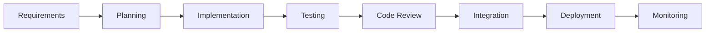

## 1.2 Why Delivery Matters

Imagine that a developer implements a working feature.

However:

- The changes are not committed.
- The build fails on another machine.
- The database migration is missing.
- Production environment variables are incorrect.
- No rollback procedure exists.

The feature may work locally but still be unsuitable for release.

> [!important]
> Software delivery requires reproducible builds, verified behavior, and controlled changes—not just working code.

---

# Part III — Git Fundamentals

## 2. What Is Git?

Git is a distributed version control system.

It tracks changes to files over time.

Git allows developers to:

- Maintain project history.
- Work on separate branches.
- Compare changes.
- Restore earlier versions.
- Collaborate.
- Review contributions.

## 2.1 Git vs GitHub

| Git | GitHub |
|---|---|
| Version control system | Repository hosting and collaboration platform |
| Tracks commits locally | Hosts remote repositories |
| Supports branches | Supports pull requests |
| Manages file history | Provides collaboration workflows |
| Works without internet | Remote features require connectivity |

## 2.2 Mental Model

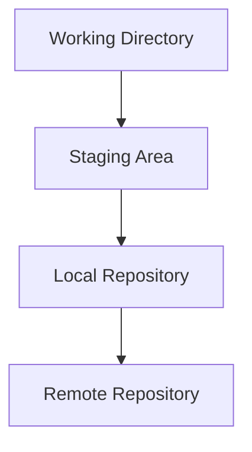

Each layer has a different purpose.

---

# Part IV — Git's Three Main Areas

## 3. Working Directory

The working directory contains the files currently being edited.

Example:

```text
GroupTrack/
├── app/
├── docs/
├── AGENTS.md
└── settings.gradle
```

Editing `TasksActivity.java` changes the working directory.

## 3.1 Staging Area

The staging area contains changes selected for the next commit.

Example:

```powershell
git add app/src/main/java/com/example/grouptrack/tasks/ui/TasksActivity.java
```

This stages the specified file.

## 3.2 Local Repository

The local repository stores committed project history.

Example:

```powershell
git commit -m "fix: correct task empty state"
```

## 3.3 Remote Repository

A remote repository enables collaboration and backup through a hosting service.

Example:

```powershell
git push origin main
```

This pushes local commits to the remote `main` branch, assuming the operation is permitted and the branch is configured.

## 3.4 Important

Staging is not committing.

Committing is not pushing.

Pushing is not necessarily deploying.

---

# Part V — The git-workflow-and-versioning Skill

## 4. Purpose

The `git-workflow-and-versioning` skill establishes disciplined version control practices for AI coding agents.

Its major themes include:

- Trunk-based development.
- Atomic commits.
- Small changes.
- Commit-as-save-point.
- Clear history.
- Safe collaboration.

## 4.1 When to Use

Use this skill whenever an agent:

- Modifies project files.
- Implements a feature.
- Fixes a bug.
- Refactors code.
- Prepares a pull request.
- Organizes commits.
- Integrates changes.

## 4.2 General Workflow

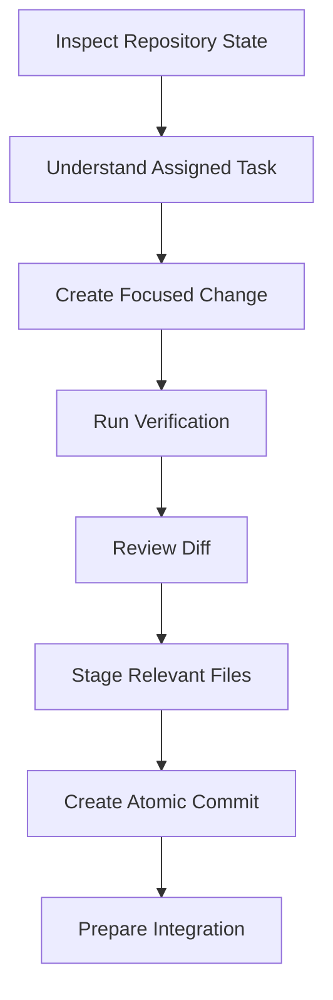

> [!important]
> An AI agent should inspect the existing working tree before making changes. It must not assume every uncommitted file belongs to its current task.

---

# Part VI — Atomic Commits

## 5. What Is an Atomic Commit?

An atomic commit represents one coherent logical change.

It should be understandable and independently reviewable.

Examples:

```text
feat: add task status filter

fix: prevent duplicate join requests

test: cover schedule conflict validation

docs: clarify project membership rules
```

## 5.1 Poor Commit

```text
update everything
```

This message does not explain what changed.

## 5.2 Better Commit

```text
fix: correct completed task contribution count
```

This identifies the type and purpose of the change.

## 5.3 Atomic Commit Principles

A commit should:

1. Represent a coherent change.
2. Avoid unrelated modifications.
3. Have a meaningful message.
4. Preserve repository consistency where practical.
5. Be small enough to review.

## 5.4 Example

Suppose an agent is implementing GroupTrack's Members page.

Possible commits:

```text
feat: add project member query

feat: render grouped member list

test: verify completed task counts
```

The precise boundaries depend on whether each commit forms a valid, independently understandable checkpoint.

---

# Part VII — Conventional Commits

## 6. What Are Conventional Commits?

Conventional Commits is a naming convention for commit messages.

Basic structure:

```text
<type>: <description>
```

Common types:

| Type | Purpose |
|---|---|
| feat | New feature |
| fix | Bug fix |
| docs | Documentation |
| refactor | Internal restructuring |
| test | Test changes |
| chore | Maintenance |
| build | Build configuration |
| ci | CI configuration |
| perf | Performance improvement |

## 6.1 Examples

```powershell
git commit -m "feat: add project task filters"
```

```powershell
git commit -m "fix: handle missing GPS updates"
```

```powershell
git commit -m "test: cover product validation"
```

## 6.2 Important

Conventional Commits is optional unless required by the project.

Consistency is more important than adopting a convention without understanding it.

---

# Part VIII — Commit-as-Save-Point

## 7. What Is Commit-as-Save-Point?

The commit-as-save-point pattern treats a verified commit as a reliable checkpoint during development.

Instead of implementing an entire feature before committing, an agent works through smaller verified changes.

## 7.1 Workflow

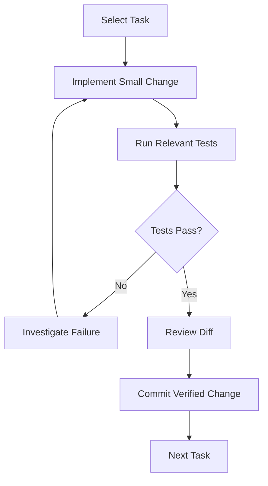

## 7.2 Benefits

- Easier debugging.
- Smaller review units.
- Clearer history.
- Safer recovery.
- Better progress tracking.

## 7.3 Important

A commit is a checkpoint, not proof that every requirement has been satisfied.

Verification evidence remains necessary.

---

# Part IX — Trunk-Based Development

## 8. What Is Trunk-Based Development?

Trunk-based development is a version control approach where developers integrate small changes frequently into a shared mainline branch.

The mainline is often named:

```text
main
```

## 8.1 Typical Structure

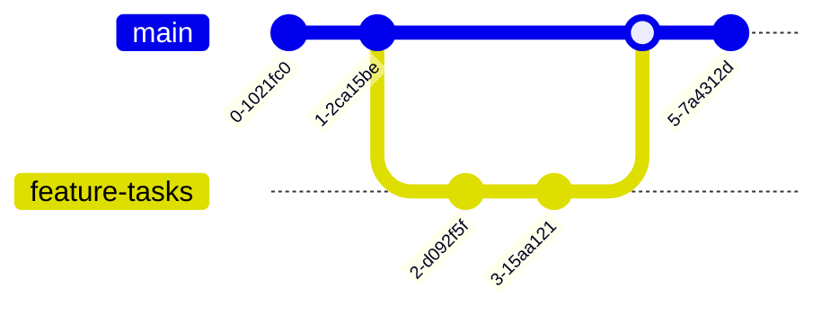

## 8.2 Characteristics

- Short-lived branches.
- Frequent integration.
- Small changes.
- Automated testing.
- Strong mainline stability.

## 8.3 Benefits

Frequent integration reduces the distance between branches.

This can reduce merge conflicts and integration surprises.

## 8.4 Important

Trunk-based development does not mean pushing untested code directly into production.

Mainline protection and automated quality gates remain important.

---

# Part X — Branching Strategies

## 9. Common Strategies

### Feature Branching

Each feature is developed in a separate branch.

Example:

```text
main
 ├── feature/member-page
 ├── feature/task-filter
 └── fix/login-validation
```

### Trunk-Based Development

Developers use short-lived branches and integrate frequently.

### GitFlow

GitFlow uses more structured long-lived branches, commonly including development and release branches.

## 9.1 Comparison

| Strategy | Advantages | Tradeoffs |
|---|---|---|
| Feature branching | Isolated development | Long-lived branches may diverge |
| Trunk-based | Frequent integration | Requires disciplined testing |
| GitFlow | Structured release management | More branching complexity |

## 9.2 Recommendation for Small Projects

For a small student or startup project, short-lived feature branches with a protected `main` branch are often sufficient.

Avoid introducing complex branching policies unless the project requires them.

---

# Part XI — Safe Git Operations

## 10. Inspect Before Modifying

Useful commands:

```powershell
git status
```

```powershell
git diff
```

```powershell
git branch
```

```powershell
git log --oneline -5
```

These help establish repository state.

## 10.1 Inspecting Staged Changes

```powershell
git diff --cached
```

This displays changes selected for the next commit.

## 10.2 Why Inspection Matters

An AI agent may encounter:

- Existing user modifications.
- Untracked documentation.
- Changes from another developer.
- Generated files.
- Incomplete work.

It should not overwrite or discard those changes without authorization.

## 10.3 Dangerous Operations

Some Git commands can permanently discard local work if used incorrectly.

Examples include forceful resets and cleanup operations.

The correct approach is to understand their consequences and obtain authorization before performing destructive operations.

> [!warning]
> Never use destructive Git operations simply to make a working tree appear clean.

---

# Part XII — Pull Requests

## 11. What Is a Pull Request?

A pull request proposes integrating changes from one branch into another.

It provides a place to:

- Review code.
- Discuss implementation decisions.
- Run automated checks.
- Request corrections.
- Approve integration.

## 11.1 Pull Request Lifecycle

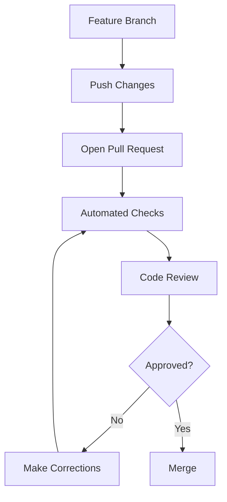

## 11.2 Good Pull Request Description

A useful pull request explains:

1. What changed.
2. Why it changed.
3. How it was tested.
4. Which risks remain.
5. Whether deployment considerations exist.

## 11.3 Example

```markdown
# Add GroupTrack Member Contribution Display

## Summary
Display completed-task contribution counts
for project members.

## Scope
- Member contribution query
- Members page display
- Relevant tests

## Verification
- Unit tests
- Android build
- Manual UI verification

## Risks
Contribution counts depend on task status
and project membership data.

## Out of Scope
- New analytics features
- Notification changes
```

Verification entries must reflect actual completed checks.

---

# Part XIII — Merge Readiness

## 12. When Is Code Ready to Merge?

A change is ready for integration when it satisfies the project's quality gates.

Typical requirements:

- Acceptance criteria satisfied.
- Tests pass.
- Build succeeds.
- Review findings resolved.
- Security checks completed where relevant.
- Documentation updated.
- No unrelated modifications.

## 12.1 Merge Readiness Diagram

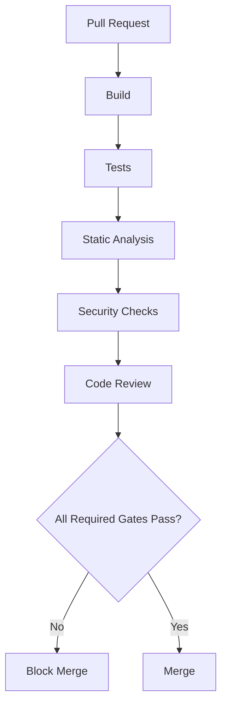

## 12.2 Important

A green CI pipeline is strong evidence, but it does not prove the absence of all defects.

---

# Part XIV — Semantic Versioning

## 13. What Is Semantic Versioning?

Semantic Versioning is a version numbering convention.

Format:

```text
MAJOR.MINOR.PATCH
```

Example:

```text
2.4.1
```

## 13.1 Components

**MAJOR**

Incremented for incompatible changes to a public API.

**MINOR**

Incremented for backward-compatible functionality.

**PATCH**

Incremented for backward-compatible bug fixes.

## 13.2 Example

```text
1.0.0 → Initial stable release

1.1.0 → New backward-compatible feature

1.1.1 → Backward-compatible bug fix

2.0.0 → Breaking public API change
```

## 13.3 Important

Semantic Versioning is most meaningful when a project defines a public API and compatibility expectations.

Not every internal student project needs a complex versioning policy.

---

# Part XV — Introduction to CI/CD

## 14. What Is CI/CD?

CI/CD refers to practices and automation that help teams integrate, verify, and deliver software changes reliably.

CI stands for:

**Continuous Integration**

CD may refer to:

- Continuous Delivery.
- Continuous Deployment.

These are related but distinct concepts.

---

# Part XVI — Continuous Integration

## 15. What Is Continuous Integration?

Continuous Integration is the practice of integrating changes frequently and verifying them through automated checks.

Typical CI activities include:

- Installing dependencies.
- Compiling code.
- Running tests.
- Checking formatting.
- Running static analysis.
- Checking dependencies.

## 15.1 CI Workflow

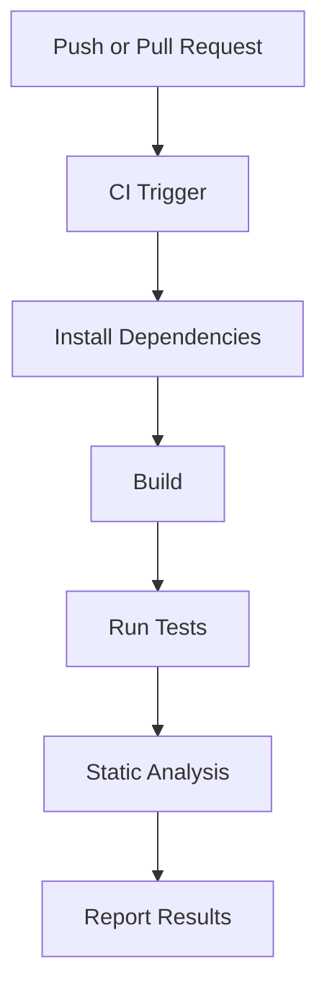

## 15.2 Benefits

CI provides:

- Faster feedback.
- Earlier defect detection.
- Consistent verification.
- Reduced integration risk.
- Repeatable build procedures.

## 15.3 Important

CI should run in a clean environment rather than relying on hidden local machine configuration.

---

# Part XVII — Continuous Delivery vs Deployment

## 16. Continuous Delivery

Continuous Delivery keeps software in a state where it can be released reliably.

A human approval step may still be required before production deployment.

## 16.1 Continuous Deployment

Continuous Deployment automatically releases qualifying changes after required checks pass.

## 16.2 Comparison

| Practice | Main Goal | Production Release |
|---|---|---|
| Continuous Integration | Verify integrated changes | Not required |
| Continuous Delivery | Keep software release-ready | May require approval |
| Continuous Deployment | Automatically release approved changes | Automated |

## 16.3 Important

Continuous deployment is not automatically the best choice for every application.

The appropriate approach depends on risk, team maturity, and operational requirements.

---

# Part XVIII — The ci-cd-and-automation Skill

## 17. Purpose

The `ci-cd-and-automation` skill helps agents design reliable build, test, and deployment workflows.

Important themes include:

- Shift Left.
- Faster Is Safer.
- Automated quality gates.
- Feature flags.
- Fast feedback loops.
- Reliable deployment pipelines.

## 17.1 When to Use

Use the skill when:

- Creating CI pipelines.
- Modifying build automation.
- Adding automated tests.
- Establishing merge checks.
- Improving deployment workflows.
- Reducing manual verification.

## 17.2 Core Principle

> Automate repeatable verification so problems are detected early and consistently.

---

# Part XIX — Shift Left

## 18. What Does Shift Left Mean?

Shift Left means performing quality and security activities earlier in the development lifecycle.

Instead of discovering defects immediately before deployment, teams identify them during implementation.

## 18.1 Traditional Approach

```text
Implement
    ↓
Integrate
    ↓
Prepare Release
    ↓
Test
    ↓
Discover Problems
```

## 18.2 Shift-Left Approach

```text
Requirements
    ↓
Define Acceptance Tests
    ↓
Implement
    ↓
Run Automated Checks
    ↓
Review
    ↓
Release
```

## 18.3 Benefits

- Earlier feedback.
- Lower correction costs.
- Fewer late-stage surprises.
- Better confidence in changes.

## 18.4 Important

Shift Left does not eliminate the need for production monitoring and post-deployment verification.

---

# Part XX — Faster Is Safer

## 19. Understanding the Principle

The Faster Is Safer principle emphasizes that small, frequently verified changes can be safer than large, infrequent releases.

The idea is not to rush development.

It is to reduce the amount of unverified work accumulating between feedback cycles.

## 19.1 Comparison

### Large Release

```text
50 changes
    ↓
One integration event
    ↓
Many possible failure sources
```

### Small Releases

```text
Small change
    ↓
Verify
    ↓
Integrate
    ↓
Repeat
```

## 19.2 Benefits

- Easier debugging.
- Smaller rollback scope.
- Faster review.
- More predictable releases.

## 19.3 Important

Release frequency should match the system's risk profile and operational capabilities.

---

# Part XXI — Automated Quality Gates

## 20. What Is a Quality Gate?

A quality gate is a condition that must be satisfied before work advances to the next stage.

Examples:

- Tests must pass.
- Build must succeed.
- Lint checks must pass.
- Security findings must be addressed.
- Required reviewers must approve.

## 20.1 Pipeline Example

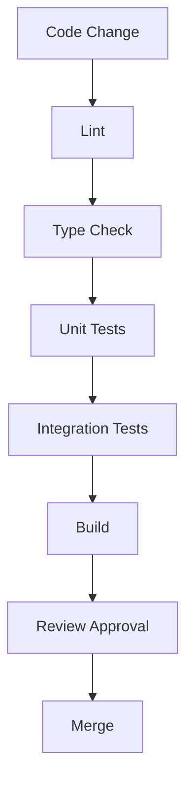

## 20.2 Important

Quality gates should be meaningful and maintainable.

An excessively complicated pipeline can slow development without improving reliability.

---

# Part XXII — Understanding GitHub Actions

## 21. What Is GitHub Actions?

GitHub Actions is an automation platform commonly used to run CI/CD workflows for GitHub repositories.

A workflow is typically defined using YAML.

Common location:

```text
.github/workflows/
```

## 21.1 Basic Structure

```text
Repository
└── .github/
    └── workflows/
        └── ci.yml
```

## 21.2 Main Concepts

| Concept | Meaning |
|---|---|
| Workflow | Automated process |
| Event | Trigger |
| Job | Group of steps |
| Step | Individual operation |
| Runner | Environment executing the job |
| Artifact | Output retained from a workflow |

## 21.3 Common Triggers

- Push.
- Pull request.
- Manual execution.
- Scheduled execution.

---

# Part XXIII — Example Next.js CI Pipeline

## 22. Illustrative Workflow

```yaml
name: Frontend CI

on:
  pull_request:
  push:
    branches:
      - main

jobs:
  verify:
    runs-on: ubuntu-latest

    steps:
      - name: Checkout repository
        uses: actions/checkout@v4

      - name: Set up Node.js
        uses: actions/setup-node@v4
        with:
          node-version: "24"
          cache: npm

      - name: Install dependencies
        run: npm ci

      - name: Run lint
        run: npm run lint

      - name: Build application
        run: npm run build
```

## 22.1 Explanation

**Checkout**

Retrieves repository files.

**Set up Node.js**

Installs the selected Node.js version.

**Install dependencies**

Uses the lockfile for reproducible dependency installation.

**Lint**

Checks code against configured linting rules.

**Build**

Verifies that the frontend can compile for production.

## 22.2 Important

This example assumes:

- The workflow runs from the frontend project root.
- A compatible lockfile exists.
- The `lint` and `build` scripts are defined.

For a repository containing separate `frontend/` and `backend/` directories, configure the working directory appropriately.

Actual action versions and runtime requirements should be checked against current official documentation.

---

# Part XXIV — Example Laravel CI Pipeline

## 23. Illustrative Workflow

```yaml
name: Laravel CI

on:
  pull_request:
  push:
    branches:
      - main

jobs:
  test:
    runs-on: ubuntu-latest

    steps:
      - name: Checkout repository
        uses: actions/checkout@v4

      - name: Set up PHP
        uses: shivammathur/setup-php@v2
        with:
          php-version: "8.2"
          extensions: mbstring, pdo_sqlite
          coverage: none

      - name: Install dependencies
        run: composer install --no-interaction --prefer-dist

      - name: Prepare environment
        run: |
          cp .env.example .env
          php artisan key:generate

      - name: Run tests
        env:
          DB_CONNECTION: sqlite
          DB_DATABASE: ":memory:"
        run: php artisan test
```

## 23.1 Explanation

This workflow demonstrates:

- PHP environment setup.
- Composer dependency installation.
- Application environment preparation.
- Automated test execution.

## 23.2 Important

This is an educational example.

It assumes the application and tests support SQLite.

For a PostgreSQL-dependent application, the pipeline may need a PostgreSQL service container and suitable test configuration.

The CI environment should match important production behaviors.

---

# Part XXV — Android CI Concepts

## 24. Android Build Verification

An Android project may use Gradle to perform automated verification.

Common checks include:

- Java compilation.
- Unit tests.
- Android lint.
- Debug APK build.

## 24.1 Example Commands

```powershell
.\gradlew.bat testDebugUnitTest
```

```powershell
.\gradlew.bat lintDebug
```

```powershell
.\gradlew.bat assembleDebug
```

These commands are illustrative and depend on the project's Gradle configuration.

## 24.2 Android CI Pipeline

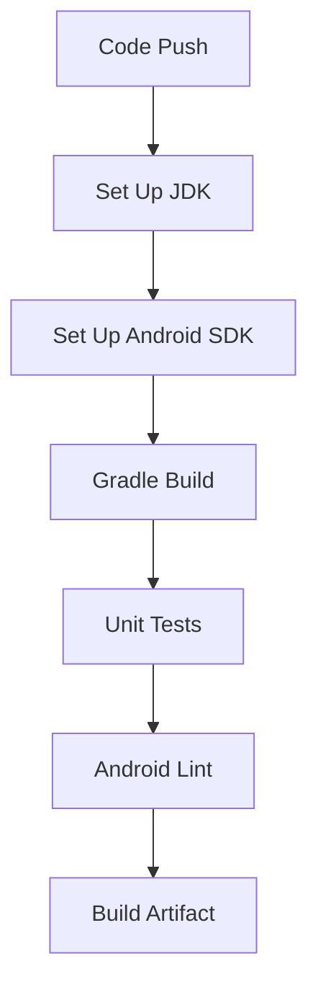

## 24.3 Important

Android instrumentation tests generally require an emulator or connected device.

They are not equivalent to local JVM unit tests.

---

# Part XXVI — Build Artifacts

## 25. What Is a Build Artifact?

A build artifact is an output produced during a build process.

Examples:

- Android APK.
- Android App Bundle.
- Compiled frontend assets.
- Packaged application.
- Test reports.

## 25.1 Why Artifacts Matter

Artifacts can support:

- Testing.
- Deployment.
- Release tracking.
- Debugging.
- Reproducibility.

## 25.2 Important

A successful artifact build does not automatically prove the application is secure or functionally correct.

---

# Part XXVII — Dependency Checks

## 26. Why Audit Dependencies?

Dependencies can introduce:

- Known vulnerabilities.
- Compatibility issues.
- Unsupported packages.
- Unexpected transitive dependencies.

## 26.1 Example Commands

For Node.js:

```powershell
npm audit
```

For Composer:

```powershell
composer audit
```

## 26.2 CI Integration

Dependency checks may be included in automated pipelines.

However, teams should establish policies for interpreting and prioritizing findings.

## 26.3 Important

Avoid automatically applying major dependency upgrades without checking compatibility and testing the result.

---

# Part XXVIII — CI Failure Feedback Loops

## 27. What Happens When CI Fails?

A failed pipeline should trigger investigation.

The recommended workflow is:

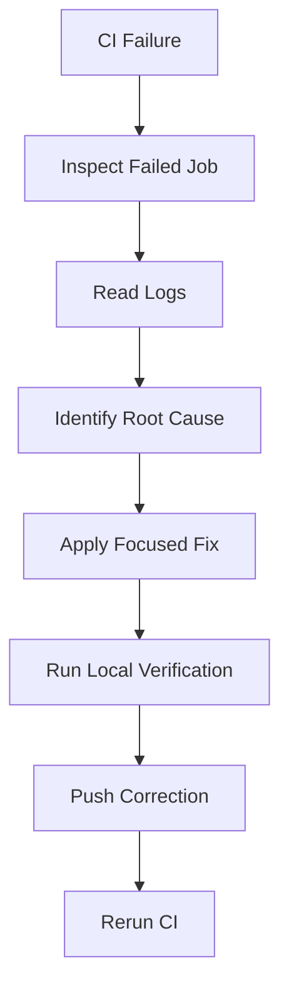

## 27.1 Common Causes

- Missing dependencies.
- Incorrect runtime version.
- Failing tests.
- Environment differences.
- Missing configuration.
- Build errors.

## 27.2 Important

Do not remove tests or disable quality checks merely to make the pipeline green.

---

# Part XXIX — The shipping-and-launch Skill

## 28. Purpose

The `shipping-and-launch` skill provides a structured approach to preparing software for release.

Its main themes include:

- Pre-launch checklists.
- Feature flag management.
- Staged rollouts.
- Rollback planning.
- Monitoring.
- Release readiness.

## 28.1 When to Use

Use this skill when:

- Preparing a production deployment.
- Releasing a new application version.
- Launching a significant feature.
- Planning a migration.
- Coordinating a rollout.
- Establishing rollback procedures.

## 28.2 Important

Shipping is a controlled engineering activity, not simply uploading application files.

---

# Part XXX — Deployment vs Release

## 29. What Is Deployment?

Deployment places a software version into an environment.

## 29.1 What Is Release?

Release makes functionality available to intended users.

These events can occur at different times.

## 29.2 Example

A new feature is deployed but hidden behind a disabled feature flag.

Later, the flag is enabled for approved users.

The deployment and release are separate events.

## 29.3 Comparison

| Deployment | Release |
|---|---|
| Software is installed or activated in an environment | Functionality becomes available |
| Infrastructure-oriented | User-facing |
| May be invisible to users | Usually changes user experience |

---

# Part XXXI — Development Environments

## 30. Common Environments

### Development

Used for implementing and debugging changes.

### Testing

Used for automated or manual verification.

### Staging

Designed to resemble production closely enough to validate release behavior.

### Production

The environment used by actual users.

## 30.1 Diagram

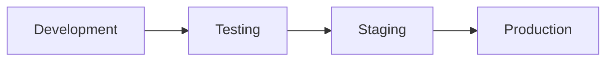

## 30.2 Important

Not every project requires four separate environments.

The appropriate setup depends on complexity, resources, and risk.

---

# Part XXXII — Environment Configuration

## 31. Why Configuration Matters

Different environments may use different:

- Database connections.
- API endpoints.
- Authentication settings.
- Storage services.
- Logging levels.
- External integrations.

## 31.1 Example

```text
Development:
Local Laravel API

Staging:
Test Laravel API

Production:
Production Laravel API
```

## 31.2 Important

Production secrets must not be committed to source control.

Sensitive configuration should be managed through appropriate deployment mechanisms.

---

# Part XXXIII — Feature Flags

## 32. What Is a Feature Flag?

A feature flag is a mechanism that controls whether functionality is enabled.

Example:

```text
FEATURE_NEW_DASHBOARD = false
```

The feature may exist in deployed code while remaining disabled.

## 32.1 Benefits

- Controlled rollout.
- Easier experimentation.
- Reduced release risk.
- Faster disabling of problematic features.

## 32.2 Feature Flag Lifecycle

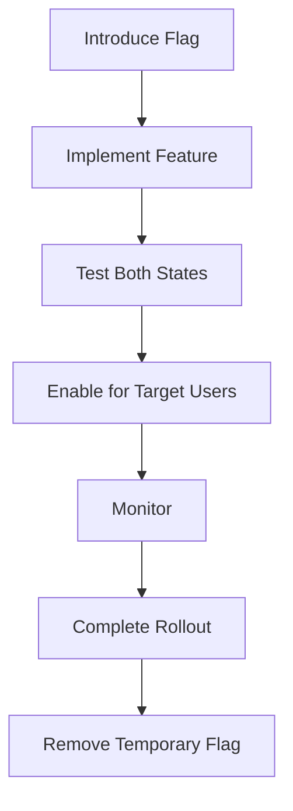

## 32.3 Important

Feature flags should not become permanent unnecessary complexity.

Temporary flags should have a clear removal plan.

---

# Part XXXIV — Staged Rollouts

## 33. What Is a Staged Rollout?

A staged rollout releases software to progressively larger groups rather than everyone simultaneously.

Example:

```text
Internal Testers
      ↓
Small User Group
      ↓
Larger User Group
      ↓
General Availability
```

## 33.1 Benefits

- Earlier detection of production issues.
- Smaller initial impact.
- Opportunity to monitor.
- Easier release decisions.

## 33.2 Important

Rollout stages and percentages should be chosen according to the system's requirements and operational capabilities.

---

# Part XXXV — Rollback Strategies

## 34. What Is Rollback?

Rollback restores a previously known-good application state after a problematic release.

Possible approaches include:

- Reverting a deployment.
- Disabling a feature flag.
- Restoring a prior application version.
- Executing an approved recovery procedure.

## 34.1 Rollback Workflow

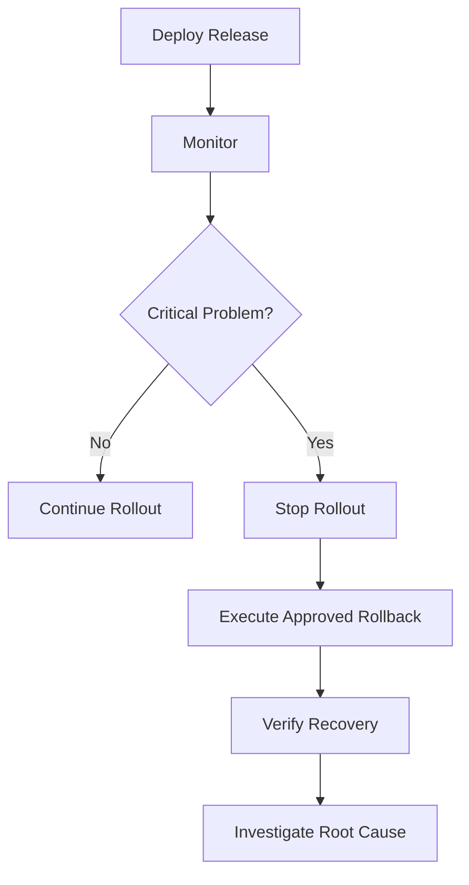

## 34.2 Important

Database migrations can complicate rollback.

A previous application version may not be compatible with a newly modified database schema.

Release planning should account for this risk.

---

# Part XXXVI — Database Migration Safety

## 35. Why Migrations Need Planning

Database changes may affect:

- Existing records.
- Application compatibility.
- Performance.
- Data integrity.
- Rollback feasibility.

## 35.1 Expand-and-Contract

Expand-and-contract is a migration strategy that separates compatible schema additions from later removal of old structures.

Conceptual sequence:

1. Add a compatible structure.
2. Update application behavior.
3. Migrate data when required.
4. Verify compatibility.
5. Remove obsolete structures in a later controlled change.

## 35.2 Example

Suppose a field must be renamed.

Immediately removing the old field may break an older application version.

A phased migration may allow both versions to operate during transition.

## 35.3 Important

Migration plans should include backups, compatibility checks, and authorized recovery procedures where appropriate.

---

# Part XXXVII — Monitoring After Deployment

## 36. Why Monitoring Matters

Testing cannot reproduce every production condition.

Monitoring helps detect problems after release.

Common signals include:

- Error rates.
- Response times.
- Request volume.
- Service availability.
- Database performance.
- Application crashes.

## 36.1 Monitoring Workflow

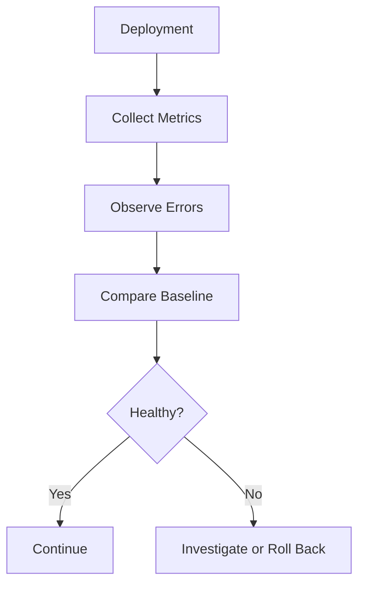

## 36.2 Important

Monitoring should focus on meaningful application behavior, not simply whether the server process is running.

---

# Part XXXVIII — Release Documentation

## 37. What Are Release Notes?

Release notes summarize changes included in a software version.

They may include:

- New features.
- Bug fixes.
- Improvements.
- Known limitations.
- Migration requirements.

## 37.1 Example

```markdown
# GroupTrack v1.1.0

## Added
- Members page contribution display

## Fixed
- Task empty-state handling

## Improved
- Task list loading feedback

## Known Limitations
- Features remain limited to the approved MVP scope
```

This is an illustrative release note, not a record of an actual release.

## 37.2 Important

Release notes should accurately describe shipped behavior.

---

# Part XXXIX — Shipping Checklist

## 38. Pre-Release Checklist

### Requirements

- [ ] Approved scope is complete.
- [ ] Acceptance criteria are satisfied.
- [ ] Known limitations are documented.

### Code Quality

- [ ] Code review is complete.
- [ ] Blocking findings are resolved.
- [ ] Unrelated changes are excluded.

### Testing

- [ ] Relevant unit tests pass.
- [ ] Integration tests pass.
- [ ] Build succeeds.
- [ ] Critical user flows are verified.

### Security

- [ ] Authorization is reviewed.
- [ ] Sensitive configuration is protected.
- [ ] Relevant dependency risks are evaluated.

### Deployment

- [ ] Environment configuration is verified.
- [ ] Database changes are reviewed.
- [ ] Rollback plan exists.
- [ ] Deployment responsibilities are clear.

### Monitoring

- [ ] Relevant health signals are available.
- [ ] Error reporting is configured.
- [ ] Post-release verification is planned.

---

# Part XL — GroupTrack Case Study

## 39. Android Release Workflow

### Project Context

GroupTrack is an Android student project using Java and Firebase.

The goal is to deliver its approved MVP reliably.

## 39.1 Suggested Workflow

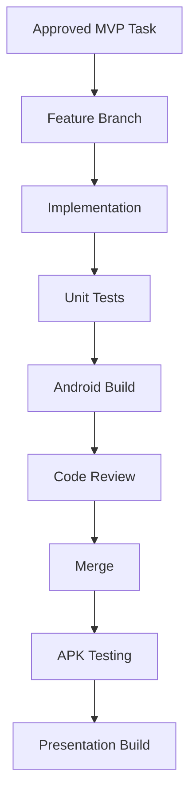

## 39.2 Relevant Checks

- Java compilation.
- Gradle build.
- Unit tests.
- Android lint.
- Emulator testing.
- Physical-device testing.
- Firebase access verification.

## 39.3 Release Considerations

For a school presentation:

- Confirm the application launches.
- Verify authentication.
- Verify approved MVP workflows.
- Test on the intended demonstration device.
- Prepare an authorized backup demonstration plan.
- Avoid last-minute unrelated features.

## 39.4 Important

A student project does not need an enterprise deployment architecture.

Use only the delivery practices that meaningfully support the project's scope.

---

# Part XLI — GoPasig Case Study

## 40. Laravel Fleet Management Release

### Project Context

GoPasig includes:

- Bus tracking.
- ETA calculations.
- Route management.
- Driver scheduling.
- Administrative operations.

## 40.1 Delivery Risks

Potential concerns include:

- Stale GPS information.
- Incorrect route assignments.
- Schedule conflicts.
- Database migration compatibility.
- Unauthorized administrative operations.

## 40.2 Suggested Pipeline

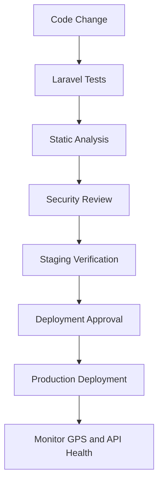

## 40.3 Pre-Deployment Checks

- Route data is available.
- Schedule validation is tested.
- Database migrations are reviewed.
- Authentication and permissions work.
- ETA behavior is verified using representative data.
- Stale-location behavior is handled appropriately.

## 40.4 Important

Transportation-related information should not be presented as current when the underlying location data is stale.

---

# Part XLII — Next.js + Laravel E-commerce Case Study

## 41. Full-Stack Delivery

### Architecture

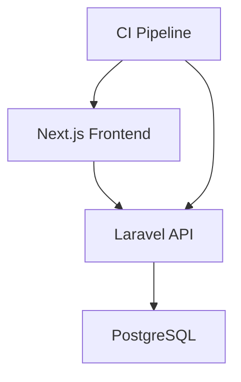

## 41.1 Frontend Checks

- Lint.
- Type checking.
- Production build.
- Relevant component tests.
- API integration verification.

## 41.2 Backend Checks

- PHP dependency installation.
- Laravel tests.
- Database integration tests.
- Authorization tests.
- Validation tests.

## 41.3 Deployment Sequence

A conceptual sequence:

1. Verify the backend.
2. Verify the frontend.
3. Review database compatibility.
4. Prepare environment configuration.
5. Deploy compatible changes.
6. Run smoke tests.
7. Monitor application behavior.

## 41.4 Important

The actual deployment order depends on compatibility requirements.

Avoid assuming the frontend must always deploy before or after the backend.

---

# Part XLIII — Agentic Git Workflow

## 42. How Codex Should Handle Changes

An AI coding agent should:

1. Inspect repository status.
2. Read project instructions.
3. Understand the approved task.
4. Identify relevant files.
5. Implement a focused change.
6. Run relevant tests.
7. Review the diff.
8. Stage only related files.
9. Create a commit when authorized.
10. Report the result.

## 42.1 Example Codex Prompt

```text
Use the git-workflow-and-versioning skill.

PROJECT:
GroupTrack Android.

TASK:
Prepare the completed Members page change
for version control.

INSTRUCTIONS:

1. Read AGENTS.md.
2. Inspect git status.
3. Identify files related to the task.
4. Review the diff.
5. Check for unrelated modifications.
6. Verify relevant tests and build results.
7. Propose an atomic commit.
8. Explain the commit scope.

CONSTRAINTS:
- Preserve unrelated user changes.
- Do not stage unrelated files.
- Do not rewrite history.
- Do not force-push.
- Do not commit secrets.

Do not create the commit until approved.

OUTPUT:
- Relevant files
- Verification results
- Proposed commit message
- Risks
```

---

# Part XLIV — Agentic CI/CD Workflow

## 43. Example Codex Prompt

```text
Use the ci-cd-and-automation skill.

PROJECT:
Next.js frontend and Laravel backend.

TASK:
Design a minimal CI workflow.

REQUIREMENTS:

Frontend:
- Install dependencies
- Run lint
- Run type checking where configured
- Build application

Backend:
- Install Composer dependencies
- Prepare test environment
- Run Laravel tests

INSTRUCTIONS:

1. Inspect existing project scripts.
2. Inspect runtime requirements.
3. Inspect repository structure.
4. Identify existing CI configuration.
5. Propose a minimal pipeline.
6. Explain each quality gate.
7. Identify required configuration.
8. Document assumptions.

CONSTRAINTS:
- Avoid unnecessary services.
- Do not expose secrets.
- Do not invent commands.
- Do not disable failing tests.
- Do not deploy automatically.

OUTPUT:
- Proposed workflow
- Required dependencies
- Verification plan
- Risks

Planning only.
```

---

# Part XLV — Agentic Shipping Workflow

## 44. Example Codex Prompt

```text
Use the shipping-and-launch skill.

PROJECT:
GoPasig Laravel application.

TASK:
Prepare a release-readiness assessment.

INSTRUCTIONS:

1. Read project documentation.
2. Review the approved release scope.
3. Inspect current Git status.
4. Review relevant tests.
5. Check build readiness.
6. Review environment requirements.
7. Identify database migration risks.
8. Review security-sensitive changes.
9. Define post-deployment smoke tests.
10. Propose a rollback strategy.
11. Identify monitoring requirements.

BOUNDARIES:
- Do not deploy.
- Do not access production systems.
- Do not modify production data.
- Do not execute migrations.
- Do not change credentials.

OUTPUT:
- Release checklist
- Verification evidence
- Blocking issues
- Remaining risks
- Deployment prerequisites
- Rollback considerations

Assessment only.
```

---

# Part XLVI — Common Git Anti-Patterns

## 45. Anti-Patterns

| Anti-Pattern | Problem | Better Approach |
|---|---|---|
| Huge commits | Difficult to review | Atomic commits |
| Vague messages | Unclear history | Descriptive messages |
| Long-lived branches | Integration conflicts | Frequent integration |
| Committing secrets | Security exposure | Secure configuration |
| Ignoring working tree | Risk of overwriting work | Inspect status first |
| Force-pushing shared branches | History disruption | Follow team policy |
| Mixing unrelated changes | Unclear scope | Focused commits |
| Committing generated clutter | Repository noise | Appropriate ignore rules |

---

# Part XLVII — Common CI/CD Anti-Patterns

## 46. Anti-Patterns

### 46.1 Disabling Tests to Pass CI

This removes evidence of correctness.

### 46.2 Ignoring Failed Pipelines

This allows defects to accumulate.

### 46.3 Excessive Pipeline Complexity

This increases maintenance without necessarily improving reliability.

### 46.4 Unpinned or Unreviewed Dependencies

This can introduce unexpected changes.

### 46.5 Secrets in Workflow Files

This creates unnecessary security exposure.

### 46.6 Production-Only Verification

This delays defect detection.

### 46.7 Automatic Deployment Without Recovery Planning

This increases operational risk.

---

# Part XLVIII — Common Shipping Anti-Patterns

## 47. Anti-Patterns

### 47.1 Deploying Without Verification

A local build is not sufficient evidence.

### 47.2 No Rollback Plan

Recovery becomes difficult during failures.

### 47.3 Ignoring Database Compatibility

Application versions may become incompatible with the schema.

### 47.4 No Monitoring

Failures may remain undetected.

### 47.5 Uncontrolled Feature Flags

Temporary complexity becomes permanent.

### 47.6 Last-Minute Scope Expansion

Unreviewed changes increase release risk.

---

# Part XLIX — Practical Exercises

> [!note]
> Theory-first exercises. No repository modification required.

## Exercise 1 — Version Control

Explain why version control is essential for collaborative software development.

## Exercise 2 — Git vs GitHub

Describe the differences between Git and GitHub.

## Exercise 3 — Git Areas

Explain the working directory, staging area, and local repository.

## Exercise 4 — Atomic Commits

Design three atomic commits for a task management feature.

## Exercise 5 — Commit Messages

Write five meaningful Conventional Commit messages.

## Exercise 6 — Commit-as-Save-Point

Explain how verified commits support incremental development.

## Exercise 7 — Branching

Compare trunk-based development and feature branching.

## Exercise 8 — Pull Requests

Write a pull request description for a completed Android feature.

## Exercise 9 — Merge Readiness

Create a merge readiness checklist.

## Exercise 10 — Semantic Versioning

Explain the meaning of MAJOR, MINOR, and PATCH.

## Exercise 11 — CI

Define Continuous Integration.

## Exercise 12 — CD

Explain Continuous Delivery and Continuous Deployment.

## Exercise 13 — Shift Left

Describe how early testing reduces delivery risk.

## Exercise 14 — Faster Is Safer

Explain why smaller verified releases can be safer.

## Exercise 15 — Quality Gates

Design quality gates for a Laravel API.

## Exercise 16 — GitHub Actions

Explain workflows, jobs, steps, events, and runners.

## Exercise 17 — Next.js CI

Design a minimal frontend verification pipeline.

## Exercise 18 — Laravel CI

Identify the requirements of a backend testing pipeline.

## Exercise 19 — Android CI

List appropriate automated checks for an Android project.

## Exercise 20 — Artifacts

Explain why build artifacts matter.

## Exercise 21 — Dependencies

Describe how dependency auditing fits into CI.

## Exercise 22 — CI Failures

Design a response workflow for a failed build.

## Exercise 23 — Shipping

Define release readiness.

## Exercise 24 — Deployment vs Release

Explain how feature flags separate deployment from release.

## Exercise 25 — Environments

Compare development, staging, and production.

## Exercise 26 — Configuration

Explain why secrets must remain outside source control.

## Exercise 27 — Feature Flags

Describe the lifecycle of a temporary feature flag.

## Exercise 28 — Staged Rollout

Design a gradual release strategy for a web application.

## Exercise 29 — Rollback

Explain the importance of a rollback plan.

## Exercise 30 — Database Migration

Describe the expand-and-contract strategy.

## Exercise 31 — Monitoring

Identify useful post-deployment health indicators.

## Exercise 32 — Release Notes

Draft release notes for a completed feature.

## Exercise 33 — GroupTrack

Design a Git and CI workflow for the Android MVP.

## Exercise 34 — GoPasig

Create a release checklist for route and schedule management.

## Exercise 35 — E-commerce

Design a combined frontend and backend CI strategy.

## Exercise 36 — Final Exercise

Create a complete software delivery plan for one approved project feature.

Include:

1. Project overview.
2. Feature scope.
3. Git branching strategy.
4. Atomic commit plan.
5. Commit naming convention.
6. Pull request requirements.
7. Code review process.
8. Automated quality gates.
9. Unit testing.
10. Integration testing.
11. Build verification.
12. Dependency checks.
13. Security checks.
14. Environment configuration.
15. Deployment prerequisites.
16. Database migration considerations.
17. Feature flag strategy.
18. Release strategy.
19. Rollback procedure.
20. Monitoring plan.
21. Smoke testing.
22. Release notes.
23. Remaining risks.
24. Definition of Done.
25. Final release approval criteria.

---

# Part L — Knowledge Check

1. What is version control?
2. What is the difference between Git and GitHub?
3. What is the staging area?
4. What is an atomic commit?
5. Why are descriptive commit messages important?
6. What is commit-as-save-point?
7. What is trunk-based development?
8. Why are short-lived branches useful?
9. What is a pull request?
10. What are merge quality gates?
11. What is Semantic Versioning?
12. What is Continuous Integration?
13. What is Continuous Delivery?
14. What is Continuous Deployment?
15. What is Shift Left?
16. What does Faster Is Safer mean?
17. What is a CI pipeline?
18. What is a GitHub Actions workflow?
19. What is a build artifact?
20. Why are dependency checks important?
21. How should CI failures be handled?
22. What is the shipping-and-launch skill?
23. What is the difference between deployment and release?
24. What is a staging environment?
25. What is a feature flag?
26. What is a staged rollout?
27. What is rollback?
28. Why are database migrations risky?
29. What is expand-and-contract?
30. Why is post-deployment monitoring important?
31. What are release notes?
32. Why should AI agents inspect Git status?
33. Why should unrelated files remain untouched?
34. What makes a release ready?
35. Why must verification claims reflect actual execution?

---

# Part LI — Key Takeaways

> [!summary]
> - Git tracks source code history.
> - GitHub supports remote collaboration and pull requests.
> - Atomic commits represent coherent changes.
> - Commit-as-save-point supports incremental development.
> - Trunk-based development emphasizes frequent integration.
> - Short-lived branches reduce integration complexity.
> - Pull requests support review and automated checks.
> - Merge readiness requires evidence.
> - CI verifies changes automatically.
> - Continuous Delivery keeps software release-ready.
> - Continuous Deployment automates production releases.
> - Shift Left encourages early verification.
> - Faster Is Safer favors small, verified changes.
> - Quality gates prevent unverified changes from advancing.
> - CI failures should trigger investigation.
> - Deployment and release are distinct activities.
> - Feature flags allow controlled feature availability.
> - Staged rollouts reduce initial release exposure.
> - Rollback plans support recovery.
> - Database changes require compatibility planning.
> - Monitoring verifies real-world application behavior.
> - Release notes communicate delivered changes.
> - AI agents must respect repository state and authorization boundaries.
> - Shipping is complete only when the release has been verified appropriately.

---

# Part LII — Final Mental Model

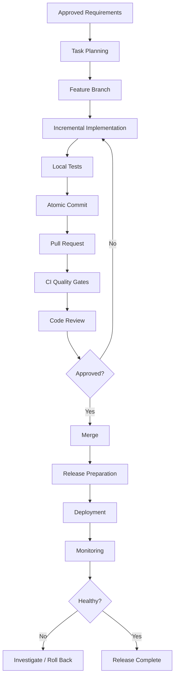

> [!important] Final Principle
> **Reliable software delivery is built on small changes, reproducible verification, controlled integration, and observable releases. AI coding agents should accelerate these practices—not bypass them.**

---

# Part LIII — Official References

## Primary Repository

- Agent Skills Repository: `https://github.com/addyosmani/agent-skills`
- Git Workflow and Versioning: `https://github.com/addyosmani/agent-skills/blob/main/skills/git-workflow-and-versioning/SKILL.md`
- CI/CD and Automation: `https://github.com/addyosmani/agent-skills/blob/main/skills/ci-cd-and-automation/SKILL.md`
- Shipping and Launch: `https://github.com/addyosmani/agent-skills/blob/main/skills/shipping-and-launch/SKILL.md`
- Incremental Implementation: `https://github.com/addyosmani/agent-skills/blob/main/skills/incremental-implementation/SKILL.md`

## Supporting Documentation

- Git Documentation: `https://git-scm.com/doc`
- GitHub Actions Documentation: `https://docs.github.com/en/actions`
- GitHub Pull Requests: `https://docs.github.com/en/pull-requests`
- Semantic Versioning: `https://semver.org`
- OpenAI Codex Documentation: `https://developers.openai.com/codex/`
- Laravel Deployment Documentation: `https://laravel.com/docs/12.x/deployment`
- Next.js Deployment Documentation: `https://nextjs.org/docs/app/getting-started/deploying`
- Android Build Documentation: `https://developer.android.com/build`

> [!note] Documentation Scope
> This lesson combines the repository's Git, CI/CD, and shipping principles with general software engineering practices.
>
> The example pipelines are educational starting points and must be adapted to actual project requirements.
>
> No local repositories were modified.
>
> No CI pipelines were executed.
>
> No application deployments were performed.

---

# Part LIV — Next Lesson

**[[13 - Agent Personas and Multi-Agent Collaboration]]**

Topics:

1. Agent personas fundamentals.
2. Specialist agents vs general-purpose agents.
3. Repository agent definitions.
4. Code reviewer persona.
5. Test engineer persona.
6. Security auditor persona.
7. Web performance auditor persona.
8. Multi-agent collaboration models.
9. Task delegation.
10. Context isolation.
11. Agent orchestration.
12. Parallel vs sequential execution.
13. Avoiding conflicting modifications.
14. Human approval boundaries.
15. Evidence consolidation.
16. Multi-agent anti-patterns.
17. Android, Laravel, and Next.js examples.
18. Practical exercises.
19. Official references.

**End of Lesson 12 — Git Workflows, CI/CD, and Shipping.**
