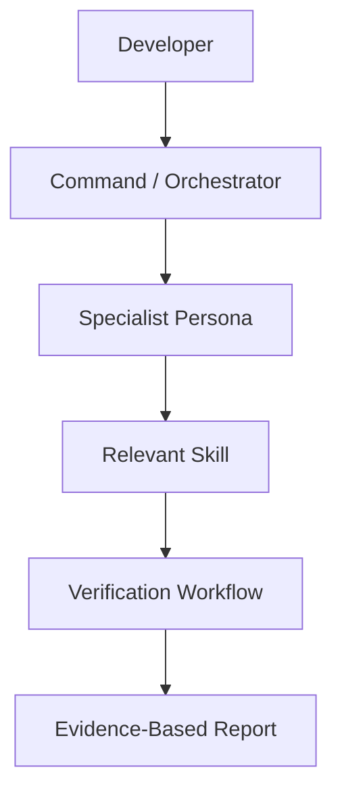
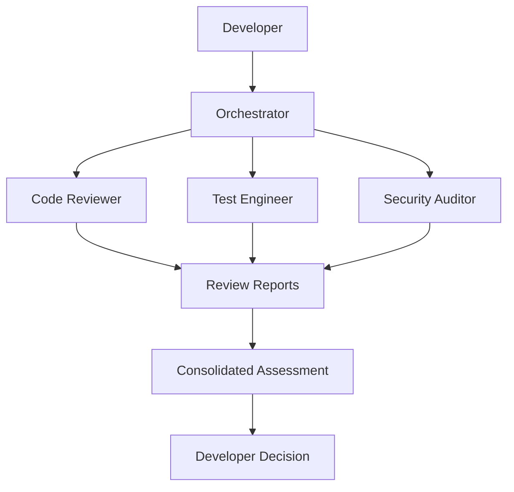
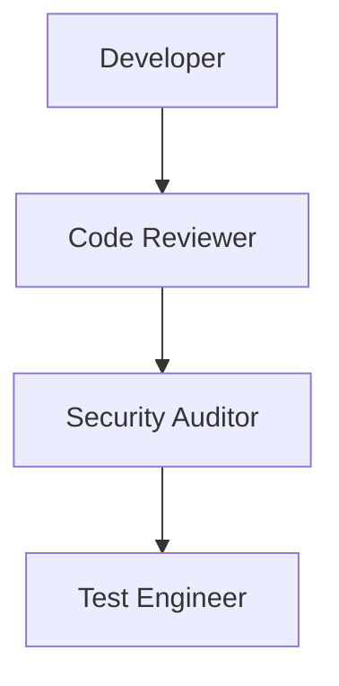
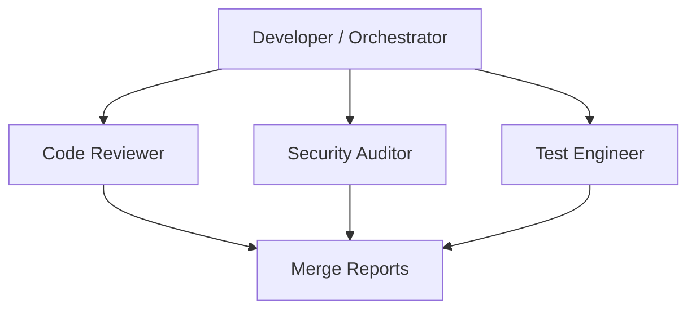
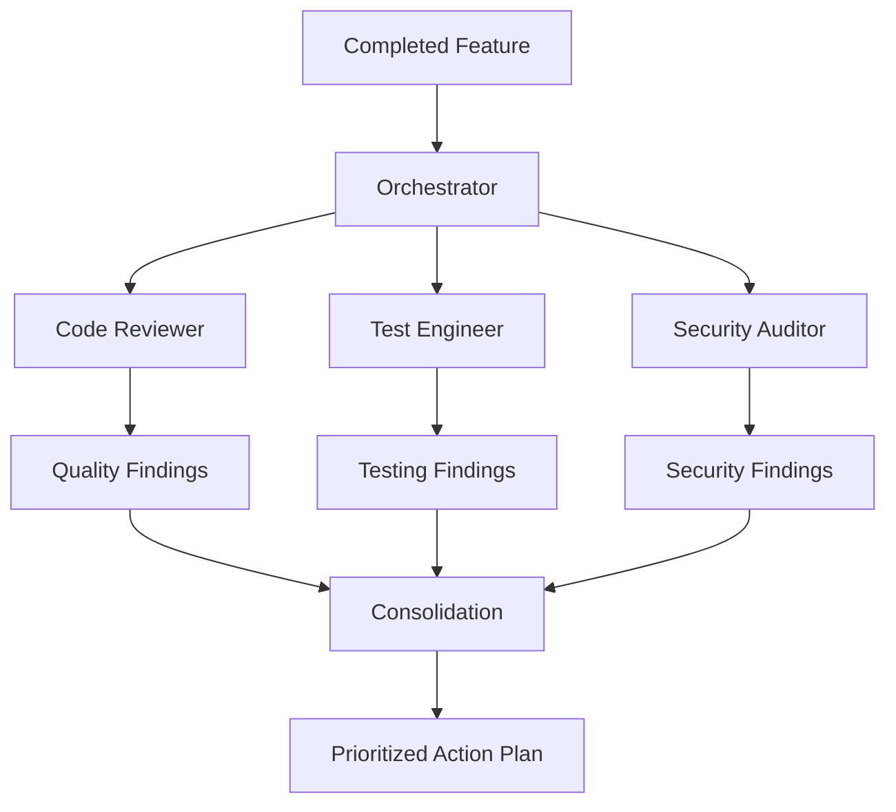
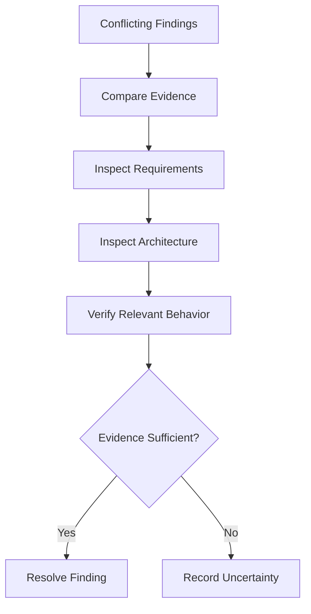
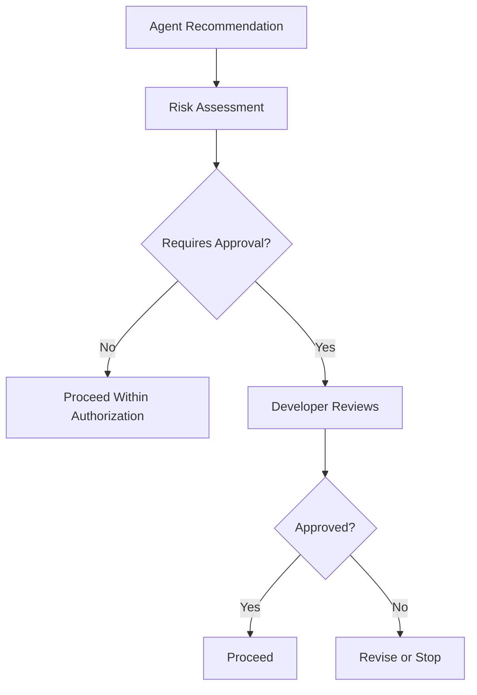
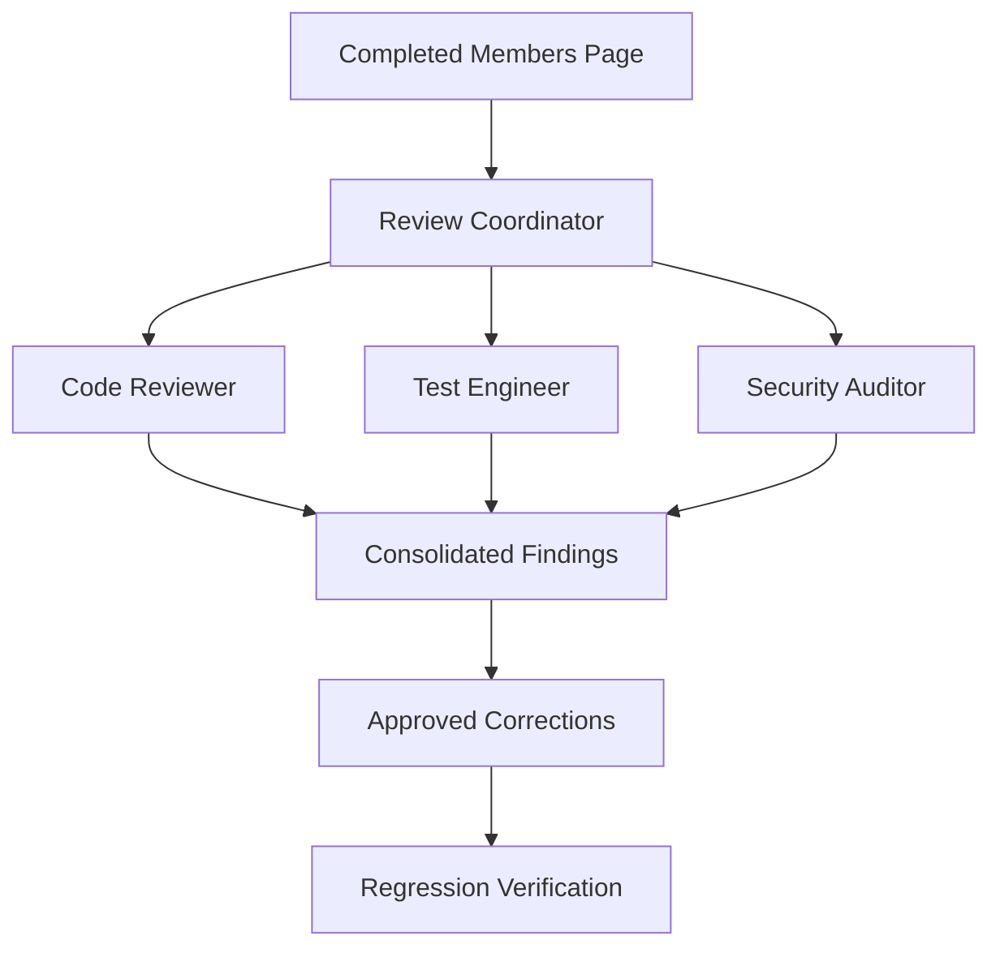
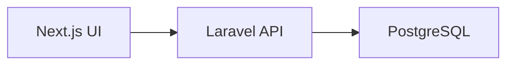
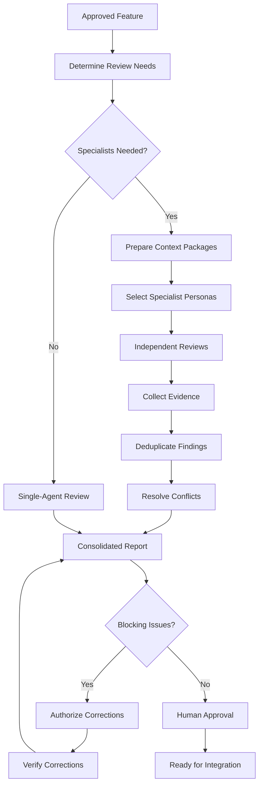

---
title: "13 — Agent Personas and Multi-Agent Collaboration"
course: "Agent Skills"
repository: "addyosmani/agent-skills"
lesson: 13
difficulty: Intermediate to Advanced
approach: Theory First
status: Complete
tags:
  - agentic-engineering
  - agent-skills
  - codex
  - agent-personas
  - multi-agent
  - orchestration
  - task-delegation
  - context-engineering
  - code-review
---

# 13 — Agent Personas and Multi-Agent Collaboration

> [!abstract] Lesson Overview
> **Repository:** [addyosmani/agent-skills](https://github.com/addyosmani/agent-skills)
>
> **Primary Concepts:**
> - Agent personas
> - Specialist reviewers
> - Agent orchestration
> - Parallel fan-out and merge
> - Context isolation
> - Evidence consolidation
> - Human approval boundaries
>
> **Repository Personas:**
> - `code-reviewer`
> - `test-engineer`
> - `security-auditor`
> - `web-performance-auditor`
>
> **Learning Approach:** Theory First
>
> **Goal:** Understand how specialized AI agents can collaborate safely and efficiently without creating unnecessary complexity, conflicting modifications, or unreliable conclusions.

---

# Part I — Learning Objectives

After completing this lesson, you should be able to:

1. Define an AI agent persona.
2. Distinguish personas from skills.
3. Understand agent orchestration.
4. Identify the four repository personas.
5. Explain specialist versus general-purpose agents.
6. Understand role-based task delegation.
7. Explain context isolation.
8. Distinguish sequential from parallel workflows.
9. Understand parallel fan-out and merge.
10. Explain why personas should not orchestrate other personas.
11. Define read-only specialist reviews.
12. Understand evidence-based findings.
13. Identify conflicting agent conclusions.
14. Consolidate multiple review reports.
15. Establish human approval boundaries.
16. Understand multi-agent resource costs.
17. Recognize common orchestration anti-patterns.
18. Design collaboration workflows for Android, Laravel, and Next.js projects.

---

# Part II — AI Agent Personas

## 1. What Is an Agent Persona?

An **agent persona** defines a specialized role, perspective, responsibility, and expected output for an AI coding agent.

Instead of asking one general-purpose agent to evaluate every aspect of a system simultaneously, we can assign a specialist perspective.

For example:

- A Code Reviewer examines implementation quality.
- A Test Engineer evaluates verification coverage.
- A Security Auditor evaluates security risks.
- A Performance Auditor evaluates measurable performance concerns.

Each persona approaches the same software from a different engineering perspective.

### Example

Suppose a Laravel API feature has been completed.

A general-purpose agent might receive:

```text
Review this feature.
```

A specialized reviewer might receive:

```text
Act as the code-reviewer persona.

Review the implementation for:
- Correctness
- Readability
- Architecture
- Security
- Performance

Report evidence-supported findings.
Do not modify files.
```

The second request establishes a clearer responsibility.

> [!important]
> A persona is not automatically a separate AI model or independent running process. It is a defined role that may be executed through a supported agent mechanism.

---

# Part III — Personas vs Skills vs Commands

## 2. The Three-Layer Model

The Agent Skills repository separates three concepts.

| Layer | Purpose | Question |
|---|---|---|
| Persona | Defines specialist responsibility | Who? |
| Skill | Defines engineering workflow | How? |
| Command | Initiates or coordinates work | When? |

### 2.1 Persona

A persona describes the perspective and expected behavior of an agent.

Example:

`code-reviewer`

### 2.2 Skill

A skill describes a structured engineering procedure.

Example:

`code-review-and-quality`

### 2.3 Command

A command provides a user-facing entry point to a workflow.

Example:

`/review`

The repository's command names are integration-specific; do not assume every command is available in every coding agent.

## 2.4 Architecture



## 2.5 Example

```text
Developer:
Review this feature.

Orchestrator:
Select code-reviewer.

Persona:
Senior engineering reviewer.

Skill:
code-review-and-quality.

Output:
Prioritized review findings.
```

The persona supplies the perspective.

The skill supplies the process.

The orchestrator controls the workflow.

---

# Part IV — Repository Architecture

## 3. Relevant Directories

The repository organizes reusable instructions into distinct locations.

```text
agent-skills/
│
├── agents/
│   ├── code-reviewer.md
│   ├── test-engineer.md
│   ├── security-auditor.md
│   └── web-performance-auditor.md
│
├── skills/
│   ├── code-review-and-quality/
│   ├── test-driven-development/
│   ├── security-and-hardening/
│   └── performance-optimization/
│
├── references/
│   └── orchestration-patterns.md
│
├── docs/
│   └── agents.md
│
└── AGENTS.md
```

The directories have different responsibilities.

### `agents/`

Contains specialist persona definitions.

### `skills/`

Contains reusable engineering workflows.

### `references/`

Contains supporting guidance and checklists.

### `docs/agents.md`

Explains persona selection and composition.

### `AGENTS.md`

Defines repository-level operating rules.

> [!note]
> The repository's persona definitions are Markdown files. Their availability as executable subagents depends on the host platform and its integration.

---

# Part V — General-Purpose vs Specialist Agents

## 4. General-Purpose Agent

A general-purpose coding agent can perform many tasks:

- Explore repositories.
- Implement features.
- Fix bugs.
- Write tests.
- Review code.
- Update documentation.

### Advantages

- Flexible.
- Easy to coordinate.
- Requires less setup.
- Suitable for small tasks.

### Limitations

- May miss specialist concerns.
- May mix implementation and review responsibilities.
- Can accumulate irrelevant context.

## 4.1 Specialist Agent

A specialist agent focuses on a narrower responsibility.

Examples:

```text
Code Reviewer
Test Engineer
Security Auditor
Performance Auditor
```

### Advantages

- Clear evaluation criteria.
- Focused context.
- More consistent report structure.
- Independent review perspectives.

### Limitations

- Additional execution cost.
- Potentially redundant findings.
- Requires orchestration.
- May lack broader project context.

## 4.2 Comparison

| Attribute | General-Purpose | Specialist |
|---|---|---|
| Scope | Broad | Narrow |
| Flexibility | High | Task-specific |
| Context | Potentially extensive | Focused |
| Coordination | Simple | May require orchestration |
| Output | General | Structured by specialty |

## 4.3 When to Use Each

Use a general-purpose agent for a straightforward task with clear requirements.

Consider specialist agents when the work benefits from independent verification across distinct concerns.

> [!important]
> More agents do not automatically produce better software.

---

# Part VI — The Code Reviewer Persona

## 5. Purpose

The repository's `code-reviewer` persona evaluates implementation quality from a senior engineering perspective.

Its review aligns with five dimensions:

1. Correctness.
2. Readability.
3. Architecture.
4. Security.
5. Performance.

## 5.1 Responsibilities

A code reviewer should:

- Read the approved requirements.
- Inspect the relevant diff.
- Understand existing architecture.
- Identify concrete defects.
- Classify findings.
- Recommend focused corrections.

## 5.2 Example

A Next.js component fetches product data repeatedly because of incorrect effect dependencies.

A code reviewer may identify:

```text
Finding:
The component may issue redundant API requests.

Evidence:
The effect depends on state that it updates.

Impact:
Unnecessary requests and repeated rendering.

Recommendation:
Review the effect dependencies and data-fetching lifecycle.
```

The finding must be verified against the actual implementation.

## 5.3 Important Boundary

The reviewer should not automatically rewrite the feature.

A review report and an implementation task are different activities.

---

# Part VII — The Test Engineer Persona

## 6. Purpose

The `test-engineer` persona evaluates whether the implementation has sufficient verification evidence.

Its focus includes:

- Test strategy.
- Test coverage.
- Acceptance criteria.
- Edge cases.
- Regression protection.
- Test reliability.

## 6.1 Example

GroupTrack feature:

**Member Contribution Count**

Requirement:

Count tasks assigned to a member that have `DONE` status within the selected project.

A test engineer might recommend:

| Test Case | Expected Result |
|---|---|
| No assigned tasks | Count is zero |
| One completed task | Count is one |
| Working task | Not counted |
| Task from another project | Not counted |
| Multiple completed tasks | Correct total |

## 6.2 The Prove-It Principle

An implementation claim should be supported by evidence.

For example:

```text
Claim:
The contribution count works.

Evidence:
A test verifies completed tasks are counted
while incomplete tasks are excluded.
```

A test engineer distinguishes:

- Implemented behavior.
- Tested behavior.
- Untested assumptions.

## 6.3 Important

A test engineer should not claim that tests passed unless they were actually executed and the results were available.

---

# Part VIII — The Security Auditor Persona

## 7. Purpose

The `security-auditor` persona examines security-sensitive aspects of a change.

Typical areas include:

- Authentication.
- Authorization.
- Input validation.
- Data exposure.
- Secret handling.
- Dependency risks.
- Trust boundaries.

## 7.1 Example

An e-commerce API exposes:

```text
GET /api/orders/{id}
```

A security auditor should verify that the backend enforces the approved permission rules for accessing the requested order.

Authentication alone may not be sufficient.

## 7.2 Example Report

```text
Category:
Authorization

Finding:
Resource ownership enforcement requires verification.

Evidence:
The inspected controller retrieves an order
without an apparent resource-level policy check.

Impact:
Potential unauthorized access.

Recommendation:
Verify authorization in the controller,
policy, middleware, or underlying service.

Status:
Requires further investigation.
```

Notice that the report distinguishes a concern from a confirmed vulnerability.

## 7.3 Important

Security findings should be grounded in actual code and configuration, not assumptions based solely on file names.

---

# Part IX — The Web Performance Auditor Persona

## 8. Purpose

The `web-performance-auditor` persona evaluates web application performance.

Its focus includes:

- Core Web Vitals.
- Loading performance.
- Rendering responsiveness.
- Layout stability.
- Network activity.
- JavaScript execution.
- Resource loading.

The repository describes Quick and Deep audit modes.

## 8.1 Example

A Next.js website contains:

- Large hero images.
- Several client components.
- Third-party scripts.
- Multiple API requests.

A performance auditor may investigate whether these affect user experience.

## 8.2 Relevant Metrics

| Metric | Purpose |
|---|---|
| LCP | Main content loading |
| INP | Interaction responsiveness |
| CLS | Visual stability |

## 8.3 Measurement Honesty

A performance auditor must distinguish:

```text
Measured:
LCP observed during a specific test.

Suspected:
Hero image size may affect LCP.

Unverified:
Production performance has not been measured.
```

## 8.4 Important

Do not fabricate Lighthouse scores or Core Web Vitals measurements.

A performance recommendation should clearly identify whether it is based on actual measurements or static inspection.

---

# Part X — Agent Orchestration

## 9. What Is Agent Orchestration?

Agent orchestration is the coordination of multiple agent roles toward a shared objective.

It determines:

- Which agents participate.
- What each agent receives.
- Which tasks run first.
- Which tasks can run concurrently.
- How results are combined.
- Who makes final decisions.

## 9.1 Basic Architecture



## 9.2 Important

The orchestrator is responsible for coordinating the work.

Specialist personas should remain focused on their assigned responsibilities.

---

# Part XI — The Repository's Orchestration Rule

## 10. Personas Do Not Invoke Personas

The repository establishes an important composition rule:

**Personas do not invoke other personas.**

Instead, the user or an orchestration command determines which personas should run.

### Incorrect Architecture



This creates a chain where specialist personas control one another.

### Preferred Architecture



## 10.1 Why This Matters

It helps avoid:

- Hidden delegation.
- Recursive agent spawning.
- Uncontrolled execution costs.
- Unclear responsibility.
- Conflicting orchestration decisions.

## 10.2 Repository-Specific Rule

The repository documents **parallel fan-out followed by a merge step** as its endorsed multi-persona orchestration pattern.

Other collaboration models exist in agentic software engineering, but they should not be mistaken for supported workflows of this particular repository.

---

# Part XII — Parallel Fan-Out and Merge

## 11. What Is Parallel Fan-Out?

Parallel fan-out means assigning independent tasks to multiple agents at approximately the same time.

Each agent receives a clearly defined responsibility.

After completion, the results are consolidated.

## 11.1 Example

A Laravel feature has been implemented.

Three reviewers examine the same change:

```text
Agent A:
Code quality review.

Agent B:
Test coverage review.

Agent C:
Security review.
```

They return independent reports.

The orchestrator combines them.

## 11.2 Diagram



## 11.3 Why Parallel Review Works

These tasks are largely independent.

Each reviewer can inspect the same code without modifying it.

This reduces the risk of conflicting file changes.

---

# Part XIII — Sequential vs Parallel Execution

## 12. Sequential Execution

Sequential execution means one task completes before the next begins.

Example:

```text
Implementation
    ↓
Testing
    ↓
Code Review
    ↓
Security Review
```

### Advantages

- Clear dependencies.
- Easier debugging.
- Predictable execution order.

### Disadvantages

- Potentially slower.
- Independent tasks cannot overlap.

## 12.1 Parallel Execution

Parallel execution allows independent tasks to proceed concurrently.

Example:

```text
          ┌─ Code Review
Feature ──┼─ Test Review
          └─ Security Review
```

### Advantages

- Potentially faster.
- Independent perspectives.
- Focused task execution.

### Disadvantages

- Higher resource usage.
- More coordination.
- Potentially conflicting findings.

## 12.2 Decision Table

| Situation | Preferred Approach |
|---|---|
| Task B depends on Task A | Sequential |
| Independent read-only reviews | Parallel |
| Multiple agents editing one file | Avoid simultaneous edits |
| Shared database migration | Coordinated sequential changes |
| Independent documentation reviews | Parallel may help |

> [!important]
> Parallelism is useful only when tasks are genuinely independent.

---

# Part XIV — Context Isolation

## 13. What Is Context Isolation?

Context isolation means giving each agent the information necessary for its assigned responsibility without automatically providing every detail from the entire project.

This helps reduce irrelevant context.

## 13.1 Example

### Code Reviewer Context

```text
- Approved feature specification
- Relevant source files
- Git diff
- Architecture conventions
```

### Test Engineer Context

```text
- Acceptance criteria
- Relevant test files
- Implementation behavior
- Test execution results
```

### Security Auditor Context

```text
- Relevant routes
- Authentication configuration
- Authorization rules
- Data-access logic
- Trust boundaries
```

## 13.2 Benefits

- Better focus.
- Lower context overhead.
- Clearer responsibility.
- Reduced irrelevant information.

## 13.3 Risks

Too little context can produce incorrect conclusions.

For example, a security auditor examining only a controller may miss authorization enforced in middleware.

Therefore, context should be focused but sufficiently complete.

---

# Part XV — Context Packages

## 14. What Is a Context Package?

A context package is the information provided to an agent before it begins work.

A useful package includes:

1. Objective.
2. Relevant requirements.
3. Project constraints.
4. Files or modules in scope.
5. Relevant documentation.
6. Available verification evidence.
7. Expected output.
8. Explicit boundaries.

## 14.1 Template

```markdown
# Agent Task Context

## Objective
Review the product creation API.

## Project
Laravel backend.

## Requirements
Product creation is restricted to approved roles.

## Scope
- Product routes
- Product controller
- Validation
- Authorization
- Relevant tests

## Constraints
- Read-only review
- No unrelated changes
- No production access

## Evidence
- Relevant Git diff
- Test results
- Architecture documentation

## Output
Prioritized findings with file references.
```

## 14.2 Important

A context package should contain authoritative project information, not unsupported assumptions.

---

# Part XVI — Task Delegation

## 15. What Makes a Good Delegated Task?

A good task has:

- One clear objective.
- Defined boundaries.
- Relevant context.
- Expected deliverables.
- Verification criteria.
- Explicit permissions.

## 15.1 Poor Delegation

```text
Check the entire project and improve everything.
```

Problems:

- Undefined scope.
- Unclear completion criteria.
- High risk of unrelated changes.
- Difficult verification.

## 15.2 Better Delegation

```text
Review the Laravel product creation endpoint
for authorization and validation concerns.

Inspect the relevant routes, controller,
policies, request validation, and tests.

Return evidence-supported findings.

Do not modify files.
```

This request is more focused and verifiable.

---

# Part XVII — Agent Ownership Boundaries

## 16. Why Ownership Matters

When multiple agents can modify the same repository, conflicting edits may occur.

For example:

```text
Agent A modifies ProductController.php.

Agent B modifies ProductController.php.

Both changes are based on different versions.
```

The resulting changes may conflict.

## 16.1 Safer Approaches

- Use read-only reviewers.
- Assign non-overlapping implementation scopes.
- Serialize changes to shared files.
- Use separate branches or isolated workspaces where supported.
- Review integration changes before merging.

## 16.2 Important

The repository's endorsed parallel review workflow avoids many write conflicts because reviewers produce reports rather than directly modifying the implementation.

---

# Part XVIII — Evidence-Based Findings

## 17. Why Evidence Matters

Specialist agents should not merely express opinions.

Their conclusions should be supported by observable evidence.

## 17.1 Example

Weak finding:

```text
The API is insecure.
```

Better finding:

```text
Category:
Authorization

Location:
ProductController.php

Observation:
The create action does not visibly invoke
an authorization policy.

Required Verification:
Check whether route middleware or another
application layer enforces the permission.

Risk:
Unauthorized product creation if no
other authorization boundary exists.
```

## 17.2 Evidence Types

- Source code.
- Configuration.
- Tests.
- Build logs.
- Runtime measurements.
- Official documentation.
- Approved requirements.

## 17.3 Important

A finding should clearly distinguish:

**Confirmed**, **suspected**, and **not verified**.

---

# Part XIX — Consolidating Agent Reports

## 18. What Is Evidence Consolidation?

Evidence consolidation combines findings from multiple reviewers into one coherent assessment.

The orchestrator should:

1. Collect reports.
2. Identify duplicates.
3. Compare severity.
4. Resolve contradictions where evidence allows.
5. Preserve uncertainty.
6. Prioritize required corrections.
7. Present a unified action plan.

## 18.1 Example

### Code Reviewer

```text
Finding:
Missing resource authorization.

Severity:
Required.
```

### Security Auditor

```text
Finding:
Potential broken access control.

Severity:
High.
```

These may describe the same underlying issue.

The consolidated report should avoid counting them as two independent defects.

## 18.2 Consolidation Table

| Finding | Reported By | Status | Priority |
|---|---|---|---|
| Missing resource authorization | Code + Security | Requires verification | High |
| Missing edge-case test | Test Engineer | Confirmed | Medium |
| Unclear variable name | Code Reviewer | Confirmed | Low |

## 18.3 Important

The orchestrator should not automatically accept the most severe classification without reviewing the supporting evidence.

---

# Part XX — Handling Conflicting Findings

## 19. Why Agents May Disagree

Different agents may reach different conclusions because of:

- Different context.
- Different assumptions.
- Different evaluation criteria.
- Missing evidence.
- Different interpretations of requirements.

## 19.1 Example

### Agent A

```text
The service layer is unnecessary.
```

### Agent B

```text
The service layer preserves separation
between HTTP handling and business rules.
```

Both conclusions may appear reasonable.

The correct decision depends on the actual project architecture.

## 19.2 Resolution Process



## 19.3 Important

Do not resolve technical disagreements through majority voting alone.

Evidence and requirements should determine the decision.

---

# Part XXI — Human Approval Boundaries

## 20. Why Human Approval Matters

AI agents can assist with implementation and verification, but important decisions may require explicit developer authorization.

Examples:

- Changing project scope.
- Introducing dependencies.
- Modifying authentication architecture.
- Performing database migrations.
- Deploying to production.
- Discarding uncommitted changes.

## 20.1 Approval Model



## 20.2 Important

Delegating analysis does not automatically authorize the agent to perform every recommended action.

---

# Part XXII — Multi-Agent Cost and Efficiency

## 21. Why More Agents Can Cost More

Each additional agent may require:

- Context processing.
- Repository exploration.
- Tool execution.
- Model inference.
- Report generation.
- Result consolidation.

## 21.1 Example

A minor text alignment issue probably does not require:

```text
Code Reviewer
Test Engineer
Security Auditor
Performance Auditor
```

A single focused agent may be sufficient.

However, a significant authentication change may benefit from multiple specialist perspectives.

## 21.2 Decision Framework

Ask:

1. Is the task complex?
2. Are there independent concerns?
3. Is the change security-sensitive?
4. Would a separate review materially improve confidence?
5. Is the additional coordination justified?

## 21.3 Important

The goal is **appropriate specialization**, not maximizing the number of agents.

---

# Part XXIII — Multi-Agent Anti-Patterns

## 22. Persona Chaining

One specialist independently invokes another specialist.

This violates the repository's orchestration model.

## 22.1 Recursive Delegation

Agents repeatedly delegate tasks without clear boundaries.

Consequences:

- Uncontrolled complexity.
- Difficult traceability.
- Increased cost.

## 22.2 Shared-File Conflicts

Multiple agents edit the same files simultaneously.

Consequences:

- Conflicting changes.
- Lost work.
- Difficult integration.

## 22.3 Duplicate Reviews

Several agents repeat the same review without providing independent value.

## 22.4 Unsupported Conclusions

The orchestrator combines speculative findings into a seemingly authoritative report.

## 22.5 Excessive Orchestration

A small task receives an unnecessarily complicated multi-agent workflow.

## 22.6 Missing Approval

Agents execute sensitive actions without authorization.

> [!warning]
> Multi-agent collaboration should improve engineering discipline, not bypass it.

---

# Part XXIV — Codex Integration Considerations

## 23. Using Personas with Codex

Codex can use structured project instructions and installed skills.

The Agent Skills repository also provides Codex-specific integration guidance.

However, **installing a Markdown persona file does not by itself guarantee that Codex will automatically execute it as an independent subagent**.

Actual multi-agent execution depends on the Codex version, available features, configuration, and permissions.

## 23.1 Portable Approach

Even without parallel subagent execution, the persona concepts can be applied sequentially.

Example:

```text
Step 1:
Ask Codex to perform a code review.

Step 2:
Ask Codex to evaluate test coverage.

Step 3:
Ask Codex to perform a security review.

Step 4:
Consolidate the findings.
```

This preserves specialist perspectives without requiring native parallel orchestration.

## 23.2 Important

Do not assume that a slash command from another coding-agent platform works identically in Codex.

Use the documented integration for your installed version.

---

# Part XXV — Example Persona Definition

## 24. Educational Persona Template

The following illustrates the information a specialist persona might contain.

It is a conceptual template, not a guaranteed drop-in configuration for every agent platform.

```markdown
---
name: api-reviewer
description: Reviews API contracts and backend boundaries.
---

# API Reviewer

## Role

Evaluate API implementations for correctness,
contract consistency, and maintainability.

## Responsibilities

- Inspect API specifications.
- Review request validation.
- Review response contracts.
- Check error semantics.
- Identify breaking changes.

## Boundaries

- Read-only review.
- Do not modify source code.
- Do not invoke other personas.
- Do not access production data.

## Output

For each finding:

- Severity
- File location
- Evidence
- Impact
- Recommendation

## Composition

Invoke directly when:
- Reviewing API changes.

Invoke via:
- An authorized orchestration workflow.

Do not invoke from:
- Another specialist persona.
```

## 24.1 Design Principles

A useful persona definition should establish:

- Role.
- Scope.
- Responsibilities.
- Constraints.
- Output format.
- Composition rules.

## 24.2 Important

Before creating a new persona, check whether an existing one already covers the requirement.

Unnecessary personas increase maintenance complexity.

---

# Part XXVI — GroupTrack Case Study

## 25. Scenario: Members Page Review

### Project Context

GroupTrack is an Android application using Java and Firebase.

The Members page displays:

- Project groups.
- Member names.
- Member roles.
- Completed-task contribution counts.

## 25.1 Review Objectives

Verify:

1. Correct member grouping.
2. Correct contribution calculation.
3. Appropriate loading states.
4. Appropriate empty states.
5. Firebase data-access consistency.
6. Strict adherence to the approved MVP.

## 25.2 Specialist Assignments

### Code Reviewer

Evaluate:

- UI architecture.
- Readability.
- Duplicate logic.
- Data-access separation.
- Unnecessary abstractions.

### Test Engineer

Evaluate:

- Contribution count tests.
- Empty project cases.
- Missing member data.
- Archived project behavior.
- Regression coverage.

### Security Auditor

Evaluate:

- Firebase access rules.
- Project membership boundaries.
- Unauthorized data access.
- Sensitive information exposure.

## 25.3 Workflow



## 25.4 Important

Avoid adding unrelated features during the review.

The purpose is to verify the approved Members page behavior.

---

# Part XXVII — GoPasig Case Study

## 26. Scenario: Schedule Management Review

### Project Context

GoPasig uses Laravel for fleet management and bus tracking.

Schedule management involves:

- Drivers.
- Buses.
- Routes.
- Operating schedules.
- Assignment conflicts.

## 26.1 Code Reviewer

Evaluate:

- Controller responsibilities.
- Business logic placement.
- Query efficiency.
- Error handling.
- Existing architectural conventions.

## 26.2 Test Engineer

Evaluate:

- Overlapping schedules.
- Duplicate assignments.
- Invalid time ranges.
- Missing records.
- Boundary conditions.

## 26.3 Security Auditor

Evaluate:

- Administrative permissions.
- Input validation.
- Resource authorization.
- Data integrity.
- Sensitive operational information.

## 26.4 Example Consolidated Report

```markdown
# GoPasig Schedule Management Review

## Code Quality
- Review schedule validation placement.
- Check for duplicated assignment logic.

## Testing
- Verify overlapping assignment cases.
- Verify invalid schedule inputs.

## Security
- Verify authorization for schedule updates.
- Verify validation of route and driver identifiers.

## Integration
- Confirm approved business rules remain intact.

## Decision
Pending verification evidence.
```

## 26.5 Important

The reviewers should not invent scheduling rules.

They must derive expected behavior from the approved specification and existing system constraints.

---

# Part XXVIII — Next.js + Laravel Case Study

## 27. Scenario: Product Management Feature

### Architecture



## 27.1 Code Reviewer

Focus:

- Frontend component structure.
- API client organization.
- Backend controller responsibilities.
- Error handling.
- Type consistency.

## 27.2 Test Engineer

Focus:

- Product validation.
- Successful creation.
- Invalid requests.
- Unauthorized requests.
- Frontend error handling.

## 27.3 Security Auditor

Focus:

- Authentication.
- Authorization.
- Input validation.
- Safe database access.
- Sensitive configuration.

## 27.4 Performance Auditor

Use when there is a meaningful performance question.

Possible concerns:

- Product list loading.
- Excessive API requests.
- Unnecessary client-side JavaScript.
- Large images.
- Rendering delays.

## 27.5 Important

The performance auditor should not be invoked automatically for every small backend change.

Choose the specialist based on the actual risk.

---

# Part XXIX — Reusable Codex Prompts

## 28. Code Reviewer Prompt

```text
PROJECT:
GroupTrack Android.

ROLE:
Code Reviewer.

TASK:
Review the completed Members page implementation.

CONTEXT:
Read AGENTS.md, the approved requirements,
relevant source files, and the current diff.

REVIEW:
- Correctness
- Readability
- Architecture
- Security
- Performance

RULES:
- Do not modify files.
- Do not invent defects.
- Preserve approved MVP scope.
- Distinguish confirmed findings from concerns.

OUTPUT:
- Severity
- File location
- Evidence
- Impact
- Recommendation
```

## 28.1 Test Engineer Prompt

```text
PROJECT:
GoPasig Laravel.

ROLE:
Test Engineer.

TASK:
Evaluate test coverage for schedule management.

CONTEXT:
Read the approved schedule requirements,
relevant implementation, and existing tests.

REVIEW:
- Acceptance criteria
- Edge cases
- Invalid inputs
- Assignment conflicts
- Regression protection

RULES:
- Do not modify files.
- Do not claim tests passed unless executed.
- Identify missing verification evidence.

OUTPUT:
- Covered behaviors
- Missing tests
- Risks
- Recommended test cases
```

## 28.2 Security Auditor Prompt

```text
PROJECT:
Next.js frontend and Laravel backend.

ROLE:
Security Auditor.

TASK:
Review the product management API.

CONTEXT:
Inspect relevant routes, middleware,
authorization, validation, and data access.

REVIEW:
- Authentication
- Authorization
- Input validation
- Sensitive data
- Dependency concerns

RULES:
- Read-only.
- No production access.
- No secret exposure.
- No unsupported vulnerability claims.

OUTPUT:
- Confirmed findings
- Concerns requiring verification
- Severity
- Evidence
- Recommended corrections
```

---

# Part XXX — Consolidated Review Prompt

## 29. Orchestrator Prompt

```text
PROJECT:
Next.js frontend and Laravel backend.

OBJECTIVE:
Coordinate a release-readiness review.

SPECIALIST PERSPECTIVES:

1. Code Reviewer
2. Test Engineer
3. Security Auditor

WORKFLOW:

1. Read AGENTS.md.
2. Read the approved feature specification.
3. Identify the relevant Git diff.
4. Provide each specialist with sufficient context.
5. Perform independent read-only reviews.
6. Collect all findings.
7. Deduplicate overlapping findings.
8. Compare conflicting conclusions.
9. Preserve unresolved uncertainty.
10. Produce one prioritized report.

BOUNDARIES:

- Specialists must not invoke other specialists.
- Do not modify code.
- Do not access production systems.
- Do not fabricate test results.
- Do not deploy.
- Require approval before implementation.

OUTPUT:

- Review summary
- Confirmed findings
- Unverified concerns
- Severity
- Evidence
- Required corrections
- Suggested verification
- Final readiness assessment

If native parallel agents are unavailable,
perform the specialist reviews sequentially.
```

---

# Part XXXI — Consolidated Report Template

## 30. Reusable Documentation

```markdown
# Multi-Agent Review Report

## 1. Project Information

Project:
Feature:
Branch:
Commit:
Review Date:

## 2. Review Scope

Describe the approved change.

## 3. Participating Personas

- Code Reviewer
- Test Engineer
- Security Auditor

## 4. Verification Evidence

Build:
Tests:
Static Analysis:
Runtime Verification:

## 5. Code Quality Findings

### Finding
Severity:
File:
Evidence:
Impact:
Recommendation:

## 6. Testing Findings

Covered Behaviors:
Missing Tests:
Unverified Cases:

## 7. Security Findings

Confirmed Risks:
Potential Concerns:
Required Verification:

## 8. Duplicate Findings

List consolidated findings.

## 9. Conflicting Conclusions

Describe disagreements and supporting evidence.

## 10. Required Corrections

List blocking issues.

## 11. Optional Improvements

List nonblocking recommendations.

## 12. Remaining Risks

Document unresolved uncertainty.

## 13. Final Decision

- Ready for integration
- Changes required
- Blocked pending verification

## 14. Approval

Reviewer:
Decision:
Date:
```

---

# Part XXXII — Designing a Multi-Agent Workflow

## 31. Step-by-Step Design

### Step 1 — Define the Objective

What outcome is required?

Example:

```text
Determine whether the product creation
feature is ready for integration.
```

### Step 2 — Identify Independent Concerns

Possible concerns:

- Code quality.
- Test coverage.
- Security.

### Step 3 — Select Personas

Choose only specialists that materially contribute.

### Step 4 — Prepare Context

Provide:

- Requirements.
- Relevant files.
- Project rules.
- Existing tests.
- Available evidence.

### Step 5 — Establish Boundaries

Define:

- Read-only or write permissions.
- File scope.
- Production restrictions.
- Approval requirements.

### Step 6 — Execute Reviews

Run independent reviews using the host's supported mechanisms.

### Step 7 — Consolidate Results

Remove duplicates and reconcile findings.

### Step 8 — Prioritize Corrections

Address confirmed blocking issues first.

### Step 9 — Verify Changes

Run appropriate tests after corrections.

### Step 10 — Obtain Approval

Use the project's established merge or release process.

---

# Part XXXIII — When Not to Use Multiple Agents

## 32. Avoid Unnecessary Orchestration

Multi-agent review may be excessive for:

- Correcting a typo.
- Updating a simple label.
- Adjusting basic spacing.
- Renaming a local variable.
- Editing a small documentation sentence.

A single agent can usually handle these tasks.

## 32.1 Decision Matrix

| Task | Suggested Approach |
|---|---|
| Simple UI text correction | Single agent |
| Small isolated bug | Single agent plus tests |
| Significant API change | Code + Test review |
| Authentication redesign | Code + Test + Security review |
| Web performance regression | Performance auditor |
| Production release assessment | Coordinated specialist review |

## 32.2 Important

Select the minimum coordination complexity necessary to achieve the required confidence.

---

# Part XXXIV — Practical Exercises

> [!note]
> Theory-first exercises. No repository modification required.

## Exercise 1 — Persona Fundamentals

Define an agent persona in your own words.

## Exercise 2 — Three-Layer Model

Explain the difference between:

- Persona.
- Skill.
- Command.

## Exercise 3 — Repository Architecture

Describe the purpose of the `agents/` directory.

## Exercise 4 — General vs Specialist

Compare general-purpose and specialist agents.

## Exercise 5 — Code Reviewer

Create a checklist for reviewing an Android UI feature.

## Exercise 6 — Test Engineer

Design test cases for a project contribution counter.

## Exercise 7 — Security Auditor

Identify authorization concerns in a product management API.

## Exercise 8 — Performance Auditor

List evidence required before claiming a web application has a performance regression.

## Exercise 9 — Orchestration

Explain the role of an orchestrator.

## Exercise 10 — Persona Composition

Explain why personas should not independently invoke other personas in this repository.

## Exercise 11 — Fan-Out and Merge

Draw a workflow involving three independent reviewers.

## Exercise 12 — Sequential vs Parallel

Identify situations where sequential execution is preferable.

## Exercise 13 — Context Isolation

Create a context package for a security review.

## Exercise 14 — Delegation

Rewrite an overly broad task into a focused specialist assignment.

## Exercise 15 — File Ownership

Explain why simultaneous edits to shared files can create problems.

## Exercise 16 — Evidence

Write an evidence-supported code review finding.

## Exercise 17 — Consolidation

Combine two duplicate findings into one report entry.

## Exercise 18 — Conflicting Conclusions

Explain how to resolve disagreements between reviewers.

## Exercise 19 — Approval Boundaries

List five actions that should require explicit authorization.

## Exercise 20 — Efficiency

Explain why adding more agents does not guarantee better results.

## Exercise 21 — Anti-Patterns

Identify five common multi-agent orchestration mistakes.

## Exercise 22 — Codex Integration

Explain the difference between persona prompting and native subagent execution.

## Exercise 23 — GroupTrack

Design a three-persona review for the Members page.

## Exercise 24 — GoPasig

Design a specialist review for schedule management.

## Exercise 25 — E-commerce

Design a review workflow for a product management feature.

## Exercise 26 — Final Exercise

Design a complete multi-agent review system for one approved feature.

Include:

1. Project overview.
2. Feature objective.
3. Approved requirements.
4. Review scope.
5. Selected personas.
6. Justification for each persona.
7. Relevant skills.
8. Context packages.
9. Agent boundaries.
10. Execution strategy.
11. Parallel or sequential decision.
12. File ownership rules.
13. Evidence requirements.
14. Report formats.
15. Severity classifications.
16. Duplicate handling.
17. Conflict resolution.
18. Human approval checkpoints.
19. Verification strategy.
20. Cost considerations.
21. Final consolidated report.
22. Definition of Done.
23. Remaining risks.
24. Final decision criteria.

---

# Part XXXV — Knowledge Check

1. What is an agent persona?
2. How does a persona differ from a skill?
3. What is an orchestration command?
4. What are the four repository personas?
5. What does a code reviewer evaluate?
6. What does a test engineer evaluate?
7. What does a security auditor evaluate?
8. What does a web performance auditor evaluate?
9. What is agent orchestration?
10. Why should personas not invoke other personas?
11. What is parallel fan-out?
12. What is the merge step?
13. When is sequential execution preferable?
14. When is parallel execution useful?
15. What is context isolation?
16. What belongs in a context package?
17. What makes a delegated task well-defined?
18. Why do file ownership boundaries matter?
19. What is an evidence-supported finding?
20. Why should speculative findings be labeled?
21. What is evidence consolidation?
22. How should duplicate findings be handled?
23. How should conflicting findings be resolved?
24. Why are human approval boundaries necessary?
25. What costs can multi-agent execution introduce?
26. What is persona chaining?
27. Why is excessive orchestration undesirable?
28. Can Markdown persona files automatically guarantee native Codex subagents?
29. How can specialist reviews be performed sequentially?
30. When should a single agent be preferred?

---

# Part XXXVI — Key Takeaways

> [!summary]
> - Agent personas define specialized roles.
> - Skills define engineering workflows.
> - Commands initiate or coordinate workflows.
> - The repository includes four specialist personas.
> - Code reviewers evaluate implementation quality.
> - Test engineers evaluate verification evidence.
> - Security auditors evaluate security risks.
> - Performance auditors evaluate measurable web performance.
> - Orchestration determines how specialist work is coordinated.
> - Personas should not independently invoke other personas.
> - The repository endorses parallel fan-out followed by a merge step.
> - Independent read-only reviews are well suited to parallel execution.
> - Context isolation improves focus but must preserve necessary information.
> - Delegated tasks need clear objectives and boundaries.
> - Shared-file edits require coordination.
> - Findings should be supported by evidence.
> - Duplicate findings should be consolidated.
> - Conflicting conclusions should be resolved through evidence.
> - Important actions require appropriate authorization.
> - Multi-agent execution introduces additional costs.
> - More agents do not automatically mean better results.
> - Native multi-agent capabilities depend on the host platform.
> - Simple tasks often require only one agent.
> - Effective collaboration prioritizes clarity, verification, and controlled execution.

---

# Part XXXVII — Final Mental Model



> [!important] Final Principle
> **Effective multi-agent development is not about maximizing the number of AI agents. It is about assigning the right responsibilities, providing sufficient context, collecting reliable evidence, and maintaining clear coordination and approval boundaries.**

---

# Part XXXVIII — Official References

## Primary Repository

- [Agent Skills Repository](https://github.com/addyosmani/agent-skills)
- [Agent Personas Documentation](https://github.com/addyosmani/agent-skills/blob/main/docs/agents.md)
- [Repository Agent Instructions](https://github.com/addyosmani/agent-skills/blob/main/AGENTS.md)
- [Orchestration Patterns](https://github.com/addyosmani/agent-skills/blob/main/references/orchestration-patterns.md)
- [Code Reviewer Persona](https://github.com/addyosmani/agent-skills/blob/main/agents/code-reviewer.md)
- [Test Engineer Persona](https://github.com/addyosmani/agent-skills/blob/main/agents/test-engineer.md)
- [Security Auditor Persona](https://github.com/addyosmani/agent-skills/blob/main/agents/security-auditor.md)
- [Web Performance Auditor Persona](https://github.com/addyosmani/agent-skills/blob/main/agents/web-performance-auditor.md)

## Supporting Skills

- [Code Review and Quality](https://github.com/addyosmani/agent-skills/blob/main/skills/code-review-and-quality/SKILL.md)
- [Test-Driven Development](https://github.com/addyosmani/agent-skills/blob/main/skills/test-driven-development/SKILL.md)
- [Security and Hardening](https://github.com/addyosmani/agent-skills/blob/main/skills/security-and-hardening/SKILL.md)
- [Performance Optimization](https://github.com/addyosmani/agent-skills/blob/main/skills/performance-optimization/SKILL.md)

## Additional Documentation

- [Codex Integration Guide](https://github.com/addyosmani/agent-skills/blob/main/docs/codex-setup.md)
- [OpenAI Codex Documentation](https://developers.openai.com/codex/)

> [!note] Documentation Scope
> This lesson explains the repository's documented persona architecture and orchestration principles alongside general multi-agent engineering concepts.
>
> Example workflows and prompts are educational.
>
> No specialist agents were launched.
>
> No local project files were inspected or modified.
>
> No automated reviews or tests were executed.

---

# Part XXXIX — Next Lesson

**[[14 - Evaluation, Limitations, and Best Practices]]**

Topics:

1. Agent evaluation fundamentals.
2. Measuring agent effectiveness.
3. Skill effectiveness.
4. Task completion criteria.
5. Quality metrics.
6. Verification evidence.
7. Reliability and repeatability.
8. Agent hallucinations.
9. Context limitations.
10. Tool limitations.
11. Agent failure patterns.
12. Cost and token efficiency.
13. Human oversight.
14. Security and permission boundaries.
15. Overengineering prevention.
16. Evaluation scorecards.
17. Repository best practices.
18. Android, Laravel, and Next.js examples.
19. Practical exercises.
20. Official references.

**End of Lesson 13 — Agent Personas and Multi-Agent Collaboration.**
