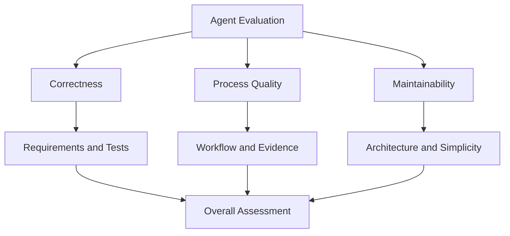
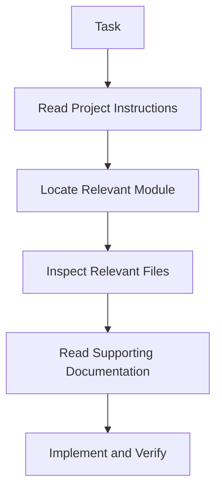
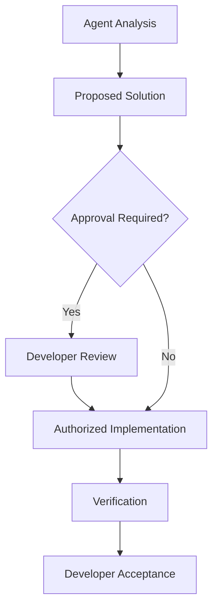
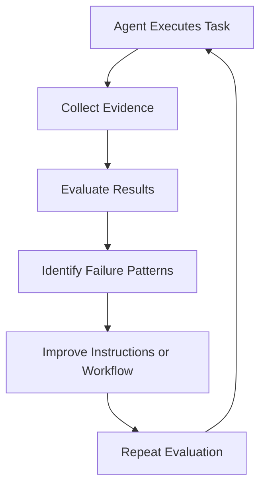
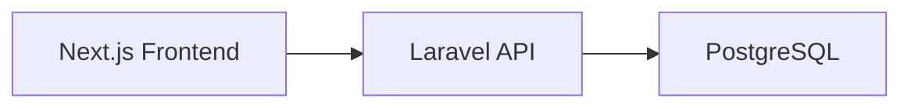
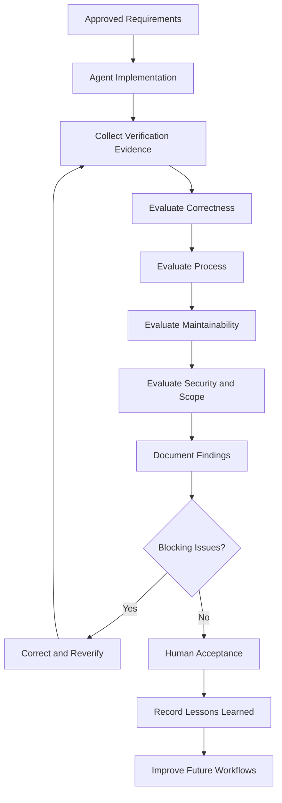

# 14 — Evaluation, Limitations, and Best Practices

> [!abstract] Lesson Overview
> **Primary Repository:** addyosmani/agent-skills
>
> **Focus Areas:**
> - Agent evaluation
> - Skill effectiveness
> - Software quality
> - Reliability and repeatability
> - Verification evidence
> - Agent limitations
> - Context management
> - Cost efficiency
> - Human oversight
> - Overengineering prevention
>
> **Approach:** Theory First
>
> **Goal:** Learn how to evaluate AI coding agents using objective criteria rather than relying on convincing explanations or seemingly successful implementations.

---

# Part I — Learning Objectives

After completing this lesson, you should be able to:

1. Define agent evaluation.
2. Distinguish output quality from process quality.
3. Explain why successful execution does not guarantee correctness.
4. Evaluate requirement compliance.
5. Define measurable acceptance criteria.
6. Understand verification evidence.
7. Evaluate testing effectiveness.
8. Measure implementation reliability.
9. Understand repeatability.
10. Identify hallucinations in agentic development.
11. Recognize context limitations.
12. Understand tool and environment limitations.
13. Evaluate code maintainability.
14. Identify unnecessary abstractions.
15. Assess agent efficiency.
16. Understand token and execution costs.
17. Evaluate security boundaries.
18. Apply human oversight.
19. Create evaluation scorecards.
20. Design improvement feedback loops.
21. Apply evaluation practices to Android, Laravel, and Next.js projects.

---

# Part II — Understanding Agent Evaluation

## 1. What Is Agent Evaluation?

**Agent evaluation** is the systematic assessment of an AI agent's behavior, decisions, implementation, and results against defined requirements and quality standards.

It answers:

> Did the agent complete the correct task, using an appropriate process, with sufficient evidence that the result works?

Evaluation should examine both the result and how the result was produced.

### Example

Suppose Codex implements a Tasks page for GroupTrack.

The generated code compiles.

Does that mean the task is complete?

Not necessarily.

We must still determine whether:

- The page follows the approved design.
- Tasks are loaded from the correct source.
- The filters work.
- Empty states are handled.
- Existing functionality remains intact.
- The implementation respects the MVP.
- Relevant tests pass.

A successful build is one piece of evidence.

It is not a complete evaluation.

---

# Part III — The Three Dimensions of Agent Evaluation

## 2. Correctness

Correctness asks:

**Does the implementation behave as required?**

Examples:

- Does the API return the expected response?
- Does the UI display the correct data?
- Does the business rule produce the expected result?
- Does authorization prevent prohibited operations?

## 2.1 Process Quality

Process quality asks:

**Did the agent follow an appropriate engineering workflow?**

Examples:

- Read project documentation.
- Inspect relevant code.
- Understand existing architecture.
- Plan before modifying.
- Make scoped changes.
- Run relevant verification.
- Report limitations.

## 2.2 Maintainability

Maintainability asks:

**Can developers understand, modify, and extend the implementation without unnecessary difficulty?**

Examples:

- Clear naming.
- Appropriate separation of concerns.
- Limited duplication.
- Consistent architecture.
- Minimal unnecessary complexity.

## 2.3 Evaluation Model



> [!important]
> A working feature can still be poorly engineered, while clean-looking code can still be functionally incorrect.

---

# Part IV — Requirement Compliance

## 3. What Is Requirement Compliance?

Requirement compliance measures whether an implementation satisfies the approved functional and non-functional requirements.

### Functional Requirements

Describe what the system must do.

Examples:

- Users can create projects.
- Members can view assigned tasks.
- Administrators can manage schedules.
- Customers can submit orders.

### Non-Functional Requirements

Describe how the system should behave.

Examples:

- Security.
- Performance.
- Reliability.
- Accessibility.
- Maintainability.

## 3.1 Requirements Traceability

A traceability matrix connects requirements to implementation and verification evidence.

| Requirement | Implementation | Verification | Status |
|---|---|---|---|
| Display assigned tasks | Tasks page | UI test | Pending |
| Filter by status | Filter logic | Unit test | Pending |
| Show empty state | Empty-state component | UI inspection | Pending |
| Enforce membership access | Firebase rules | Security test | Pending |

The statuses above are illustrative, not actual test results.

## 3.2 Why Traceability Matters

Without traceability, an agent may complete the visible UI but overlook important behavior.

Traceability helps answer:

1. What was required?
2. Where was it implemented?
3. How was it verified?
4. What remains incomplete?

---

# Part V — Acceptance Criteria

## 4. What Are Acceptance Criteria?

Acceptance criteria define observable conditions that determine whether a requirement has been satisfied.

### Weak Requirement

```text
Make the Tasks page better.
```

This is difficult to evaluate objectively.

### Stronger Requirement

```text
The Tasks page must:

1. Display tasks assigned to the authenticated user.
2. Include tasks from all accessible projects.
3. Display task title, project, status, and due date.
4. Show an empty state when no tasks exist.
5. Display a retry action when loading fails.
```

These conditions can be evaluated individually.

## 4.1 Acceptance Criteria Checklist

Good acceptance criteria should be:

- Specific.
- Observable.
- Testable.
- Relevant to approved scope.
- Clear about expected behavior.

## 4.2 Important

An AI agent should not silently redefine acceptance criteria to match its implementation.

---

# Part VI — Definition of Done

## 5. What Is Definition of Done?

The **Definition of Done (DoD)** is a shared standard describing what must be true before work is considered complete.

It differs from acceptance criteria.

Acceptance criteria are usually specific to a feature.

Definition of Done applies across tasks or features.

## 5.1 Example Definition of Done

```markdown
## Definition of Done

- [ ] Approved requirements satisfied
- [ ] Relevant code implemented
- [ ] Existing architecture respected
- [ ] Relevant tests pass
- [ ] Build succeeds
- [ ] No unrelated changes
- [ ] Security implications reviewed
- [ ] Documentation updated where necessary
- [ ] Remaining limitations disclosed
```

## 5.2 Important

Do not mark a checklist item complete without supporting evidence.

---

# Part VII — Verification Evidence

## 6. What Is Verification Evidence?

Verification evidence is observable information supporting a claim about implementation quality or correctness.

Examples include:

- Test results.
- Build output.
- Static analysis reports.
- Code review findings.
- Runtime logs.
- Screenshots.
- Manual testing records.

## 6.1 Evidence Hierarchy

Different evidence supports different claims.

| Evidence | What It Supports |
|---|---|
| Source inspection | Implementation structure |
| Successful compilation | Build compatibility |
| Unit tests | Tested logic |
| Integration tests | Component interactions |
| UI tests | Tested user interactions |
| Manual verification | Observed behavior |
| Production monitoring | Real-world operation |

No single evidence type proves everything.

## 6.2 Example

Agent claim:

```text
The login feature works correctly.
```

Better report:

```text
Implementation:
Login validation was updated.

Verification:
- Relevant unit tests passed.
- Application build succeeded.

Not Verified:
- Physical-device testing.
- Production authentication behavior.
```

This communicates the actual confidence level.

---

# Part VIII — Evidence vs Assumptions

## 7. Why Distinguish Them?

AI agents can produce plausible explanations even when evidence is incomplete.

Therefore, every important conclusion should be classified appropriately.

### Confirmed

Supported by direct evidence.

### Inferred

Reasonably concluded from available evidence.

### Unverified

Not yet tested or inspected sufficiently.

### Example

```text
Confirmed:
The controller uses a Form Request for validation.

Inferred:
The request structure may simplify controller logic.

Unverified:
The endpoint performs correctly under production load.
```

> [!warning]
> Never treat an agent's confidence or detailed explanation as a substitute for verification.

---

# Part IX — Testing Effectiveness

## 8. Why Test Count Is Not Enough

A project may have many tests but still contain important defects.

For example:

```text
100 tests pass.
```

This does not establish whether the tests cover the correct requirements.

Evaluation should consider:

- Relevance.
- Coverage of critical behavior.
- Edge cases.
- Regression protection.
- Test reliability.

## 8.1 Test Quality Questions

1. Does the test verify a real requirement?
2. Can the test detect incorrect behavior?
3. Does it include important edge cases?
4. Is it deterministic?
5. Is it maintainable?
6. Does it avoid unnecessary implementation coupling?

## 8.2 Example

GoPasig schedule validation:

| Test | Purpose |
|---|---|
| Valid assignment | Expected success |
| Overlapping driver schedule | Conflict detection |
| Overlapping bus schedule | Conflict detection |
| Invalid time range | Validation |
| Missing driver | Invalid reference |
| Unauthorized update | Access control |

These cases provide more useful evidence than testing only successful schedule creation.

---

# Part X — Reliability and Repeatability

## 9. What Is Reliability?

Reliability refers to how consistently an agent or system produces acceptable results under defined conditions.

## 9.1 What Is Repeatability?

Repeatability asks whether a workflow can produce comparable results when repeated under controlled conditions.

### Example

An agent is asked to implement the same feature in separate clean project copies.

Possible outcomes:

- Run A: Correct implementation.
- Run B: Missing validation.
- Run C: Unnecessary dependency introduced.

This indicates variation in results.

## 9.2 Why Repeatability Matters

Repeatable workflows make agent behavior easier to:

- Evaluate.
- Debug.
- Compare.
- Improve.
- Trust within defined limits.

## 9.3 Improving Repeatability

Use:

- Clear specifications.
- Stable project instructions.
- Defined constraints.
- Consistent verification.
- Structured output formats.
- Reproducible environments.

---

# Part XI — Agent Hallucinations

## 10. What Is an Agent Hallucination?

In software development, hallucination occurs when an AI agent presents unsupported or fabricated information as though it were established.

Examples:

- Inventing an API method.
- Referencing a nonexistent file.
- Claiming a test passed without running it.
- Assuming a library version supports an unavailable feature.
- Describing code behavior without inspecting the implementation.

## 10.1 Example

Incorrect:

```text
I verified that all tests passed.
```

When no tests were executed.

Correct:

```text
I inspected the implementation,
but tests have not been executed.
```

## 10.2 Prevention Strategies

- Inspect source code.
- Consult authoritative documentation.
- Verify tool output.
- Avoid unsupported assumptions.
- Explicitly report uncertainty.

## 10.3 Important

Hallucinations cannot be eliminated solely through better prompting.

Independent verification remains necessary.

---

# Part XII — Context Limitations

## 11. What Is Context Limitation?

An AI coding agent operates with a finite amount of context.

Large repositories may contain more information than can be processed effectively at once.

This creates risks such as:

- Missing relevant files.
- Forgetting constraints.
- Overlooking architectural decisions.
- Using outdated assumptions.
- Losing task focus.

## 11.1 Context Engineering

Context engineering is the practice of selecting, organizing, and maintaining the information an agent needs.

Useful context includes:

- `AGENTS.md`
- Architecture documentation.
- Feature specifications.
- Coding standards.
- Relevant source files.
- Existing tests.
- Recent decisions.

## 11.2 Progressive Disclosure

Instead of providing the entire repository immediately:



This keeps context focused.

## 11.3 Important

Providing more information is not always better.

The objective is sufficient, relevant, and authoritative context.

---

# Part XIII — Tool Limitations

## 12. Why Tools Matter

AI coding agents depend on available tools and permissions.

Examples:

- Terminal.
- File system.
- Git.
- Build tools.
- Test runners.
- Documentation retrieval.
- Browser automation.

An agent may understand how to test an Android application but lack access to an emulator.

## 12.1 Example

```text
Task:
Verify the Android UI on a physical device.

Environment:
No connected device.

Correct Response:
Report that physical-device verification
could not be performed.
```

## 12.2 Tool Capability vs Task Completion

| Capability | Possible Limitation |
|---|---|
| Source inspection | Missing files |
| Compilation | Missing SDK |
| Unit testing | Missing dependencies |
| UI testing | No emulator |
| Deployment | No authorization |
| Browser testing | Browser unavailable |

## 12.3 Important

An agent should not claim completion of an action it could not perform.

---

# Part XIV — Environment Limitations

## 13. Local vs CI vs Production

An implementation may behave differently across environments.

### Local Environment

Developer machine.

### CI Environment

Automated build and test infrastructure.

### Production Environment

Real deployment environment.

## 13.1 Common Differences

- Operating system.
- Runtime version.
- Environment variables.
- Database engine.
- File permissions.
- Network configuration.
- External services.

## 13.2 Example

A Laravel application passes tests using SQLite.

Production uses PostgreSQL.

The passing SQLite tests do not prove every PostgreSQL-specific behavior works.

## 13.3 Best Practice

Use representative testing environments for critical behavior.

---

# Part XV — Evaluating Code Quality

## 14. Code Quality Dimensions

Code quality includes:

1. Correctness.
2. Readability.
3. Maintainability.
4. Consistency.
5. Testability.
6. Security.
7. Performance where relevant.

## 14.1 Readability

Ask:

- Are names meaningful?
- Is control flow understandable?
- Are responsibilities clear?
- Is duplication manageable?

## 14.2 Maintainability

Ask:

- Can the feature be changed safely?
- Does it follow project conventions?
- Are dependencies justified?
- Is the architecture proportional to the problem?

## 14.3 Testability

Ask:

- Can important behavior be verified?
- Are dependencies manageable?
- Is business logic unnecessarily coupled to UI code?

## 14.4 Important

More classes, patterns, and abstractions do not automatically improve code quality.

---

# Part XVI — Overengineering

## 15. What Is Overengineering?

Overengineering occurs when a solution introduces more complexity than the problem requires.

Examples:

- Adding a new architecture layer for a simple feature.
- Introducing a library for functionality already supported.
- Building extensibility for hypothetical requirements.
- Creating unnecessary interfaces.
- Implementing features outside approved scope.

## 15.1 Example

GroupTrack requires a basic Members page.

An agent proposes:

```text
Members Repository
    ↓
Contribution Engine
    ↓
Analytics Service
    ↓
Event Bus
    ↓
Plugin Architecture
    ↓
Members View
```

This may be unnecessarily complex for the approved MVP.

A simpler implementation might use existing data-access and UI conventions.

## 15.2 Evaluation Questions

1. Is this abstraction required?
2. Does it solve an existing problem?
3. Does the project already have a suitable pattern?
4. Is the dependency justified?
5. Does it increase maintenance cost?
6. Is the implementation within scope?

## 15.3 Important

Simplicity does not mean ignoring architecture.

It means choosing the least complicated solution that adequately satisfies the requirements.

---

# Part XVII — Scope Discipline

## 16. What Is Scope Discipline?

Scope discipline means implementing only approved requirements and necessary supporting changes.

### Example

Task:

```text
Add an empty state to the Tasks page.
```

Unnecessary additions:

- Notification system.
- Analytics dashboard.
- New navigation framework.
- Unrelated database redesign.

## 16.1 Scope Evaluation

Compare:

**Requested changes**

against:

**Actual modifications**

Investigate differences.

## 16.2 Scope Creep Indicators

- Unrequested features.
- Unnecessary dependencies.
- Large unrelated refactors.
- Unexpected schema changes.
- Excessive configuration.

> [!important]
> A successful agent should solve the assigned problem without unnecessarily expanding it.

---

# Part XVIII — Agent Efficiency

## 17. What Is Agent Efficiency?

Agent efficiency measures how effectively an agent uses resources to complete a task.

Resources include:

- Time.
- Tokens.
- Tool calls.
- Compute.
- Developer attention.
- Review effort.

## 17.1 Efficiency Is Not Just Speed

An agent that finishes quickly but produces incorrect code is not necessarily efficient.

A useful conceptual relationship is:

\[
\text{Efficiency} =
\frac{\text{Verified Useful Output}}
{\text{Resources Consumed}}
\]

This is a conceptual model, not a standardized industry metric.

## 17.2 Example

### Agent A

- Finishes in five minutes.
- Introduces a regression.
- Requires substantial correction.

### Agent B

- Finishes in eight minutes.
- Passes relevant tests.
- Produces a focused change.

Agent B may be more efficient overall.

---

# Part XIX — Token Efficiency

## 18. Why Token Usage Matters

Agentic workflows may involve:

- Reading files.
- Searching repositories.
- Generating plans.
- Writing code.
- Running tools.
- Reviewing outputs.

Excessive context can increase cost and reduce focus.

## 18.1 Improvement Strategies

- Read relevant files first.
- Avoid repeatedly loading unchanged documentation.
- Use focused task descriptions.
- Summarize completed findings.
- Keep tasks appropriately scoped.
- Avoid unnecessary specialist agents.

## 18.2 Important

Token reduction should not compromise correctness or essential context.

---

# Part XX — Evaluating Tool Usage

## 19. Appropriate Tool Selection

An effective agent chooses tools based on the task.

Examples:

| Task | Appropriate Tool |
|---|---|
| Inspect Git changes | Git diff |
| Find implementation | Repository search |
| Verify Java code | Gradle |
| Verify Laravel behavior | PHPUnit/Pest through configured test runner |
| Verify Next.js build | Build command |
| Check API contract | Contract tests |
| Verify web performance | Performance measurement tools |

## 19.1 Tool Misuse

Examples:

- Running unrelated commands.
- Repeatedly searching the same files.
- Installing unnecessary packages.
- Editing files before understanding the architecture.
- Performing destructive operations without approval.

## 19.2 Evaluation Question

> Did the agent use the minimum appropriate tools needed to establish reliable evidence?

---

# Part XXI — Security and Permission Boundaries

## 20. Evaluating Safe Agent Behavior

Agent evaluation must include permission discipline.

Important questions:

- Did the agent respect sandbox restrictions?
- Did it avoid exposing secrets?
- Did it preserve user changes?
- Did it request approval for sensitive actions?
- Did it avoid unauthorized production operations?

## 20.1 Examples of Approval-Sensitive Actions

- Production deployment.
- Database migration.
- Destructive file operations.
- Force-pushing shared branches.
- Changing authentication architecture.
- Modifying production configuration.

## 20.2 Important

Technical ability does not imply authorization.

---

# Part XXII — Human Oversight

## 21. Human-in-the-Loop Development

Human oversight means developers retain responsibility for important engineering decisions.

The agent may:

- Analyze.
- Recommend.
- Implement within scope.
- Verify.
- Report.

The developer may need to:

- Approve architecture changes.
- Confirm requirements.
- Accept risks.
- Authorize deployment.
- Resolve ambiguous business rules.

## 21.1 Workflow



## 21.2 Important

Human oversight is particularly valuable when requirements are ambiguous or actions have significant consequences.

---

# Part XXIII — Evaluation Scorecards

## 22. What Is an Evaluation Scorecard?

An evaluation scorecard provides a structured way to assess agent performance.

It can include:

- Requirement compliance.
- Correctness.
- Testing.
- Maintainability.
- Security.
- Scope discipline.
- Documentation.
- Efficiency.

## 22.1 Example Scoring Scale

| Score | Meaning |
|---|---|
| 0 | Not satisfied |
| 1 | Major deficiencies |
| 2 | Partially satisfied |
| 3 | Satisfied |
| 4 | Strong evidence of satisfaction |

## 22.2 Example Scorecard

| Criterion | Maximum | Score |
|---|---:|---:|
| Requirement compliance | 4 | — |
| Correctness | 4 | — |
| Testing evidence | 4 | — |
| Maintainability | 4 | — |
| Security | 4 | — |
| Scope discipline | 4 | — |
| Documentation | 4 | — |
| Efficiency | 4 | — |
| **Total** | **32** | **—** |

Scores must be supported by evidence.

## 22.3 Important

A scorecard is an aid to evaluation.

It should not replace critical judgment.

---

# Part XXIV — Weighted Evaluation

## 23. Why Use Weights?

Some criteria matter more than others.

For example, an authentication feature may require stronger emphasis on security.

A static landing page may emphasize accessibility and maintainability.

## 23.1 Weighted Score Formula

\[
S = \sum_{i=1}^{n} w_i r_i
\]

Where:

- \(S\) = weighted score.
- \(w_i\) = criterion weight.
- \(r_i\) = normalized criterion rating.
- \(\sum w_i = 1\).

## 23.2 Example

| Criterion | Weight |
|---|---:|
| Correctness | 30% |
| Security | 25% |
| Testing | 20% |
| Maintainability | 15% |
| Scope discipline | 10% |
| **Total** | **100%** |

These weights are illustrative.

## 23.3 Important

A high overall score must not override a critical blocking issue.

For example, a confirmed authorization vulnerability may block release regardless of the total score.

---

# Part XXV — Evaluation Feedback Loops

## 24. Continuous Improvement

Agent evaluation should produce actionable feedback.

## 24.1 Workflow



## 24.2 Common Improvements

- Clarify requirements.
- Improve `AGENTS.md`.
- Add missing tests.
- Refine skill instructions.
- Improve task decomposition.
- Reduce irrelevant context.
- Establish approval checkpoints.

## 24.3 Important

Changes to agent instructions should be evaluated.

A prompt that works well for one task may not generalize to others.

---

# Part XXVI — Evaluating Skills

## 25. What Is Skill Effectiveness?

Skill effectiveness measures whether a reusable workflow improves task outcomes.

For example:

Does using a code review skill improve the detection of genuine defects without generating excessive false positives?

## 25.1 Evaluation Approach

Compare task outcomes with and without the skill under reasonably controlled conditions.

Consider:

- Correctness.
- Task completion.
- Verification quality.
- Unnecessary modifications.
- Execution cost.
- Review effort.

## 25.2 Example

### Without Skill

```text
Prompt:
Review this code.
```

### With Skill

```text
Prompt:
Use the code-review-and-quality skill.

Evaluate:
- Correctness
- Readability
- Architecture
- Security
- Performance

Return evidence-supported findings.
```

## 25.3 Important

One successful example does not prove a skill consistently improves results.

Evaluate across multiple representative tasks.

---

# Part XXVII — Evaluation Dataset Design

## 26. Why Use Multiple Tasks?

Agent performance varies by task.

A useful evaluation set should include different situations.

Examples:

- Simple UI change.
- Backend validation.
- Database query correction.
- Authentication bug.
- API integration.
- Refactoring.
- Documentation update.

## 26.1 Evaluation Categories

| Category | Example |
|---|---|
| Frontend | Responsive component |
| Backend | Request validation |
| Database | Query optimization |
| Security | Authorization enforcement |
| Testing | Regression test |
| Refactoring | Simplify duplicated logic |
| Documentation | Update architecture notes |

## 26.2 Important

Evaluation tasks should reflect the actual types of work the agent will perform.

---

# Part XXVIII — Failure Classification

## 27. Common Failure Categories

### Requirement Failure

The implementation does not satisfy approved behavior.

### Architecture Failure

The implementation violates established design constraints.

### Verification Failure

The agent provides insufficient or inaccurate evidence.

### Scope Failure

The agent introduces unrelated changes.

### Tool Failure

The required operation cannot be completed due to tool limitations.

### Security Failure

The implementation or agent behavior violates security requirements.

### Communication Failure

The agent fails to disclose uncertainty or limitations.

## 27.1 Failure Analysis Table

| Failure | Possible Cause | Improvement |
|---|---|---|
| Missing feature behavior | Unclear acceptance criteria | Better specification |
| Unnecessary abstractions | Weak scope constraints | Architecture rules |
| False test claims | Poor evidence discipline | Verification reporting |
| Unrelated modifications | Broad task scope | Focused delegation |
| Incorrect API usage | Outdated assumptions | Documentation verification |

---

# Part XXIX — GroupTrack Evaluation

## 28. Case Study: Tasks Page

### Project

GroupTrack Android.

### Feature

Display the authenticated user's tasks across accessible projects.

## 28.1 Evaluation Criteria

**Correctness**

- Correct task ownership.
- Correct project association.
- Correct status display.
- Correct due dates.

**UI Quality**

- Readable task cards.
- Appropriate loading state.
- Appropriate empty state.
- Error feedback.

**Architecture**

- Uses existing data-access patterns.
- Avoids unnecessary dependencies.
- Preserves MVP scope.

**Verification**

- Relevant tests.
- Successful build.
- UI behavior inspection.

## 28.2 Example Scorecard

| Criterion | Evaluation Question |
|---|---|
| Data correctness | Are only appropriate tasks displayed? |
| UI states | Are loading, empty, and error states handled? |
| Architecture | Does the implementation follow existing patterns? |
| Scope | Were unrelated features avoided? |
| Testing | Is behavior supported by tests? |

## 28.3 Important

The objective is not to create the most sophisticated Tasks page.

It is to deliver the approved behavior reliably.

---

# Part XXX — GoPasig Evaluation

## 29. Case Study: ETA System

### Project

GoPasig Laravel application.

### Feature

Provide estimated bus arrival times.

## 29.1 Correctness

Evaluate:

- Route association.
- Bus location data.
- ETA calculation.
- Stop selection.
- Stale GPS handling.

## 29.2 Reliability

Evaluate:

- Missing location updates.
- Invalid coordinates.
- Delayed requests.
- Unavailable buses.
- Incomplete route data.

## 29.3 Performance

Evaluate:

- Database query behavior.
- API response times.
- Location update frequency.
- Relevant indexing.
- Avoidable repeated queries.

## 29.4 Security

Evaluate:

- Role-based permissions.
- GPS data integrity.
- Administrative access.
- Validation boundaries.

## 29.5 Important

ETA values should be treated as estimates, not guarantees.

The system should communicate uncertainty when underlying location information is insufficient.

---

# Part XXXI — E-commerce Evaluation

## 30. Case Study: Product Management

### Architecture



## 30.1 Frontend Evaluation

- Component correctness.
- Form validation.
- Loading feedback.
- Error handling.
- Responsive layout.
- Accessibility.

## 30.2 Backend Evaluation

- Request validation.
- Authentication.
- Authorization.
- Business logic.
- Database integrity.
- API response consistency.

## 30.3 Integration Evaluation

- Correct endpoint usage.
- Compatible request payloads.
- Correct error handling.
- Expected response formats.
- Role-specific behavior.

## 30.4 Important

A successful frontend build does not prove backend correctness.

A successful backend test suite does not prove the frontend integration works.

Both layers require appropriate verification.

---

# Part XXXII — HarayaForge Evaluation

## 31. Case Study: Startup Website

### Project

HarayaForge Next.js website.

### Design Constraints

- Forge Navy: `#0B1629`
- Ember Orange: `#FF7448`
- Digital Cyan: `#46C7DC`
- Cloud White: `#F3F6FA`
- Flat solid colors.
- No gradients.
- Clean intentional layouts.
- Responsive design.

## 31.1 Evaluation Criteria

**Brand Compliance**

Does the UI follow the approved visual identity?

**Responsive Behavior**

Does the layout remain usable across screen sizes?

**Accessibility**

Are text, controls, and navigation accessible?

**Performance**

Are images and client-side resources appropriately optimized?

**Maintainability**

Are components organized without unnecessary abstractions?

## 31.2 Important

A visually attractive result is not automatically compliant with the approved brand system.

Agent evaluation should consider explicit design constraints.

---

# Part XXXIII — Agent Evaluation Prompt

## 32. Reusable Codex Prompt

```text
ROLE:
Software Engineering Evaluator.

PROJECT:
[Project name]

TASK:
Evaluate the completed implementation against
the approved requirements and project standards.

INSTRUCTIONS:

1. Read AGENTS.md.
2. Read the approved feature specification.
3. Inspect relevant source files.
4. Review the current Git diff.
5. Identify applicable acceptance criteria.
6. Examine available test evidence.
7. Evaluate architecture consistency.
8. Evaluate maintainability.
9. Review security implications.
10. Identify scope deviations.
11. Identify unnecessary complexity.
12. Document unresolved limitations.

EVALUATION DIMENSIONS:

- Requirement compliance
- Correctness
- Testing
- Architecture
- Maintainability
- Security
- Scope discipline
- Documentation
- Efficiency

BOUNDARIES:

- Read-only evaluation.
- Do not modify source files.
- Do not invent test results.
- Do not assume undocumented requirements.
- Do not access production systems.
- Distinguish confirmed findings from assumptions.

OUTPUT:

1. Evaluation summary.
2. Requirement traceability.
3. Verification evidence.
4. Confirmed issues.
5. Unverified concerns.
6. Scorecard.
7. Blocking issues.
8. Recommended corrections.
9. Remaining risks.
10. Final assessment.
```

---

# Part XXXIV — Evaluation Report Template

## 33. Reusable Report

```markdown
# Agent Implementation Evaluation

## Project Information

Project:
Feature:
Branch:
Commit:
Evaluation Date:

## 1. Objective

Describe the approved task.

## 2. Requirements

List relevant requirements.

## 3. Implementation Summary

Describe actual changes.

## 4. Verification Evidence

Build:
Unit Tests:
Integration Tests:
UI Tests:
Static Analysis:
Manual Verification:

## 5. Requirement Traceability

| Requirement | Evidence | Status |
|---|---|---|
| | | |

## 6. Evaluation Scorecard

| Criterion | Score | Evidence |
|---|---|---|
| Correctness | | |
| Testing | | |
| Maintainability | | |
| Security | | |
| Scope Discipline | | |
| Documentation | | |

## 7. Confirmed Findings

List verified issues.

## 8. Unverified Concerns

List issues requiring investigation.

## 9. Scope Deviations

Document unrelated modifications.

## 10. Complexity Assessment

Identify unnecessary abstractions.

## 11. Remaining Risks

Describe unresolved risks.

## 12. Recommended Actions

Prioritize required corrections.

## 13. Final Decision

- Accepted
- Changes Required
- Blocked Pending Verification

## 14. Approval

Reviewer:
Decision:
Date:
```

---

# Part XXXV — Practical Exercises

> [!note]
> Theory-first exercises. No repository modification required.

## Exercise 1 — Evaluation Fundamentals

Define agent evaluation.

## Exercise 2 — Quality Dimensions

Explain correctness, process quality, and maintainability.

## Exercise 3 — Requirement Compliance

Create a traceability matrix for a login feature.

## Exercise 4 — Acceptance Criteria

Rewrite an ambiguous feature request into measurable acceptance criteria.

## Exercise 5 — Definition of Done

Create a Definition of Done for an Android feature.

## Exercise 6 — Verification Evidence

List five types of evidence and explain their limitations.

## Exercise 7 — Assumptions

Distinguish confirmed, inferred, and unverified conclusions.

## Exercise 8 — Testing

Explain why passing tests do not automatically prove full correctness.

## Exercise 9 — Reliability

Describe how to evaluate repeatability.

## Exercise 10 — Hallucinations

Identify three examples of unsupported agent claims.

## Exercise 11 — Context

Design a focused context package for a Laravel task.

## Exercise 12 — Tools

Explain how unavailable tools affect verification.

## Exercise 13 — Environments

Compare local, CI, and production environments.

## Exercise 14 — Maintainability

Identify five maintainability criteria.

## Exercise 15 — Overengineering

Evaluate whether a proposed abstraction is necessary.

## Exercise 16 — Scope Discipline

Identify out-of-scope changes in a hypothetical feature implementation.

## Exercise 17 — Efficiency

Explain why speed alone is an incomplete efficiency metric.

## Exercise 18 — Token Usage

Propose ways to reduce unnecessary context consumption.

## Exercise 19 — Security

Create an approval checklist for sensitive operations.

## Exercise 20 — Human Oversight

Identify decisions requiring developer approval.

## Exercise 21 — Scorecards

Design a scorecard for an API feature.

## Exercise 22 — Weighted Evaluation

Assign weights to evaluation criteria for an authentication feature.

## Exercise 23 — Feedback Loops

Design a process for improving agent instructions after repeated failures.

## Exercise 24 — Skill Evaluation

Describe how to compare agent performance with and without a skill.

## Exercise 25 — Evaluation Dataset

Design five representative coding tasks for evaluating an agent.

## Exercise 26 — Failure Classification

Classify five hypothetical agent failures.

## Exercise 27 — GroupTrack

Evaluate a Tasks page implementation against its approved MVP requirements.

## Exercise 28 — GoPasig

Design an evaluation checklist for ETA calculations.

## Exercise 29 — E-commerce

Create a full-stack evaluation checklist.

## Exercise 30 — HarayaForge

Create a brand compliance and frontend quality checklist.

## Exercise 31 — Final Exercise

Design a complete agent evaluation framework for one project.

Include:

1. Project overview.
2. Feature scope.
3. Approved requirements.
4. Acceptance criteria.
5. Definition of Done.
6. Evaluation dimensions.
7. Evidence requirements.
8. Test strategy.
9. Architecture constraints.
10. Security requirements.
11. Scope boundaries.
12. Maintainability criteria.
13. Performance requirements.
14. Reliability criteria.
15. Tool limitations.
16. Environment limitations.
17. Scoring rubric.
18. Criterion weights.
19. Blocking conditions.
20. Feedback process.
21. Human approval checkpoints.
22. Final evaluation report.
23. Remaining risks.
24. Improvement recommendations.
25. Final acceptance decision.

---

# Part XXXVI — Knowledge Check

1. What is agent evaluation?
2. Why is output quality different from process quality?
3. Why does a successful build not guarantee correctness?
4. What is requirement compliance?
5. What are acceptance criteria?
6. What is Definition of Done?
7. What is verification evidence?
8. Why should assumptions be identified?
9. Why is test count insufficient?
10. What is reliability?
11. What is repeatability?
12. What is an agent hallucination?
13. What are common context limitations?
14. Why is progressive disclosure useful?
15. How do tool limitations affect task completion?
16. Why do environment differences matter?
17. What makes code maintainable?
18. What is overengineering?
19. What is scope discipline?
20. How should agent efficiency be evaluated?
21. Why does token efficiency matter?
22. What is appropriate tool usage?
23. Why are permission boundaries important?
24. What is human-in-the-loop development?
25. What is an evaluation scorecard?
26. Why might criteria have different weights?
27. What is an evaluation feedback loop?
28. How can skill effectiveness be evaluated?
29. Why should evaluation use multiple tasks?
30. What are common agent failure categories?

---

# Part XXXVII — Key Takeaways

> [!summary]
> - Agent evaluation should be objective.
> - Correctness, process quality, and maintainability are distinct.
> - Requirements must be traceable to implementation and verification.
> - Acceptance criteria should be measurable.
> - Definition of Done establishes shared completion standards.
> - Verification claims require evidence.
> - Passing tests do not guarantee complete correctness.
> - Reliability and repeatability matter.
> - Hallucinations require independent verification.
> - Context should be relevant and authoritative.
> - Tool limitations must be disclosed.
> - Environment differences affect confidence.
> - Maintainability is part of software quality.
> - Overengineering reduces efficiency.
> - Scope discipline prevents unnecessary changes.
> - Agent efficiency includes correction and review costs.
> - Security boundaries must be respected.
> - Human oversight remains important.
> - Scorecards support structured evaluation.
> - Critical blockers cannot be averaged away.
> - Evaluation should lead to workflow improvement.

---

# Part XXXVIII — Final Mental Model



> [!important] Final Principle
> **A reliable coding agent is not one that always produces convincing answers. It is one whose outputs can be checked against requirements, supported by evidence, and corrected through a repeatable engineering process.**

---

# Part XXXIX — Official References

## Primary Repository

- [Agent Skills Repository](https://github.com/addyosmani/agent-skills)
- [Repository Instructions](https://github.com/addyosmani/agent-skills/blob/main/AGENTS.md)

## OpenAI Documentation

- [Codex Documentation](https://developers.openai.com/codex/)
- [Codex Best Practices](https://developers.openai.com/codex/learn/best-practices/)
- [Codex AGENTS.md Guide](https://developers.openai.com/codex/guides/agents-md/)

## Software Engineering

- [Git Documentation](https://git-scm.com/doc)
- [GitHub Actions Documentation](https://docs.github.com/en/actions)
- [OWASP Application Security Verification Standard](https://owasp.org/www-project-application-security-verification-standard/)
- [Google Engineering Practices](https://google.github.io/eng-practices/)

## Project Frameworks

- [Android Developers](https://developer.android.com/)
- [Laravel Documentation](https://laravel.com/docs/12.x)
- [Next.js Documentation](https://nextjs.org/docs)
- [React Documentation](https://react.dev/)

> [!note] Documentation Scope
> This lesson combines general software engineering evaluation principles with the Agent Skills learning curriculum.
>
> The evaluation frameworks, scorecards, and prompts are educational examples rather than official scoring standards from the repository.
>
> No repositories were inspected.
>
> No tests were executed.
>
> No agent performance measurements were collected.

---

# Part XL — Next Lesson

**[[15 - Final Practical Exercises and Integration]]**

Topics:

1. Complete Agent Skills review.
2. Integrating skills into development workflows.
3. Project preparation.
4. Repository documentation.
5. Requirements engineering.
6. Planning and task decomposition.
7. Context engineering.
8. Incremental implementation.
9. Testing and debugging.
10. Code review and security.
11. Git and CI/CD.
12. Agent personas.
13. Multi-agent review.
14. Evaluation and scoring.
15. Android practical scenario.
16. Laravel practical scenario.
17. Next.js practical scenario.
18. Final capstone exercise.
19. Agentic engineering maturity assessment.
20. Final learning roadmap.

**End of Lesson 14 — Evaluation, Limitations, and Best Practices.**
