# 15 — Final Practical Exercises and Integration

> [!abstract] Lesson Overview
> **Primary Repository:** [addyosmani/agent-skills](https://github.com/addyosmani/agent-skills)
>
> **Course:** Agent Skills — Complete Learning Series
>
> **Focus:** Integrating skills, project documentation, task planning, implementation, verification, review, and delivery into one disciplined agentic development workflow.
>
> **Learning Approach:** Theory First
>
> **Goal:** Develop the ability to design, supervise, and evaluate an AI-assisted software development process from requirements to release.

---

# Part I — Learning Objectives

After completing this lesson, you should be able to:

1. Explain the complete Agent Skills development lifecycle.
2. Identify which skills apply to different development activities.
3. Design a project-specific agentic workflow.
4. Establish effective repository instructions.
5. Create requirements and acceptance criteria.
6. Decompose features into verifiable tasks.
7. Apply context engineering.
8. Implement features incrementally.
9. Integrate testing into development.
10. Apply systematic debugging.
11. Evaluate code quality and security.
12. Use Git checkpoints appropriately.
13. Understand CI/CD integration.
14. Coordinate specialist reviews.
15. Evaluate agent outputs objectively.
16. Prevent scope creep and overengineering.
17. Create reusable Codex prompts.
18. Design project-specific verification checklists.
19. Assess agentic development maturity.
20. Complete a theoretical final capstone exercise.

---

# Part II — Course Recap

## 1. What Have We Learned?

Throughout the course, we explored how structured engineering workflows improve the reliability of AI coding agents.

### Complete Lesson Overview

| Lesson | Topic | Core Principle |
|---|---|---|
| 00 | Repository Overview | Understand the engineering framework |
| 01 | Agent Skills Fundamentals | Skills encode repeatable workflows |
| 02 | Repository Architecture | Understand `SKILL.md` |
| 03 | Installation and Codex Integration | Integrate skills into coding tools |
| 04 | Skills Discovery | Activate relevant workflows |
| 05 | Requirements and Specifications | Define before implementing |
| 06 | Planning and Task Breakdown | Divide work into verifiable units |
| 07 | Incremental Implementation and TDD | Build and verify small changes |
| 08 | Context Engineering | Provide relevant information |
| 09 | Frontend UI and API Engineering | Respect interfaces and contracts |
| 10 | Debugging and Error Recovery | Investigate root causes |
| 11 | Code Review and Security | Evaluate before integration |
| 12 | Git, CI/CD, and Shipping | Deliver verified changes |
| 13 | Agent Personas | Coordinate specialist reviews |
| 14 | Evaluation and Best Practices | Measure results objectively |
| 15 | Final Integration | Combine everything |

The lessons form a connected engineering system.

They are not isolated techniques.

---

# Part III — The Complete Development Lifecycle

## 2. The Six Stages

The Agent Skills repository organizes engineering work around six primary stages:

1. Define.
2. Plan.
3. Build.
4. Verify.
5. Review.
6. Ship.

## 2.1 Lifecycle Diagram

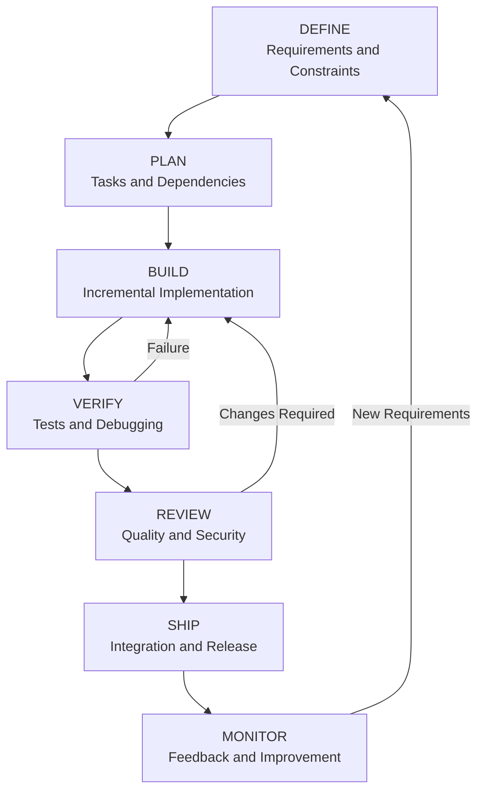

Monitoring and feedback continue after shipping when the application is deployed.

## 2.2 Fundamental Principle

> The goal is not to make an AI agent write code as quickly as possible. The goal is to produce correct, maintainable, verified software through a repeatable process.

---

# Part IV — Stage 1: Define

## 3. Requirements Before Code

The Define stage establishes what should be built.

An agent should understand:

- The problem.
- The users.
- The expected behavior.
- The approved scope.
- The constraints.
- The acceptance criteria.

## 3.1 Relevant Skills

- `interview-me`
- `idea-refine`
- `spec-driven-development`
- `constraint-driven-development`

Not every task requires all four.

Choose according to the level of ambiguity and risk.

## 3.2 Example: GroupTrack

Suppose the feature is:

**Display My Tasks Across All Projects**

### Problem

Users need one place to see their assigned tasks without opening every project separately.

### Functional Requirements

1. Display tasks assigned to the authenticated user.
2. Include tasks from accessible projects.
3. Display task title.
4. Display associated project.
5. Display status.
6. Display due date.
7. Support approved status filters.
8. Handle loading, empty, and error states.

### Constraints

- Android Java.
- Existing project architecture.
- Existing Firebase integration.
- No unnecessary dependencies.
- No unrelated features.
- Strict MVP scope.

## 3.3 Acceptance Criteria

```markdown
## Acceptance Criteria

- [ ] Only appropriate assigned tasks are displayed.
- [ ] Tasks include their project names.
- [ ] Status filters work as specified.
- [ ] Empty results display an appropriate message.
- [ ] Loading failures display an error state.
- [ ] Existing navigation remains functional.
```

## 3.4 Definition of Done

Acceptance criteria describe feature-specific behavior.

Definition of Done describes the general quality bar.

```markdown
## Definition of Done

- [ ] Acceptance criteria satisfied
- [ ] Existing architecture respected
- [ ] Relevant tests completed
- [ ] Build verified
- [ ] No unrelated changes
- [ ] No unnecessary dependencies
- [ ] Remaining limitations documented
```

---

# Part V — Stage 2: Plan

## 4. Planning and Task Decomposition

Once requirements are defined, the next step is to organize implementation.

### Relevant Skill

`planning-and-task-breakdown`

## 4.1 Why Planning Matters

Without a plan, an agent may:

- Modify unrelated files.
- Miss dependencies.
- Implement features in the wrong order.
- Introduce unnecessary abstractions.
- Delay testing until the end.

## 4.2 Example Task Breakdown

Feature:

**GroupTrack — My Tasks**

| Task | Responsibility | Verification |
|---|---|---|
| 1 | Inspect existing task architecture | Architecture summary |
| 2 | Identify required data query | Query requirements |
| 3 | Implement task retrieval | Data-access tests |
| 4 | Implement task cards | UI inspection |
| 5 | Implement filters | Filter tests |
| 6 | Implement UI states | State verification |
| 7 | Perform integration testing | Test evidence |
| 8 | Review final diff | Scope and quality review |

## 4.3 Dependency Mapping

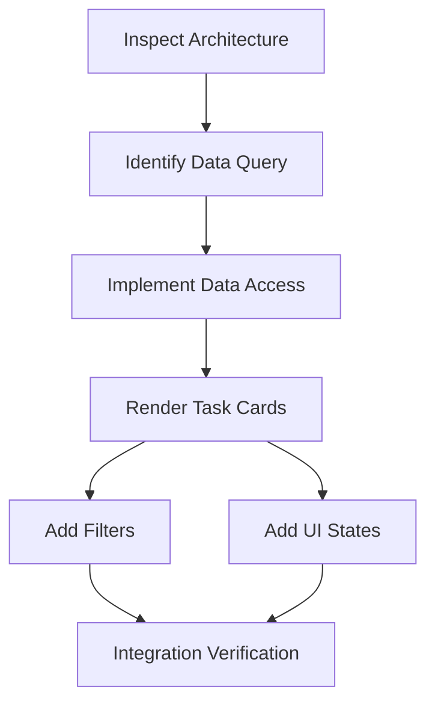

## 4.4 Task Quality

A good implementation task should be:

- Small.
- Specific.
- Testable.
- Scoped.
- Independently understandable.

## 4.5 Important

Planning does not mean generating unnecessary documentation.

For small changes, a short plan may be sufficient.

---

# Part VI — Stage 3: Build

## 5. Incremental Implementation

The Build stage converts the approved plan into working software.

### Relevant Skills

- `incremental-implementation`
- `test-driven-development`
- `context-engineering`
- `source-driven-development`

Additional skills apply according to the task.

## 5.1 Thin Vertical Slices

A vertical slice implements a small piece of functionality across the necessary application layers.

For example:

```text
UI
 ↓
Application Logic
 ↓
Data Access
 ↓
Database
```

Instead of implementing every database feature first and every UI feature later, the developer may complete one small, testable user behavior.

## 5.2 Example: Laravel Product Creation

A small vertical slice might include:

1. Product creation request validation.
2. Authorized controller action.
3. Database persistence.
4. API response.
5. Relevant tests.

## 5.3 Incremental Workflow

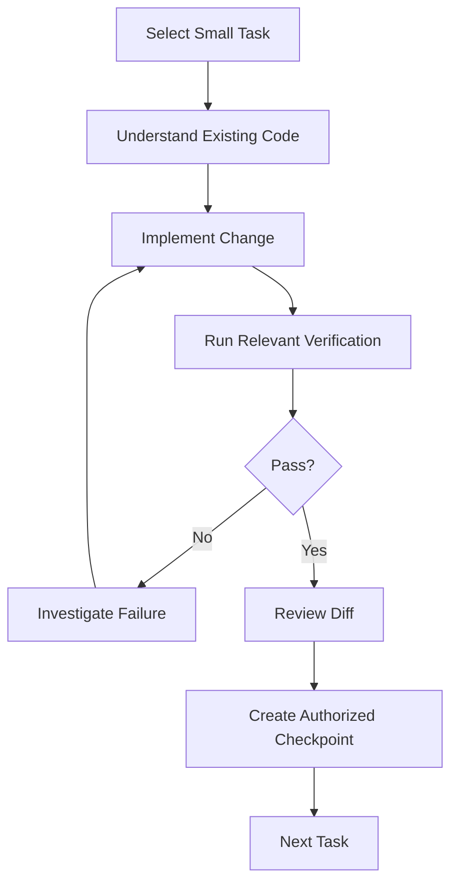

## 5.4 Important

Avoid implementing an entire large feature before checking whether the foundational behavior works.

---

# Part VII — Context Engineering Integration

## 6. The Role of Context

AI agents require project-specific context.

A useful context system should answer:

- What is this project?
- What architecture does it use?
- What are the coding standards?
- What features are approved?
- What constraints must be respected?
- How should changes be verified?

## 6.1 Suggested Documentation Structure

```text
project/
├── AGENTS.md
├── docs/
│   ├── overview.md
│   ├── architecture.md
│   ├── requirements.md
│   ├── database.md
│   ├── coding-standards.md
│   ├── workflow.md
│   └── testing.md
└── src/
```

This is an example structure, not a required repository layout.

## 6.2 Responsibilities

### `AGENTS.md`

Contains concise operating instructions for the coding agent.

### `overview.md`

Explains project purpose and users.

### `architecture.md`

Describes major components and boundaries.

### `requirements.md`

Defines approved functionality.

### `coding-standards.md`

Documents implementation conventions.

### `testing.md`

Explains verification procedures.

## 6.3 Important Distinction

Project-specific `AGENTS.md` files should describe the actual project.

Do not copy the Agent Skills repository's own root instructions into unrelated projects. Those instructions are intended for contributors to that repository.

---

# Part VIII — Skills Discovery

## 7. Selecting the Correct Skill

The repository includes a `using-agent-skills` meta-skill for routing tasks to relevant workflows.

However, when a coding tool already provides native skill discovery, a second always-on routing mechanism may be unnecessary.

## 7.1 Example Decision Table

| Task | Relevant Skill |
|---|---|
| Clarify an unclear feature | `interview-me` |
| Write specifications | `spec-driven-development` |
| Establish quality constraints | `constraint-driven-development` |
| Break down tasks | `planning-and-task-breakdown` |
| Implement a feature | `incremental-implementation` |
| Write behavior tests | `test-driven-development` |
| Build frontend UI | `frontend-ui-engineering` |
| Design API contracts | `api-and-interface-design` |
| Debug a failing test | `debugging-and-error-recovery` |
| Review code | `code-review-and-quality` |
| Simplify working code | `code-simplification` |
| Review security | `security-and-hardening` |
| Manage Git changes | `git-workflow-and-versioning` |
| Prepare release | `shipping-and-launch` |

## 7.2 Important

Skill selection should follow the task's needs.

Do not activate every skill for every request.

---

# Part IX — Stage 4: Verify

## 8. Verification Is Mandatory

The Verify stage establishes whether implementation claims are supported by evidence.

### Relevant Skills

- `test-driven-development`
- `browser-testing-with-devtools`
- `debugging-and-error-recovery`

## 8.1 Verification Levels

| Level | Purpose |
|---|---|
| Static inspection | Examine source structure |
| Compilation | Verify code can build |
| Unit testing | Verify isolated logic |
| Integration testing | Verify interacting components |
| UI testing | Verify user interactions |
| Manual testing | Observe actual behavior |
| Performance testing | Evaluate measurable performance |

## 8.2 Example: GroupTrack

Relevant checks might include:

```powershell
.\gradlew.bat testDebugUnitTest
```

```powershell
.\gradlew.bat lintDebug
```

```powershell
.\gradlew.bat assembleDebug
```

The available Gradle tasks depend on the actual project configuration.

## 8.3 Example: Laravel

```powershell
php artisan test
```

## 8.4 Example: Next.js

```powershell
npm run build
```

Other checks depend on the scripts configured in `package.json`.

## 8.5 Important

Do not claim a command succeeded unless it was executed successfully.

---

# Part X — Debugging Integration

## 9. The Debugging Workflow

When verification fails, the agent should investigate systematically.

### Five-Step Model

**Reproduce → Localize → Reduce → Fix → Guard**

## 9.1 Reproduce

Establish the failing behavior.

## 9.2 Localize

Identify the relevant component or layer.

## 9.3 Reduce

Find the smallest scenario that reproduces the problem.

## 9.4 Fix

Correct the underlying cause.

## 9.5 Guard

Add appropriate regression protection.

## 9.6 Diagram

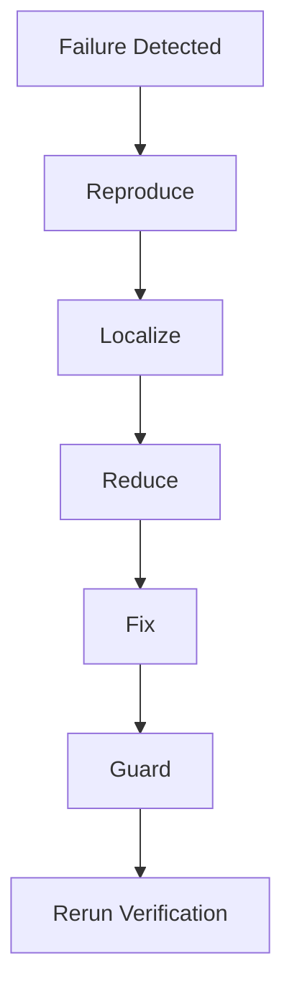

## 9.7 Example

A Laravel API returns HTTP 422.

The agent should determine whether:

- The request payload is invalid.
- Validation rules are incorrect.
- Frontend field names differ from the API contract.
- Required fields are missing.

It should not immediately remove validation rules merely to make the request succeed.

---

# Part XI — Stage 5: Review

## 10. Code Review Integration

The Review stage evaluates the implementation beyond basic functionality.

### Relevant Skills

- `code-review-and-quality`
- `code-simplification`
- `security-and-hardening`
- `performance-optimization`

## 10.1 Five Review Dimensions

1. Correctness.
2. Readability.
3. Architecture.
4. Security.
5. Performance.

## 10.2 Review Questions

**Correctness**

Does the code satisfy the requirements?

**Readability**

Can another developer understand the implementation?

**Architecture**

Does it follow established project boundaries?

**Security**

Are relevant trust boundaries protected?

**Performance**

Are there meaningful, evidence-supported performance concerns?

## 10.3 Review Workflow

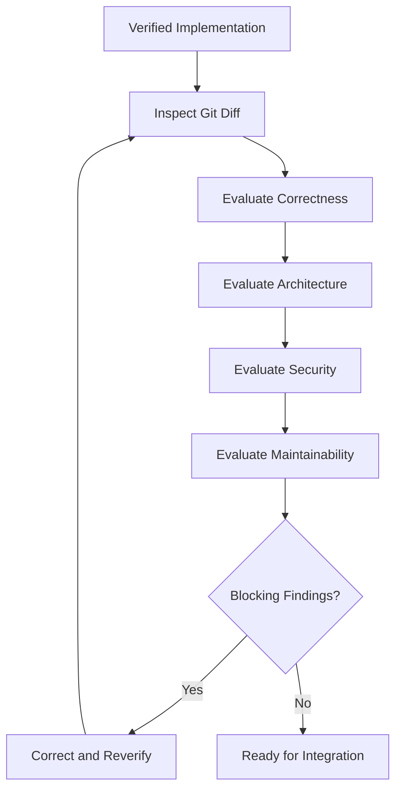

## 10.4 Important

A review should prioritize actual defects over speculative improvements.

---

# Part XII — Security Integration

## 11. Security as a Continuous Responsibility

Security should not be postponed until the final release.

It matters during:

- Requirements.
- Architecture.
- Implementation.
- Testing.
- Review.
- Deployment.

## 11.1 Example: E-commerce

A product management API may need:

- Authentication.
- Role authorization.
- Input validation.
- Safe database operations.
- Appropriate error responses.
- Protected credentials.

## 11.2 Example

```text
POST /api/products
```

A secure design must verify that the requesting user is authorized to create products.

The frontend hiding an administrative button is not sufficient authorization.

## 11.3 Important

Security enforcement belongs at appropriate trusted boundaries, including the backend.

---

# Part XIII — Stage 6: Ship

## 12. Software Delivery

The Ship stage prepares verified software for integration or release.

### Relevant Skills

- `git-workflow-and-versioning`
- `ci-cd-and-automation`
- `shipping-and-launch`
- `documentation-and-adrs`
- `observability-and-instrumentation`

## 12.1 Git Workflow

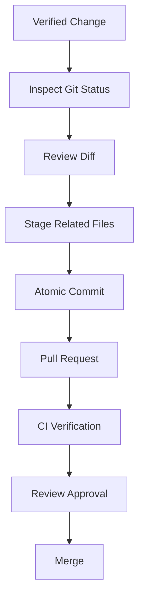

## 12.2 CI/CD

Automated pipelines may verify:

- Dependency installation.
- Compilation.
- Unit tests.
- Integration tests.
- Static analysis.
- Security checks.
- Build artifacts.

## 12.3 Shipping

Production delivery may additionally require:

- Environment configuration.
- Migration planning.
- Release approval.
- Rollback strategy.
- Monitoring.
- Smoke tests.

## 12.4 Important

For a student project, shipping may mean producing a verified demonstration build rather than deploying to a public production environment.

---

# Part XIV — Agent Personas Integration

## 13. Specialist Reviews

The repository provides four specialist personas:

- `code-reviewer`
- `test-engineer`
- `security-auditor`
- `web-performance-auditor`

## 13.1 Multi-Agent Review

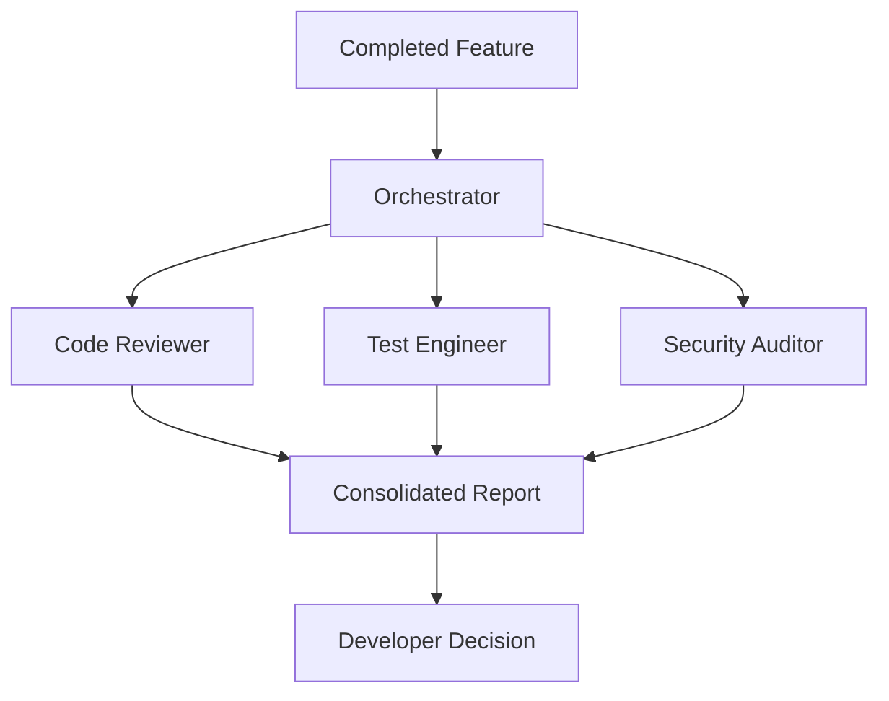

## 13.2 Composition Rule

Specialist personas should not independently invoke other personas.

The orchestrator manages delegation and consolidates results.

## 13.3 Important

Multi-agent review is optional.

Small, low-risk tasks often require only one focused agent.

---

# Part XV — The Complete Agentic Workflow

## 14. Unified Process

A complete workflow can be expressed as follows:

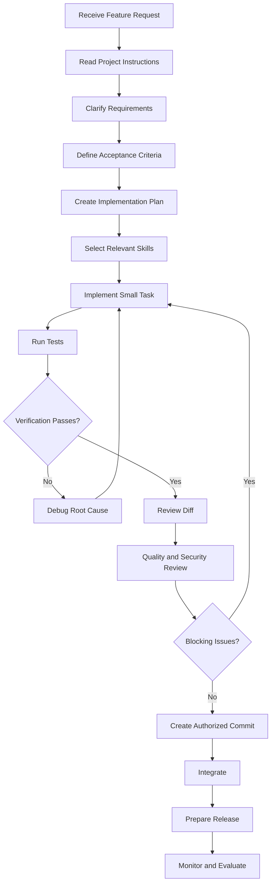

## 14.1 Core Engineering Rule

> Every stage should produce an observable result that can be reviewed before proceeding.

---

# Part XVI — Reusable Codex Workflow Prompt

## 15. Master Development Prompt

The following prompt combines the main concepts from the course.

```text
ROLE:
AI Software Engineering Assistant.

PROJECT:
[Project name]

OBJECTIVE:
Implement the approved feature using a disciplined,
incremental, and verifiable development workflow.

PHASE 1 — UNDERSTAND

1. Read AGENTS.md.
2. Read relevant project documentation.
3. Inspect existing architecture.
4. Identify relevant source files.
5. Review current Git status.
6. Identify existing tests and conventions.

PHASE 2 — REQUIREMENTS

1. Identify approved functional requirements.
2. Identify non-functional requirements.
3. Define acceptance criteria.
4. Identify constraints.
5. Identify unclear requirements.

Do not invent business rules.

PHASE 3 — PLAN

1. Break the feature into small tasks.
2. Identify dependencies.
3. Define verification for each task.
4. Identify likely risks.
5. Propose the implementation order.

Wait for approval before implementation
if the task requires planning approval.

PHASE 4 — IMPLEMENT

1. Follow existing architecture.
2. Implement one small task at a time.
3. Use relevant installed skills.
4. Avoid unnecessary dependencies.
5. Avoid unrelated refactoring.
6. Preserve existing functionality.

PHASE 5 — VERIFY

1. Run relevant tests.
2. Run appropriate build checks.
3. Investigate failures.
4. Verify acceptance criteria.
5. Report unverified behavior.

Never fabricate test results.

PHASE 6 — REVIEW

1. Review the Git diff.
2. Evaluate correctness.
3. Evaluate readability.
4. Evaluate architecture.
5. Evaluate security.
6. Evaluate performance where relevant.
7. Identify unnecessary complexity.
8. Identify scope deviations.

PHASE 7 — DELIVERY

1. Confirm verification evidence.
2. Identify files belonging to the task.
3. Propose an atomic commit.
4. Document remaining risks.
5. Prepare integration recommendations.

Do not commit, push, deploy, or modify
production systems without authorization.

CONSTRAINTS:

- Follow approved MVP scope.
- Preserve unrelated user changes.
- Do not overengineer.
- Do not introduce unnecessary abstractions.
- Do not invent requirements.
- Do not disable tests to force success.
- Do not claim verification without evidence.

FINAL OUTPUT:

1. Implementation summary.
2. Files changed.
3. Requirements satisfied.
4. Verification performed.
5. Test results.
6. Remaining limitations.
7. Security considerations.
8. Scope compliance.
9. Recommended next action.
```

---

# Part XVII — Final Project Scenario 1: GroupTrack

## 16. Android Agentic Development

### Project

GroupTrack — Student Project Management and Contribution Tracking.

### Technology

- Android Studio.
- Java.
- Firebase.
- Gradle.

### Scenario

Implement and verify the approved **My Tasks** feature.

## 16.1 Phase A — Define

Identify:

- Task ownership rules.
- Accessible project boundaries.
- Required task information.
- Filter behavior.
- Loading and error states.

## 16.2 Phase B — Plan

Example tasks:

1. Inspect existing task models.
2. Inspect existing data-access methods.
3. Define the required query.
4. Implement data retrieval.
5. Render task cards.
6. Implement filters.
7. Add UI states.
8. Verify behavior.

## 16.3 Phase C — Build

Follow existing Android architecture.

Avoid introducing a new framework unless required.

## 16.4 Phase D — Verify

Evaluate:

- Task ownership.
- Project association.
- Status filtering.
- Empty state.
- Error handling.
- Existing navigation.

## 16.5 Phase E — Review

Check:

- MVP compliance.
- Java code readability.
- Data-access separation.
- Firebase permissions.
- Unnecessary dependencies.

## 16.6 Phase F — Deliver

Prepare:

- Verified build.
- Relevant test results.
- Focused Git changes.
- Known limitations.
- Demonstration checklist.

### Final Exercise

Create a complete implementation and verification plan for the feature.

Do not write code yet.

---

# Part XVIII — Final Project Scenario 2: GoPasig

## 17. Laravel Fleet Management

### Project

GoPasig — Web-Based GPS Bus Tracking and ETA System.

### Technology

- Laravel.
- PHP.
- Database.
- Google Maps integration.
- Browser frontend.

### Scenario

Implement and verify **Driver Schedule Conflict Validation**.

## 17.1 Requirements

The system must enforce approved scheduling rules.

Possible validation concerns include:

- Invalid time ranges.
- Duplicate assignments.
- Driver schedule conflicts.
- Bus schedule conflicts.
- Missing references.
- Unauthorized changes.

The precise rules must come from the approved specification.

## 17.2 Planning

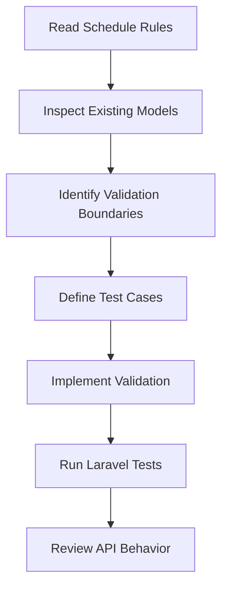

## 17.3 Evaluation

Assess:

- Correctness.
- Database consistency.
- Authorization.
- Validation.
- Error semantics.
- Performance.
- Maintainability.

## 17.4 Final Exercise

Create a requirements traceability matrix and a release-readiness checklist for schedule management.

---

# Part XIX — Final Project Scenario 3: E-commerce

## 18. Full-Stack Agentic Development

### Project

E-commerce System.

### Architecture

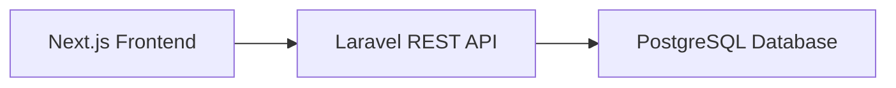

### Scenario

Implement **Product Creation** for authorized administrative users.

## 18.1 Define

Requirements:

- Authorized users can create products.
- Inputs must be validated.
- Product records must be stored correctly.
- API errors must be meaningful.
- Frontend must handle success and failure.

## 18.2 Plan

Possible tasks:

1. Inspect product architecture.
2. Define API contract.
3. Implement request validation.
4. Implement authorization.
5. Implement persistence.
6. Add backend tests.
7. Implement frontend form.
8. Connect API client.
9. Add UI feedback.
10. Verify integration.

## 18.3 Build

Respect separation of concerns:

**Frontend**

- Presentation.
- User interaction.
- Client-side feedback.

**Backend**

- Authorization.
- Validation.
- Business rules.
- Persistence.

**Database**

- Data integrity.
- Constraints.
- Storage.

## 18.4 Verify

Check:

- Valid requests.
- Invalid requests.
- Unauthorized requests.
- Duplicate or conflicting data where relevant.
- Database persistence.
- Frontend error handling.

## 18.5 Review

Evaluate:

- API contract consistency.
- MVC separation.
- Prepared database access through appropriate framework mechanisms.
- Type safety.
- Security.
- Maintainability.

## 18.6 Final Exercise

Design a complete end-to-end agentic development workflow for Product Creation.

Include separate frontend and backend verification.

---

# Part XX — Practical Exercise: Repository Readiness

## 19. Evaluate an Existing Repository

Before using AI agents, determine whether the repository provides sufficient context.

### Checklist

- [ ] Project purpose documented.
- [ ] Technology stack identified.
- [ ] Architecture explained.
- [ ] Requirements available.
- [ ] Coding conventions defined.
- [ ] Testing commands documented.
- [ ] Git repository initialized.
- [ ] Sensitive files excluded appropriately.
- [ ] Relevant agent instructions available.
- [ ] Scope boundaries defined.

### Exercise

Select one existing project.

Identify missing documentation.

Explain which missing items would most affect agent reliability.

---

# Part XXI — Practical Exercise: Skill Selection

## 20. Match Skills to Tasks

Choose the most relevant skill or skills for each scenario.

| Scenario | Your Selection |
|---|---|
| Requirements are unclear | |
| A feature needs task decomposition | |
| A new API endpoint is required | |
| A frontend component needs improvement | |
| An existing test fails | |
| A security-sensitive feature needs review | |
| A database migration is planned | |
| A production release is approaching | |
| Code is unnecessarily complicated | |
| An agent repeatedly ignores quality standards | |

### Evaluation Criteria

A good answer should explain:

1. Why the skill applies.
2. What workflow it provides.
3. What evidence is required.
4. Which additional skills are unnecessary.

---

# Part XXII — Practical Exercise: Task Decomposition

## 21. Decompose a Feature

Feature:

**GroupTrack — Join Requests**

Create tasks for:

- Retrieving pending requests.
- Displaying requests.
- Approving requests.
- Rejecting requests.
- Handling loading states.
- Preventing duplicate actions.
- Updating the UI.
- Verifying permissions.

### Required Output

```markdown
# Implementation Plan

## Objective

## Approved Requirements

## Constraints

## Task Breakdown

### Task 1
Objective:
Dependencies:
Files:
Acceptance Criteria:
Verification:

### Task 2
Objective:
Dependencies:
Files:
Acceptance Criteria:
Verification:

## Risks

## Definition of Done
```

---

# Part XXIII — Practical Exercise: Debugging

## 22. Investigate a Failure

Scenario:

A Next.js frontend sends a request to Laravel.

The API returns HTTP 422.

### Questions

1. What does HTTP 422 commonly indicate?
2. Which request details should be inspected?
3. Which Laravel validation rules should be reviewed?
4. How can the failure be reproduced?
5. What evidence would identify the root cause?
6. How should the correction be verified?
7. What regression test would be useful?

### Constraint

Do not remove validation merely to make the request succeed.

---

# Part XXIV — Practical Exercise: Code Review

## 23. Review an Implementation

Scenario:

An agent adds a new service layer to an Android application for a simple data display feature.

### Evaluation Questions

1. Does the existing architecture require this layer?
2. Does it solve a real problem?
3. Does it introduce unnecessary dependencies?
4. Does it duplicate existing logic?
5. Does it improve testability?
6. Does it remain within MVP scope?
7. Could a simpler implementation satisfy the requirements?

### Required Output

Write a short review report:

```markdown
# Code Review

## Finding

## Evidence

## Impact

## Recommendation

## Severity

## Verification Required
```

---

# Part XXV — Practical Exercise: CI/CD

## 24. Design a Minimal Pipeline

Choose one:

- Android Java.
- Laravel.
- Next.js.

### Required Components

1. Repository checkout.
2. Runtime setup.
3. Dependency installation.
4. Relevant tests.
5. Build verification.
6. Failure reporting.

### Questions

- Which checks should run on pull requests?
- Which checks should block merging?
- Which checks require special infrastructure?
- How should failures be investigated?
- Is automated deployment necessary?

### Constraint

Avoid introducing unnecessary pipeline complexity.

---

# Part XXVI — Practical Exercise: Multi-Agent Review

## 25. Design a Specialist Review

Scenario:

A Laravel authentication feature is ready for review.

### Suggested Personas

- Code Reviewer.
- Test Engineer.
- Security Auditor.

### Required Plan

1. Define the review objective.
2. Identify relevant files.
3. Prepare context packages.
4. Assign independent responsibilities.
5. Define read-only boundaries.
6. Collect evidence.
7. Consolidate findings.
8. Identify blocking issues.
9. Establish approval requirements.

### Important

Specialists should not independently invoke other specialists.

The orchestrator controls the workflow.

---

# Part XXVII — Agentic Engineering Maturity

## 26. What Is Maturity?

Agentic engineering maturity describes how systematically a developer or team uses AI coding agents.

It is not simply a measure of how many tools are installed.

## 26.1 Proposed Five-Level Model

This is an educational model for self-assessment.

### Level 1 — Ad Hoc

Characteristics:

- Vague prompts.
- Little documentation.
- Minimal verification.
- Frequent manual corrections.

### Level 2 — Structured Prompting

Characteristics:

- Clear task descriptions.
- Basic constraints.
- More consistent outputs.
- Some manual verification.

### Level 3 — Context-Engineered

Characteristics:

- Project instructions.
- Architecture documentation.
- Approved specifications.
- Scoped tasks.
- Repeatable workflows.

### Level 4 — Verification-Driven

Characteristics:

- Automated tests.
- Incremental implementation.
- Evidence-based review.
- Git discipline.
- Quality gates.

### Level 5 — Continuously Improved

Characteristics:

- Evaluation datasets.
- Workflow measurements.
- Reliable CI/CD.
- Appropriate specialist reviews.
- Feedback-driven improvement.

## 26.2 Maturity Diagram

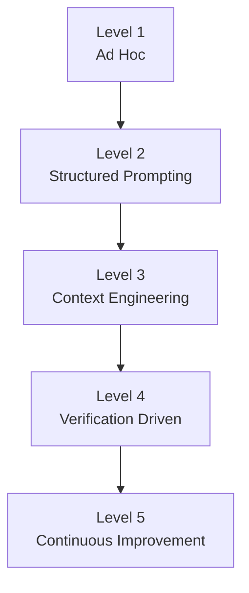

## 26.3 Important

These levels are not official classifications from the Agent Skills repository.

They are a learning framework for evaluating your own development practices.

---

# Part XXVIII — Final Evaluation Scorecard

## 27. Evaluate Your Workflow

Use the following rubric.

| Criterion | Maximum Score |
|---|---:|
| Requirements clarity | 5 |
| Acceptance criteria | 5 |
| Task decomposition | 5 |
| Context engineering | 5 |
| Skill selection | 5 |
| Incremental implementation | 5 |
| Testing discipline | 5 |
| Debugging methodology | 5 |
| Architecture compliance | 5 |
| Security awareness | 5 |
| Scope discipline | 5 |
| Git workflow | 5 |
| CI/CD readiness | 5 |
| Review quality | 5 |
| Evidence reporting | 5 |
| **Total** | **75** |

### Scoring Guide

| Score | Meaning |
|---|---|
| 0 | Not demonstrated |
| 1 | Major gaps |
| 2 | Limited implementation |
| 3 | Partially established |
| 4 | Consistently applied |
| 5 | Strong evidence of reliable practice |

### Important

The score should be supported by evidence.

A high total does not override critical security or correctness failures.

---

# Part XXIX — Final Capstone Project

## 28. Capstone Objective

Design a complete agentic development workflow for one real software feature.

You may choose:

**Option A:** GroupTrack Android feature.

**Option B:** GoPasig Laravel feature.

**Option C:** Next.js + Laravel e-commerce feature.

**Option D:** HarayaForge website feature.

## 28.1 Required Deliverables

### Deliverable 1 — Project Overview

Describe:

- Project purpose.
- Users.
- Technology stack.
- Existing architecture.

### Deliverable 2 — Problem Definition

Explain:

- Current problem.
- Expected improvement.
- Scope.
- Constraints.

### Deliverable 3 — Requirements Specification

Include:

- Functional requirements.
- Non-functional requirements.
- Acceptance criteria.

### Deliverable 4 — Context Engineering Plan

Identify:

- Required documentation.
- Relevant files.
- Project rules.
- Skill references.

### Deliverable 5 — Implementation Plan

Include:

- Task breakdown.
- Dependencies.
- Verification criteria.
- Implementation order.

### Deliverable 6 — Skill Selection

Explain which skills apply and why.

### Deliverable 7 — Testing Strategy

Include:

- Unit tests.
- Integration tests.
- UI tests where appropriate.
- Manual verification.
- Edge cases.

### Deliverable 8 — Code Review Strategy

Evaluate:

- Correctness.
- Readability.
- Architecture.
- Security.
- Performance where relevant.

### Deliverable 9 — Git Strategy

Include:

- Branching approach.
- Commit boundaries.
- Review requirements.
- Merge readiness.

### Deliverable 10 — Delivery Strategy

Include:

- Build verification.
- Environment requirements.
- Deployment or demonstration plan.
- Recovery considerations.

### Deliverable 11 — Evaluation Report

Include:

- Requirements traceability.
- Verification evidence.
- Scorecard.
- Known limitations.
- Remaining risks.

### Deliverable 12 — Retrospective

Explain:

- What worked?
- What failed?
- Which instructions were unclear?
- Which steps were unnecessary?
- What should improve next time?

---

# Part XXX — Capstone Workflow Diagram

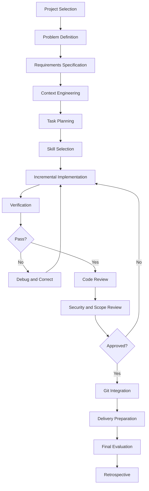

---

# Part XXXI — Final Project Documentation Template

## 29. Reusable Template

```markdown
# Agentic Development Capstone

## 1. Project Overview

Project Name:
Technology Stack:
Architecture:
Users:

## 2. Problem Definition

Problem:
Proposed Solution:
Expected Outcome:

## 3. Scope

In Scope:

Out of Scope:

Constraints:

## 4. Requirements

Functional Requirements:

Non-Functional Requirements:

## 5. Acceptance Criteria

- [ ]

## 6. Context Engineering

AGENTS.md:
Architecture Docs:
Relevant Source Files:
Testing Documentation:

## 7. Selected Skills

| Skill | Purpose |
|---|---|
| | |

## 8. Implementation Plan

| Task | Dependencies | Verification |
|---|---|---|
| | | |

## 9. Testing Strategy

Unit Tests:
Integration Tests:
UI Tests:
Manual Verification:

## 10. Code Review

Correctness:
Readability:
Architecture:
Security:
Performance:

## 11. Git Workflow

Branch:
Commit Plan:
Review Process:

## 12. Delivery

Build:
Environment:
Deployment or Demo:
Recovery Plan:

## 13. Evaluation

Requirements Compliance:
Verification Evidence:
Known Limitations:
Remaining Risks:

## 14. Final Decision

Status:
Blocking Issues:
Approval:

## 15. Retrospective

What Worked:
What Failed:
Improvements:
```

---

# Part XXXII — Common Mistakes to Avoid

## 30. Starting Without Requirements

**Problem:** The agent invents missing behavior.

**Improvement:** Clarify requirements before implementation.

## 30.1 Loading Excessive Context

**Problem:** Relevant information becomes harder to identify.

**Improvement:** Use progressive disclosure.

## 30.2 Implementing Everything at Once

**Problem:** Failures become difficult to isolate.

**Improvement:** Use small, verifiable tasks.

## 30.3 Skipping Tests

**Problem:** Correctness claims lack evidence.

**Improvement:** Integrate verification into development.

## 30.4 Overengineering

**Problem:** Complexity exceeds actual requirements.

**Improvement:** Follow approved architecture and scope.

## 30.5 Blindly Accepting Agent Output

**Problem:** Plausible explanations may conceal defects.

**Improvement:** Evaluate implementation against evidence.

## 30.6 Excessive Multi-Agent Orchestration

**Problem:** Coordination costs exceed benefits.

**Improvement:** Use specialists only when justified.

## 30.7 Shipping Without Recovery Planning

**Problem:** Failures become harder to address.

**Improvement:** Define appropriate recovery and rollback procedures.

---

# Part XXXIII — Final Knowledge Check

Answer the following without consulting previous lessons.

1. What is an agent skill?
2. What is the purpose of `SKILL.md`?
3. What is progressive disclosure?
4. Why are requirements necessary?
5. What is spec-driven development?
6. What is constraint-driven development?
7. What makes a task verifiable?
8. What is incremental implementation?
9. What is test-driven development?
10. What is context engineering?
11. What is source-driven development?
12. Why should APIs be designed around contracts?
13. What is the debugging five-step model?
14. What are the five dimensions of code review?
15. Why is code simplification important?
16. What is an atomic commit?
17. What is Continuous Integration?
18. What is the difference between deployment and release?
19. What is an agent persona?
20. What is multi-agent orchestration?
21. Why should specialist findings be evidence-based?
22. What is requirement traceability?
23. What is Definition of Done?
24. What is overengineering?
25. Why does human oversight remain important?
26. What is agent evaluation?
27. Why is a successful build insufficient evidence?
28. How do you prevent scope creep?
29. What is an agentic engineering feedback loop?
30. What makes an agentic workflow reliable?

---

# Part XXXIV — Final Key Takeaways

> [!summary]
> - Agent Skills provide structured engineering workflows.
> - Requirements should be established before implementation.
> - Acceptance criteria make work verifiable.
> - Task decomposition reduces complexity.
> - Context engineering improves agent understanding.
> - Skills should be selected according to task requirements.
> - Incremental implementation enables early feedback.
> - Testing provides evidence of behavior.
> - Debugging should investigate root causes.
> - Code review evaluates more than compilation.
> - Security requires appropriate trust boundaries.
> - Git preserves coherent development checkpoints.
> - CI/CD supports repeatable verification and delivery.
> - Specialist personas provide focused review perspectives.
> - Multi-agent workflows require coordination.
> - Evaluation should be based on observable evidence.
> - Overengineering should be avoided.
> - Scope discipline protects project requirements.
> - Human approval remains important.
> - A reliable workflow can be repeated and improved.
> - The ultimate goal is verified, maintainable software.

---

# Part XXXV — Final Mental Model

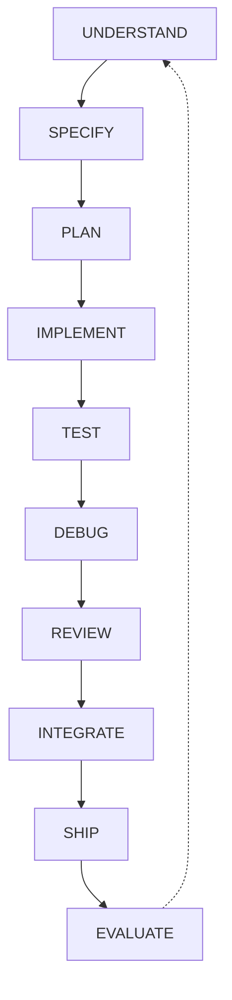

> [!important] Final Principle
> **Agentic software engineering is the disciplined use of AI agents within a development process that prioritizes requirements, context, incremental implementation, verification, review, and controlled delivery.**
>
> AI agents can accelerate engineering work, but reliable results still depend on clear instructions, appropriate tools, observable evidence, and human judgment.

---

# Part XXXVI — Official References

## Primary Repository

- [Agent Skills](https://github.com/addyosmani/agent-skills)
- [Getting Started](https://github.com/addyosmani/agent-skills/blob/main/docs/getting-started.md)
- [Repository README](https://github.com/addyosmani/agent-skills/blob/main/README.md)

## Core Skills

- [Spec-Driven Development](https://github.com/addyosmani/agent-skills/tree/main/skills/spec-driven-development)
- [Planning and Task Breakdown](https://github.com/addyosmani/agent-skills/tree/main/skills/planning-and-task-breakdown)
- [Incremental Implementation](https://github.com/addyosmani/agent-skills/tree/main/skills/incremental-implementation)
- [Test-Driven Development](https://github.com/addyosmani/agent-skills/tree/main/skills/test-driven-development)
- [Context Engineering](https://github.com/addyosmani/agent-skills/tree/main/skills/context-engineering)
- [Debugging and Error Recovery](https://github.com/addyosmani/agent-skills/tree/main/skills/debugging-and-error-recovery)
- [Code Review and Quality](https://github.com/addyosmani/agent-skills/tree/main/skills/code-review-and-quality)
- [Git Workflow and Versioning](https://github.com/addyosmani/agent-skills/tree/main/skills/git-workflow-and-versioning)
- [Shipping and Launch](https://github.com/addyosmani/agent-skills/tree/main/skills/shipping-and-launch)

## Supporting Documentation

- [OpenAI Codex Documentation](https://developers.openai.com/codex/)
- [Git Documentation](https://git-scm.com/doc)
- [GitHub Actions](https://docs.github.com/en/actions)
- [Android Developers](https://developer.android.com/)
- [Laravel Documentation](https://laravel.com/docs/12.x)
- [Next.js Documentation](https://nextjs.org/docs)

> [!note] Documentation Scope
> This lesson combines the Agent Skills repository's documented development principles with an educational capstone framework.
>
> The maturity model, scorecard, exercises, and project scenarios are teaching materials rather than official repository standards.
>
> No project files were modified.
>
> No tests were executed.
>
> No deployments were performed.

---

# Course Completion

**Agent Skills — Lessons 00–15**

**Status: Theory Curriculum Complete**

You have now covered the foundational concepts required to design a structured agentic development workflow.

The next stage is applying these principles to a real project through supervised, incremental implementation and verification.

**End of Lesson 15 — Final Practical Exercises and Integration.**
