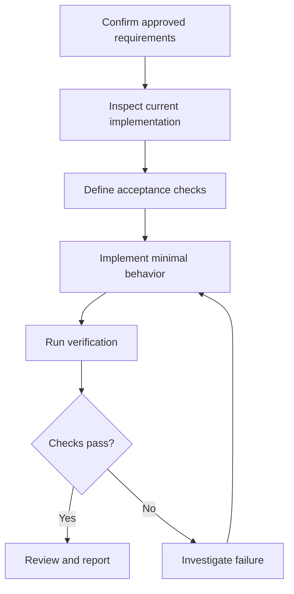

# 04 — Task Decomposition and Feature Development

> **Course:** OpenAI Codex & Agentic Software Development  
> **Phase:** 3 — Agentic Coding Workflow  
> **Lesson:** 3.4 — Task Decomposition and Feature Development  
> **Difficulty:** Intermediate  
> **Platform:** Windows / PowerShell / Codex CLI  
> **Status:** In Progress  
> **Prerequisite:** [[03 - Planning Before Implementation]]

---

## 1. Introduction

Features often span user interfaces, application logic, persistence, validation, tests, and documentation. A broad instruction that asks an agent to build an entire feature at once leaves many decisions unstated and makes the result harder to verify.

**Task decomposition** breaks an approved objective into bounded pieces of work. **Incremental feature development** implements those pieces in a sensible order and verifies meaningful outcomes along the way.

The aim is not to maximize the number of tasks. It is to make each step understandable, reviewable, and useful while keeping the overall feature aligned with approved requirements.

**Core principle:** Decompose by meaningful outcomes, implement in small increments, verify each increment, and stop before expanding scope.

---

## 2. Learning Objectives

By the end of this lesson, learners should be able to:

1. Define task decomposition and explain why it helps agentic development.
2. Distinguish features, milestones, tasks, and subtasks.
3. Choose useful task boundaries and identify dependencies.
4. Explain vertical slicing and how it differs from horizontal decomposition.
5. Set acceptance criteria, scope boundaries, and stop conditions.
6. Plan incremental implementation and verification with Codex.
7. Apply decomposition to Android, Laravel, and cross-stack examples.

---

## 3. Decomposition: From Feature to Task

**Task decomposition** is breaking a larger objective into smaller work units with clear outcomes. A useful task is small enough to understand and verify, but large enough to produce meaningful progress.

| Level | Meaning | Example |
|---|---|---|
| Feature | Application capability | Task management |
| Milestone | Meaningful delivery checkpoint | Users can create a task |
| Task | Bounded development objective | Validate task titles |
| Subtask | Smaller action within a task | Reject an empty title |

An individual file edit is usually an implementation activity, not a feature by itself. For example, editing a controller, model, and migration may all contribute to one task creation capability.

Large requests are difficult because they combine product, architecture, data, UI, and testing decisions. Before implementation, ask Codex to inspect the approved requirements and propose a task breakdown. Do not let the breakdown invent new requirements.

### 3.1 Task Contract

```markdown
## Task
Implement required-title validation.

## Objective
Prevent submission of a task without a title.

## Scope and non-goals
Use the existing task creation flow. Do not add task editing,
database fields, or authentication changes.

## Acceptance criteria
- Empty titles are rejected.
- Valid titles continue to work.

## Verification
Run the relevant checks and inspect the resulting diff.

## Stop condition
Stop after verification and reporting.
```

Good tasks also identify relevant context, prerequisites, and any decisions that need developer approval.

---

## 4. Vertical Slicing and Task Boundaries

A **vertical slice** delivers a small end-to-end behavior across the layers it needs. For example, “create a task with a title” might include a minimal form, validation, application logic, persistence, feedback, and a focused test.

**Horizontal decomposition** organizes work by technical layer:

```text
All UI → all application logic → all persistence → integration
```

**Vertical decomposition** organizes work by user-visible capability:

```text
Create a task → view tasks → update a task
```

Vertical slices can provide earlier integration feedback. Horizontal work can still be appropriate when a real shared prerequisite—such as an agreed API contract or required infrastructure—must be established first. Avoid building speculative foundations for unapproved future features.

Before accepting a proposed slice, ask:

- Does it produce a demonstrable behavior?
- Can it be tested or otherwise verified?
- Are its dependencies known?
- Can it be reviewed independently?
- Does it avoid speculative requirements?

---

## 5. Dependencies and Milestones

A **task dependency** exists when one task needs another task’s output before it can proceed. Common examples are prerequisite dependencies, shared data contracts, frontend-to-API interfaces, and verification environment requirements.



The graph shows logical ordering, not a mandatory order for writing tests. A cycle—Task A requires B while B requires A—usually means the boundaries or shared contract need clarification.

An **implementation milestone** is a checkpoint with a meaningful, observable result. For a task creation feature, milestones might be:

| Milestone | Outcome | Example verification |
|---|---|---|
| Requirements confirmed | Fields, permissions, and behavior are agreed | Review approved specification |
| Minimal creation works | Valid task can be created | Focused test or supported manual check |
| Invalid input is handled | Invalid submissions receive expected feedback | Negative-path checks |
| Integrated feature reviewed | Combined behavior meets the contract | Relevant broader checks and diff review |

Track progress by verified capabilities, not by how many files were edited.

---

## 6. Incremental Development and Verification

Implement one approved task at a time:

```text
Select task → inspect context → make focused change
→ run relevant checks → review outcome → continue or stop
```

Small increments help catch defects earlier, simplify review, and make debugging more focused. They do not remove the need for broader integration checks after pieces are combined.

For behavior that can be tested meaningfully, **Red–Green–Refactor** is one useful option:

1. **Red:** Add or identify a focused check that fails for the missing behavior.
2. **Green:** Implement the minimum change that satisfies it.
3. **Refactor:** Improve structure while preserving the approved behavior.
4. **Verify:** Run focused and, when appropriate, broader checks.

This is not required for every task. Visual changes, exploratory work, and infrastructure tasks may need other verification methods. Use only checks that exist in the project; do not invent successful results.

---

## 7. Scope Control, Approvals, and Stop Conditions

Classify proposed work as:

- **Required:** Needed for the acceptance criteria.
- **Supporting:** Directly necessary to deliver or verify them.
- **Unrelated:** Does not contribute to the approved outcome.

For example, adding product-name search does not automatically authorize filters, analytics, recommendation features, a new UI framework, or a backend redesign.

Use explicit non-goals and ask the agent to stop if a necessary change falls outside the approved scope. Developer approval may be appropriate before adding dependencies, changing shared contracts or schemas, redesigning architecture, or touching unrelated modules.

An approval checkpoint is a workflow decision. It is separate from technical sandbox permissions: a tool may be capable of a change while the task still requires developer agreement to expand its scope.

Stop when the acceptance criteria are met and the required checks and report are complete. If requirements conflict, a prerequisite is missing, or repeated attempts provide no new evidence, report the blocker and the decision needed. Do not continue into the next feature just because it is nearby.

---

## 8. Working One Task at a Time with Codex

Before work, inspect the repository state and select a practice project:

```powershell
git status
```

The following CLI examples are for future practice; available options can vary by installed version. Check `codex --help` before relying on a flag.

### 8.1 Decomposition-Only Prompt

```text
Read applicable AGENTS.md instructions and relevant approved
feature documentation. Analyze the approved task creation feature.

Return its objective, requirements, scope and non-goals, smallest
meaningful slices, dependencies, milestones, acceptance criteria,
verification plan, approval points, and stop conditions.

Use repository evidence. Do not invent requirements or modify files.
Stop after presenting the breakdown.
```

Review the breakdown before implementation. Confirm that it reflects approved requirements and does not introduce speculative work.

### 8.2 Bounded Implementation Prompt

```text
Implement only the approved task T3: minimal task creation behavior.

Read applicable project instructions, the approved plan, and relevant
code. Follow existing architecture, preserve existing behavior, and
make the smallest necessary changes. Do not implement later tasks,
add unrelated features, or introduce dependencies.

If an unapproved schema or architecture change is required, stop and
explain why. Run relevant available checks, inspect the diff, and report
changed files, actual results, and remaining limitations. Stop after T3.
```

Codex CLI may support sandbox options such as read-only and workspace-write modes; confirm current syntax and policy with the installed CLI. Sandbox mode does not replace scope decisions, review, or verification.

---

## 9. Examples

### 9.1 Android Java: Task Creation

Suppose an approved GroupTrack requirement is to let an authorized user create a task. First inspect the existing Java UI, XML layout, task model, persistence conventions, and relevant project instructions. Confirm required fields and permissions from the approved specification rather than assuming them.

A possible decomposition is:

| Task | Outcome | Dependency |
|---|---|---|
| Inspect current flow | Relevant UI and data components identified | None |
| Confirm task contract | Fields and permissions agreed | Inspection |
| Implement minimal creation | Valid task follows existing persistence flow | Contract |
| Connect form and feedback | User can submit and see the result | Agreed interface |
| Verify integration | Build and behavior checked where available | Implementation |

Keep notifications, analytics, new roles, and UI frameworks out unless separately approved. Build checks alone may not verify appearance on a device; report visual checks that remain undone.

### 9.2 Laravel: Product Search

For an approved product-name search endpoint, inspect the existing routes, query conventions, validation, response contract, and tests. Agree on behavior such as case sensitivity and pagination before implementation if it matters to the API contract.

Possible tasks: confirm the search contract; implement the focused query within existing conventions; add or update relevant tests; check that the existing response behavior remains compatible. Do not introduce a search service or infrastructure without a requirement.

Use the actual project test commands. For Laravel, `php artisan test` is common, but a repository may define a narrower or different verification workflow.

### 9.3 Cross-Stack Feature

For a Next.js interface that displays products from a Laravel API, treat the API response shape as an explicit dependency. Inspect and confirm that contract before assuming frontend fields. Then implement the minimal data integration, loading/error behavior required by the approved design, and integration checks. This avoids frontend and backend work drifting around different assumptions.

---

## 10. Handoffs and Git

For work spanning sessions, record only the information needed to continue:

```markdown
# Task Handoff

## Completed
Verified outcome.

## Files Changed
Relevant paths.

## Verification
Checks actually run and their results.

## Decisions and Constraints
Material decisions, scope, and non-goals.

## Remaining Work or Blockers
Next approved task and any required input.
```

Use Git to inspect incremental changes:

```powershell
git status
git diff --name-only
git diff
git diff --check
```

`git diff` does not show the contents of untracked files, so inspect new files separately. Git history helps manage source changes; conversation history and handoff notes preserve task context. A task prompt should not imply that the agent may commit, push, or deploy unless that action is explicitly part of the authorized workflow.

---

## 11. Common Mistakes

| Mistake | Better approach |
|---|---|
| One task contains several independent features | Split by verifiable outcomes |
| Every small edit becomes its own milestone | Group work into meaningful results |
| Dependencies are discovered mid-implementation | Inspect contracts and prerequisites first |
| No acceptance criteria | State observable success conditions |
| Building infrastructure for hypothetical features | Implement only what approved requirements need |
| Several tasks are implemented without review | Verify meaningful increments |
| Work expands into adjacent features | State non-goals and stop conditions |
| A passing test is treated as complete proof | Report what was and was not verified |
| Decomposition creates more process than the task warrants | Scale planning to risk and complexity |

---

## 12. Practical Exercises

### Exercise A — Decompose Product Creation

For an existing Laravel application, outline a bounded product-creation feature. Identify approved requirements, relevant components, a smallest useful slice, dependencies, acceptance criteria, verification, and non-goals. Do not assume a schema or response contract that has not been confirmed.

### Exercise B — Compare Slicing Approaches

For Android task creation and task listing, sketch a horizontal plan (UI, logic, persistence) and a vertical plan (create, then list). Which enables earlier end-to-end feedback? Which foundational task, if any, is genuinely shared?

### Exercise C — Map Dependencies

For a Next.js frontend consuming a Laravel product API, draw a graph that includes contract inspection, frontend integration, error/loading behavior, and verification. Mark unresolved API assumptions rather than guessing.

### Exercise D — Read-Only Codex Decomposition

In a practice repository, ask Codex to read applicable instructions and approved feature documentation, then produce a task breakdown with slices, dependencies, acceptance criteria, verification, approval points, and stop conditions. Instruct it not to modify files. Compare every proposed task to the actual requirements.

### Exercise E — One Increment

Select one approved task in a safe practice branch. Inspect relevant code, make the smallest change, run appropriate checks, inspect the diff, record evidence, and stop before beginning the next task.

---

## 13. Knowledge Check

1. What is task decomposition, and why is it useful with coding agents?
2. How do a feature, milestone, task, and subtask differ?
3. What makes a task bounded and verifiable?
4. What is a vertical slice? When can horizontal work be justified?
5. How should dependencies affect implementation order?
6. What does Red–Green–Refactor describe, and when might it not fit?
7. How do non-goals and approval points prevent scope creep?
8. Why should progress be reported through outcomes and evidence?
9. Why is broader verification still useful after individually verified increments?
10. What should a handoff preserve?

---

## 14. Key Terminologies

| Term | Definition |
|---|---|
| Task Decomposition | Breaking a larger objective into manageable work units |
| Feature | Capability provided by an application |
| Milestone | Checkpoint representing a meaningful outcome |
| Task | Bounded development objective |
| Subtask | Smaller activity within a task |
| Vertical Slice | End-to-end increment delivering a demonstrable behavior |
| Horizontal Decomposition | Organizing work by technical layer |
| Dependency | Prerequisite relationship between tasks |
| Acceptance Criteria | Observable conditions defining success |
| Incremental Development | Building and checking small, useful changes |
| Scope Creep | Expansion beyond approved requirements |
| Approval Checkpoint | Decision requiring developer agreement |
| Stop Condition | Rule defining when to finish or report a blocker |
| Task Handoff | Concise record needed to continue work reliably |

---

## 15. Key Takeaways

1. Decompose broad features into meaningful, verifiable outcomes.
2. Prefer the smallest useful vertical slice when practical; establish real prerequisites first.
3. Sequence tasks by actual dependencies, not arbitrary ordering.
4. Set acceptance criteria, non-goals, approval points, and stop conditions.
5. Implement and verify one bounded increment at a time, then run broader integration checks when needed.
6. Use project evidence and report only verification that actually occurred.
7. Right-size the process: decomposition should reduce complexity, not create it.

---

## 16. References

1. [OpenAI — Iterating Development Workflows with Codex](https://developers.openai.com/cookbook/examples/codex/iterating-development-workflows-with-codex)
2. [OpenAI — Using Goals in Codex](https://developers.openai.com/cookbook/examples/codex/using_goals_in_codex)
3. [OpenAI — Codex CLI](https://developers.openai.com/codex/cli/)
4. [OpenAI — Codex CLI Reference](https://developers.openai.com/codex/cli/reference/)
5. [OpenAI — AGENTS.md Guide](https://developers.openai.com/codex/guides/agents-md/)
6. [Android Developers — Guide to App Architecture](https://developer.android.com/topic/architecture)
7. [Laravel — Validation](https://laravel.com/docs/12.x/validation)
8. [Laravel — Testing](https://laravel.com/docs/12.x/testing)
9. [Git Documentation](https://git-scm.com/doc)

---

## 17. Lesson Completion Checklist

- [ ] Explain task decomposition and its purpose.
- [ ] Distinguish features, milestones, tasks, and subtasks.
- [ ] Identify useful vertical slices and actual dependencies.
- [ ] Set acceptance criteria, non-goals, and stop conditions.
- [ ] Plan one bounded implementation increment.
- [ ] Choose proportionate verification and review the diff.
- [ ] Complete a practical exercise and knowledge check.

---

## Next Lesson

**[[05 - Debugging and Refactoring with Codex]]**

The next lesson covers systematic debugging, root-cause investigation, minimal fixes, safe refactoring, and regression checks.

---

*Phase 3 — Agentic Coding Workflow | Lesson 3.4*  
*Learning Principle: Break features into meaningful outcomes, verify each approved increment, and stop before expanding scope.*
